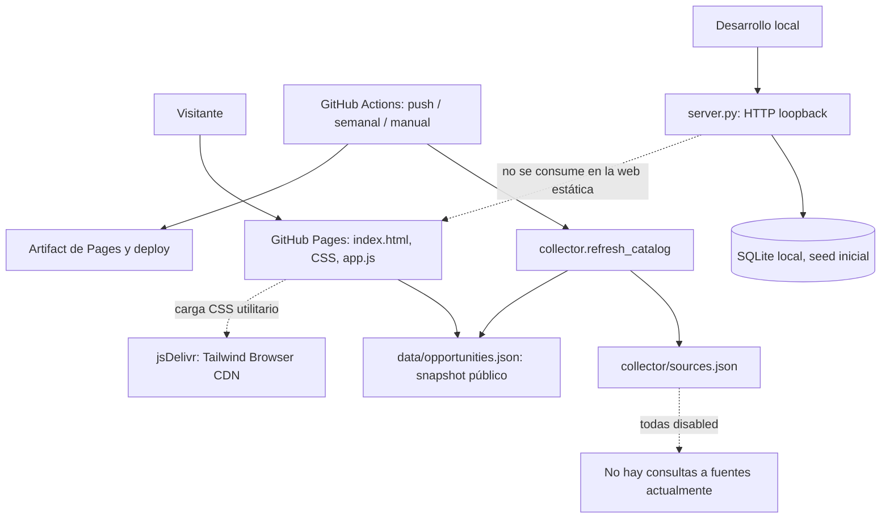

# Auditoría integral del proyecto — 25 de octubre de 2026

**Proyecto:** Ruta Sistemas / catálogo de oportunidades de carrera para Sistemas<br>
**Referencia auditada:** rama local `main`, commit `19cf942e2829833ee95ae3af177f4a44aea3566a` (`v4`)<br>
**Estado local al auditar:** sin cambios locales al inicio; `origin/main` local apunta al mismo commit. No se hizo `fetch`, por lo que esto no demuestra el estado remoto actual ni el despliegue público.<br>
**Tipo de trabajo:** inspección de solo lectura y este nuevo informe. No se modificaron código, configuración, dependencias, README ni historial.

## 1. Resumen ejecutivo

El proyecto tiene una **interfaz estática funcional para explorar un pequeño catálogo JSON demostrativo**, un servidor Python/SQLite de desarrollo local que no consume la interfaz actual, y un colector programado preparado para conectores Greenhouse/Lever. No es aún un catálogo laboral actualizado: las cuatro fuentes declaradas están deshabilitadas, el colector no consulta portales, y la última generación del catálogo auditado es del 3 de octubre.

La brecha de confianza es urgente. La ficha `OP-001` continúa con estado `verified`, pero su fecha límite indicada fue el 13 de octubre de 2026. En la fecha de auditoría ya pasó; no hay una regla que la cierre automáticamente ni que excluya una oferta vencida de la vista de activas. El campo `generatedAt` del catálogo es del 3 de octubre, 22 días antes de esta auditoría. El sitio declara que la muestra es demostrativa, pero la UI todavía presenta estados que pueden interpretarse como vigencia actual. **No se debe promocionar el catálogo actual como actualizado.**

La arquitectura más coherente con el presupuesto cero inmediato sigue siendo publicación estática en GitHub Pages con datos curados y verificaciones humanas. GitHub Actions puede automatizar importaciones pequeñas solo después de una decisión de derechos por fuente y una política de expiración. SQLite local puede permanecer como prototipo de API, pero no debe confundirse con un backend desplegado. Para rastreo HTML autorizado, Scrapy es una opción OSS madura si los conectores directos dejan de bastar. Firecrawl no es necesario para el alcance actual y aumenta la carga operativa; Freehire aporta una referencia valiosa para evaluar ingestión y normalización, pero depender de su API alojada o migrar su plataforma completa contradice autonomía y control de datos.

### Decisión ejecutiva

1. **P0:** corregir el estado publicable de la muestra y definir una regla explícita de frescura/fecha límite antes de anunciar el catálogo como actualizado.
2. **P0:** aclarar que el modo de publicación elegido es estático y que el servidor SQLite sirve solo a desarrollo local.
3. **P1:** habilitar como máximo una fuente por vez únicamente después de documentar permiso, alcance, frecuencia, datos guardados y procedimiento de retiro.
4. **P1:** añadir validación automática del JSON y reglas de calidad/expiración al workflow antes de darlo por operativo.
5. No implementar cuentas, recomendaciones IA, scraping general ni un backend productivo en esta etapa.

## 2. Alcance, método y límites

Se inspeccionaron árbol rastreado, documentación principal, código de interfaz y servidor, catálogo/semilla, scripts, conectores/políticas, workflow y commits disponibles. Se revisaron referencias actuales de documentación oficial y repositorios OSS para comparar alternativas de ejecución, publicación, Tailwind, scraping y catálogos de empleos.

Se ejecutaron inspecciones de Git y búsquedas estáticas. No se ejecutó una prueba end-to-end ni se levantó el servidor durante esta auditoría; tampoco se encontró suite de pruebas. El navegador/recurso GitHub Pages no pudo corroborarse desde este entorno y no se consultó el remoto mediante `git fetch`. La página configurada por el usuario como GitHub Actions se registra como **información proporcionada por el usuario, no verificada en Settings**. La revisión legal no es asesoría legal; los derechos de anuncios y términos de cada portal siguen pendientes.

La información y los datos pueden haber cambiado después del commit local. Antes de ejecutar cambios, comprobar de nuevo `git status`, la rama y el commit.

## 3. Identidad, objetivo y usuarios

La documentación define un catálogo para estudiantes, egresados y profesionales de Ingeniería de Sistemas, primero en Perú y con puestos remotos elegibles desde Perú. Busca presentar prácticas, trainee, junior y puestos profesionales en sectores como tecnología, banca/finanzas, telecomunicaciones, retail, energía/minería, consultoría y sector público.

La promesa es ayudar a encontrar oportunidades con potencial de carrera mediante procedencia, verificación, compensación, modalidad, continuidad y valor profesional; no garantizar empleo ni futuro. Esta visión está documentada en `Informe-investigacion-mercado-fuentes-2026-10-03.md` y `Diseno-modelo-datos-arquitectura-piloto-2026-10-03.md`. El código actual es todavía un catálogo demostrativo y no implementa perfiles ni rutas longitudinales.

## 4. Inventario del repositorio

| Área | Archivos relevantes | Función observada | Estado |
|---|---|---|---|
| Página | `index.html`, `styles.css`, `app.js` | UI estática, estilos y filtros en navegador | Implementada parcialmente; depende de JSON y CDN Tailwind |
| Catálogo | `data/opportunities.seed.json`, `data/opportunities.json` | Muestra de entrada y snapshot publicado | Datos demostrativos, pequeños y fechados |
| Generador | `scripts/build_catalog.py` | Compone catálogo desde semilla y preserva fichas ATS del snapshot | Ejecutable por Python estándar; no descubre ofertas |
| Colector | `collector/refresh_catalog.py`, `ats_connectors.py`, `policy.py`, `sources.json` | Lee configuración, consulta conectores habilitados y traduce resultados | Preparado, pero sin fuentes activas ni persistencia editorial completa |
| Backend local | `server.py` | API GET y SQLite local de solo lectura | Demo local, desconectada del frontend estático |
| Despliegue | `.github/workflows/refresh-catalog.yml` | Publicación Pages en pushes y ejecución semanal/manual del colector | Configurado en código; el servicio remoto no fue verificado |
| Documentación | README, dos informes de 3-Oct-2026, `collector/README.md` | Decisiones, investigación y operación | Rica, pero con decisiones históricas que se contradicen o acumulan |
| Artefacto | `outputs/pilot-datos-2026-10-03/Protocolo_Piloto_Oportunidades.xlsx` | Protocolo/muestra de piloto | Rastreado; no es la base activa del catálogo |

No se encontraron manifiestos `package.json`, lockfiles JS, `requirements.txt`, Dockerfile, migraciones versionadas ni suite de pruebas. La página y colectores usan bibliotecas estándar salvo el CDN del navegador; las GitHub Actions usan acciones externas. No se encontró un archivo de licencia raíz en el inventario inspeccionado. `node_modules` y `__pycache__` son locales/ignorados, no parte de la arquitectura versionada.

## 5. Git e historia disponible

| Commit | Cambio de alto nivel según árbol y mensajes |
|---|---|
| `6038a83` — `Initial commit` | Base de aplicación, servidor, colector/schema de muestra y artefacto de piloto |
| `62ec457` — `v2` | Catálogo estático JSON, UI y generador del catálogo |
| `a7b4fdb` — `v3` | Workflow de actualización y módulo `collector/refresh_catalog.py` |
| `19cf942` — `v4` | Publicación con cambios, persistencia/versionado del JSON y ajustes de filtros/metadata |

En el repositorio local solo se observó `main` y la referencia remota local `origin/main`, ambas en `19cf942`; no se observaron tags. El árbol estaba limpio al comenzar. No hay base para reconstruir actividad de ramas ya eliminadas, fecha de cada decisión o despliegues previos. No afirmar que el remoto o la web tienen exactamente este código hasta sincronizar/verificar.

## 6. Arquitectura real



**Ruta pública:** navegador descarga HTML/JS/CSS y `data/opportunities.json`; los filtros se aplican en cliente. No hay API pública propia ni backend Python en Pages. Tailwind se descarga de jsDelivr en el navegador.

**Ruta de actualización:** push a `main` publica archivos; ejecución semanal/manual llama al colector. Si la salida cambia, el workflow la agrega y hace commit directo a `main`, y luego publica el artefacto. Actualmente `sources.json` tiene cuatro entradas con `enabled:false`; por ello las corridas son un no-op sin solicitudes de empleos.

**Ruta local:** `server.py` enlaza a loopback, prepara SQLite y ofrece salud/listado GET. Se inicia con `python server.py`; Pages no ejecuta Python y la interfaz actual pide directamente el JSON estático.

## 7. Arquitectura objetivo evaluada

La arquitectura objetivo documentada inicialmente era una aplicación monolítica con API y PostgreSQL para un catálogo curado, evidencia/historial de verificaciones y administración. Una decisión posterior de presupuesto cero optó por snapshot JSON en Pages, SQLite solo local y Actions para automatización limitada. Esta última es la mejor correspondencia con los recursos actuales, con una salvedad: **Pages no puede ejecutar un backend dinámico y la cuota gratuita/continuidad del alojamiento no equivale a garantía de disponibilidad.**

### Objetivo recomendado por etapas

```text
fuentes previamente aprobadas / captura manual
      → importación pequeña y acotada (si procede)
      → validación + normalización + revisión humana
      → catálogo curado con fuentes y fecha de verificación
      → validaciones automáticas de calidad y caducidad
      → snapshot JSON estático en Pages
      → enlaces hacia la postulación original
```

Mantener el sistema canónico exportable (JSON versionado y esquema documentado). SQLite puede ser herramienta local futura para curación, pero no mantener dos verdades hasta que exista un flujo explícito de exportación y revisión. Solo plantear un servicio persistente si hay una necesidad real de edición multiusuario, estados transaccionales, historial/auditoría o volumen que el snapshot no cubra y se acepta el costo/operación asociados.

## 8. Matriz de funcionalidades

| ID | Funcionalidad | Estado real | Evidencia | Dependencias | Pendiente | Prioridad |
|---|---|---|---|---|---|---|
| F-01 | Catálogo de ofertas | Parcial/demo | `data/opportunities.json`, cinco registros | Snapshot JSON | Reemplazar muestra por registros revisados y actuales | P0 |
| F-02 | Búsqueda y filtros | Implementado en cliente | `app.js:getVisibleJobs`, `populateFilters` | JSON y DOM | Probar combinaciones, vacíos y coherencia con datos reales | P1 |
| F-03 | Ficha y enlace de postulación | Parcial | `app.js:renderDialog`; link seguro HTTPS y escape HTML | Registros con campos/evidencia | Presentar claramente última revisión, fecha vencida y verificación | P0 |
| F-04 | Clasificación de modalidad/riesgo | Parcial | `modeTag`, `statusTag`, filtro `temporary` | Calidad de datos ingresados | Vocabulario/validaciones consistentes; evitar inferencias | P1 |
| F-05 | Vigencia/frescura | Pendiente como mecanismo | `checked`, `deadline`; no hay TTL de publicación | Regla editorial y fecha actual | Rechazar/ocultar expiradas y atrasadas por defecto | P0 |
| F-06 | Ingesta Greenhouse/Lever | Implementación parcial, apagada | `collector/ats_connectors.py`; `sources.json` | Términos/rights, board y fuente aprobada | Decidir legalidad, campos y cobertura; ensayar con una fuente | P1 |
| F-07 | Verificación oficial | Parcial | Colector marca presencia en board consultado | Vínculo del empleador con ATS y verificación humana | No tratar aparición en un API como prueba suficiente de vigencia/legitimidad | P0 |
| F-08 | Deduplicación | Mínima | Clave sourceId + externalId en colector | IDs estables y varias fuentes | Dedup entre fuentes/URL y revisión de coincidencias | P2 |
| F-09 | Backend/API | Demo local | `server.py`, SQLite | Python estándar | No es backend desplegado ni consumido por Pages | P2 |
| F-10 | Administración y cuentas | No existe | No hay rutas de escritura/auth ni modelo usuario | Diseño de privacidad/seguridad | Fuera del MVP | P3 |
| F-11 | Pipeline CI y despliegue | Parcial | `.github/workflows/refresh-catalog.yml` | GitHub Pages Actions | Validación, seguridad de workflow, comprobación de artefacto | P1 |
| F-12 | CSS/Tailwind producción | Parcial | `index.html` carga Browser CDN; `styles.css` extenso | Red a jsDelivr | Sustituir CDN Browser por CSS compilado y alojado localmente | P1 |
| F-13 | Pruebas automatizadas | No encontradas | No hay tests/manifiestos | Herramientas estándar | Añadir calidad mínima al siguiente bloque | P1 |
| F-14 | Rutas de carrera / scoring | No implementado | Solo visión en docs | Dataset y evidencia longitudinal | No construir antes de validar el catálogo | P3 |

## 9. Revisión de datos y calidad

El snapshot contiene cinco registros, de los cuales cuatro no se marcan históricos y uno es un caso cerrado de prueba. `generatedAt` es `2026-10-03T18:53:34Z`. Un registro consta como verificado por portal público; tres son secundarios y provienen de una bolsa de empleo; el último es histórico cerrado. La semilla contiene la misma cohorte demostrativa.

### Incidencia bloqueante del catálogo

`OP-001` tiene fecha límite `13/10/2026`, comprobación `03/10/2026`, `status: verified`, `history: false`. La fecha límite ya pasó el 25 de octubre. No se encontró lógica que cambie el estado al comparar `deadline`, ni un tiempo máximo desde `checked`, ni un bloqueo de publicación. La fecha de cierre del convenio (`31/12/2026`) no vuelve abierta la postulación: debe separarse el plazo de empleo del plazo de aplicar. Esta ficha no debe aparecer como oportunidad actualmente postulable.

Las otras tres ofertas no históricas se revisaron el 3 de octubre y son secundarias, por lo que al 25 de octubre también están desactualizadas como referencias de postulación. No se verificó en portales actuales la disponibilidad real; solo se concluye que el propio catálogo carece de revisión reciente.

### Problemas del modelo/proceso

- Las fechas se guardan como texto localizado; no existe una regla declarada de zona horaria, parseo ni fecha de corte.
- La etiqueta `verified` es demasiado amplia: puede representar presencia en portal oficial, pero no necesariamente anuncio abierto, condiciones verificadas o elegibilidad geográfica.
- ATS `publicationStatus: open` refleja que apareció en la respuesta API, no una fecha límite explícita ni corroboración independiente.
- El colector da valores de clasificación genéricos para datos ausentes; eso puede introducir registros de escaso valor en el catálogo.
- Las fichas que no aparecen en una ejecución pasan a desconocidas/secundarias; no existe una regla de cierre tras N fallos ni una caducidad por antigüedad.
- `build_catalog.py` regenera fecha y catálogo desde semilla, pero no hace solicitudes. Una marca nueva de generación puede aparentar frescura de los registros si no se conserva su `checked` como evidencia destacada.
- El estado puede variar entre el catálogo, el servidor y la UI al traducir `verification_status` a `status`; falta una única definición de estados.

## 10. Código e interfaces relevantes

### Interfaz (`index.html`, `app.js`, `styles.css`)

`index.html` incluye CDN `https://cdn.jsdelivr.net/npm/@tailwindcss/browser@4.3.0`. `app.js` trae `./data/opportunities.json` con `cache: no-cache`, filtra en navegador por texto, modalidad, clase, familia, sector, nivel, salario y señal temporal, y presenta fichas. Se escapan los datos dinámicos antes de interpolarlos en HTML y se aceptan enlaces HTTPS, prácticas positivas que deben preservarse. La UI calcula métricas sobre registros y localiza la fecha de generación.

La migración a Tailwind no está completa: `styles.css` sigue implementando el diseño y componentes de forma extensa. La documentación oficial de Tailwind advierte que Play/Browser CDN es para desarrollo, no producción; usarlo en GitHub Pages añade dependencia externa, tiempo de procesamiento y una fuente de cambios fuera del repositorio. Compilar una hoja estática local es la opción sostenible y no requiere backend.

### Servidor local (`server.py`)

Servidor basado en `http.server` y `sqlite3` sin dependencias externas; liga a `127.0.0.1:4173`, usa allowlist de archivos estáticos, Host allowlist, cabeceras de seguridad, GET de salud y oportunidades, y rechaza POST. Inicializa base SQLite desde semilla si la base está vacía; no se encontró sincronización posterior automática de cambios de semilla a una base ya creada. Tiene FTS5 con fallback LIKE. El esquema relacional actual no coincide plenamente con el modelo de diseño: guarda `source_id` directo en oportunidad y no una relación muchas-a-muchas completa; carece de migraciones versionadas y escritura curatorial autenticada. No desplegar en Internet sin rediseñar autenticación, escritura, secretos, migraciones, respaldos y manejo de errores.

### Colector (`collector/`)

`policy.py` aplica un enfoque cerrado: exige hosts previstos, HTTPS y fuente activada/revisada; evita redirecciones, limita tiempo y tamaño. `ats_connectors.py` consulta endpoints públicos JSON de Greenhouse/Lever. `refresh_catalog.py` lee `sources.json`, adapta los anuncios y produce el snapshot; ante error de una fuente evita confiar en esa respuesta. Captura pocos campos (ID/título/ubicación/fecha/enlace) y no descarga descripción completa. No se debe confundir disponibilidad técnica de un GET público con licencia para reutilizar/republicar contenido.

## 11. CI/CD y operación

El workflow usa `push` a `main`, horario lunes `15:17 UTC` (aprox. 10:17 en Perú/Bogotá) y disparador manual. En `push`, construye y despliega; en schedule/manual, ejecuta colector y solo despliega si hay cambios detectados. El snapshot modificado se commitea directamente a `main` usando `contents: write`. La lista de archivos publicada es `index.html`, `app.js`, `styles.css` y el JSON.

**Fortalezas:** costo monetario directo potencialmente cero en repositorio público estándar; una sola unidad de despliegue; `concurrency` evita despliegues simultáneos; el workflow limita alcance a archivos estáticos.<br>
**Riesgos:** acceso de escritura al branch desde automatización; acciones referidas a tags mayores (`@v4`, etc.) en vez de SHAs inmutables; no hay validación de schema, tests ni vista previa; schedule puede retrasarse y GitHub puede desactivar workflows programados de repositorios públicos sin actividad durante 60 días. Una ejecución semanal no constituye SLA ni garantía de actualización. Consultar fuentes oficiales antes de considerar límites/cuotas como inmutables.

La documentación oficial de GitHub para Pages con workflow pide permisos Pages e ID token para publicar; revisar además si `contents: write` solo se mantiene en el job/paso que realmente versiona datos y qué branch rules se aplican. Al publicar se recomienda conservar la opción de revertir fácilmente el snapshot.

## 12. Seguridad, privacidad y licencias

El alcance actual no recopila cuentas, CV ni perfiles. La superficie de datos personales es baja. Se observó escape HTML, enlace HTTPS, lectura estática y loopback en server local. No se identificó un panel de escritura expuesto.

Pendientes:

- Revisar términos, API, condiciones de republicación, atribución, robots donde aplique y límites, por cada portal y propósito. Una respuesta API pública no basta.
- Revisar contenido de los anuncios, derechos de base de datos y política de retención; conservar enlaces y datos mínimos/evidencia preferible a copiar descripciones completas.
- Reducir alcance del token de workflow y proteger branch principal; evaluar pins de SHA para acciones.
- Tailwind CDN implica tercera parte al abrir la página, contrario al objetivo de control completo/offline.
- No hay licencia del propio proyecto identificada en raíz, ni inventario/versionado de acciones de terceros.
- Si se añade cuenta, CV o seguimiento, se necesita una evaluación aparte de privacidad, consentimiento, acceso, exportación/eliminación, cifrado y retención.

## 13. Evaluación de OSS y alternativas

La meta es autonomía y gasto monetario cero, no añadir OSS por sí mismo. El costo de infraestructura puede ser cero solo si existe hardware, internet, electricidad y horas de operación. Repositorio/licencia del software no concede derechos sobre vacantes, perfiles ni datos que el software recolecte.

| Proyecto | URL | Uso propuesto | Compatibilidad/licencia | Esfuerzo y riesgos | Recomendación |
|---|---|---|---|---|---|
| Scrapy | [github.com/scrapy/scrapy](https://github.com/scrapy/scrapy) | Crawling de HTML autorizado cuando haya varias páginas/paginación/reintentos | Python, BSD-3-Clause; OSS maduro | Integración media; dependencias/operación de crawler; necesita política por dominio, respeto a límites y pruebas. Innecesario para 1–2 endpoints JSON | Mantener como candidato, no instalar hasta que una fuente autorizada lo justifique |
| Firecrawl | [github.com/firecrawl/firecrawl](https://github.com/firecrawl/firecrawl) | Extracción/crawling HTML más general | AGPL-3.0 en repositorio; autohospedable con guía oficial | Stack multi-servicio y más consumo/operación que un colector acotado; AGPL y mantenimiento; no resuelve derechos ni vigencia | No usar para MVP; PoC solo si múltiples fuentes HTML autorizadas demuestran necesidad |
| Freehire | [github.com/strelov1/freehire](https://github.com/strelov1/freehire) | Aprendizaje/referencia para catálogo, conectores ATS, normalización y deduplicación; eventualmente clonar en laboratorio | Repositorio se presenta MIT/self-hostable, Go + PostgreSQL/pgvector + Meilisearch y workers; plataforma amplia | Integración pequeña no es evidente; stack e ingestión son mucho mayores; API alojada crea dependencia externa; licencias/derechos de cada feed deben auditarse | Referencia técnica y benchmark, no incorporar plataforma ni API como fuente base |
| APIs públicas Greenhouse / Lever | [Greenhouse Job Board API](https://developers.greenhouse.io/job-board.html), [Lever Postings API](https://github.com/lever/postings-api) | Descubrimiento de ofertas en tableros concretos | APIs de producto, no bibliotecas OSS; interfaces públicas para anuncios | Poco esfuerzo técnico, pero cada board y uso necesita revisión; no prueban continuidad ni derechos de republicación | Mantener conectores desactivados; empezar solo con empresa que enlace oficialmente ese board y revisión documentada |
| Tailwind CSS CLI | [documentación instalación](https://tailwindcss.com/docs/installation/tailwind-cli) | Generar CSS estático versionado desde utilidades | Tailwind OSS; compila en CI/local, despliegue sin CDN runtime | Bajo-medio: declarar versión y workflow reproducible; evita tercero al visitar el sitio | Recomendado siguiente ciclo de UI, no necesario para bloqueo de datos |
| SQLite (biblioteca estándar) | [documentación SQLite](https://www.sqlite.org/) | Prototipo local, almacenamiento curatorial individual | Sin servidor y sin costo adicional | Baja operación, pero no resuelve edición concurrente ni persistencia del Pages | Mantener solo local si tiene uso explícito; no llamarlo backend público |
| GitHub Pages + Actions | [Docs Pages custom workflows](https://docs.github.com/en/pages/getting-started-with-github-pages/using-custom-workflows-with-github-pages), [schedule](https://docs.github.com/en/actions/reference/workflows-and-actions/events-that-trigger-workflows) | Sitio estático + refresco periódico | Servicio alojado, no software autohospedado; reglas/cupos pueden cambiar | Muy bajo costo técnico, cierta dependencia de plataforma; schedule best-effort; token con escritura | Mejor opción inmediata para la web pública sin backend, sujeto a límites y claridad de datos |

**Veredicto construir vs integrar:** no construir desde cero un motor general de crawling ni importar una plataforma de empleo completa. Mantener propietario el modelo canónico, controles de fuente, reglas editoriales y UX diferencial. Integrar componentes solo en los límites necesarios: CSS build, API ATS permitida o Scrapy si el caso real lo exige. Firecrawl puede aportar extracción pero no autonomía absoluta: autohospedar significa operar su pila y dependencias, y no resuelve licencias ni la parte más difícil del proyecto (vigencia y evidencia).

## 14. Deuda técnica y redundancias

1. **Dos fuentes de verdad potenciales:** semilla, snapshot JSON y DB SQLite local; no hay flujo confiable seed → DB → revisión → JSON con IDs y auditoría.
2. **Estado difuso:** `status`, `publicationStatus`, `verificationStatus`, `history`, `checked` se solapan y pueden contradecirse.
3. **Sin expiración:** dato de la fecha límite y vigencia no se calculan ni validan.
4. **Datos con fechas y campos texto libre:** filtro y reporte dependen de formatos humanos.
5. **Extracción pobre para evaluación:** el ATS no trae descripción al schema y faltan sueldo, beneficios, continuidad y evidencia de detalle.
6. **UI y CSS híbridos:** muchas reglas propias conviven con Tailwind Browser CDN; la promesa de migración no está cerrada.
7. **Documentación histórica acumulativa:** el documento de arquitectura conserva propuestas antiguas (PostgreSQL administrado/Freehire) y luego anexos de SQLite/Pages; la investigación fechada refleja contexto puntual. El README aún dice configurar Pages Source en Actions, aunque el usuario ya informó que lo cambió; no confirmado remoto.
8. **Workflow con contenido y despliegue en un job:** privilegio de escritura a `main`; sin CI de validación ni pruebas.
9. **Sin versión de esquema/migración:** `CREATE IF NOT EXISTS` mantiene tabla pero no evoluciona de forma segura.
10. No hay monitoreo/alerta de fuente caída ni proceso formal de revisión curatorial.

## 15. Brechas y riesgos

Probabilidad/severidad son estimaciones cualitativas de esta auditoría.

| ID | Brecha/riesgo | Evidencia | Impacto | Prob. | Severidad | Mitigación |
|---|---|---|---|---|---|---|
| RSK-01 | Oferta pasada presentada como verificada | `OP-001` fecha límite 13/10; status verified; snapshot de 03/10 | Daño a confianza y CTA inútil | Alta | Crítica/P0 | Regla de vencimiento y revisión; retirar/histórico la muestra hasta confirmar |
| RSK-02 | Catálogo no se actualiza en realidad | todas las sources `enabled:false`; snapshot fecha 03/10 | Se aparenta catálogo actualizado sin cambios | Alta | Crítica/P0 | Mostrar aviso no en tiempo real; proceso humano o fuente aprobada |
| RSK-03 | Uso de ofertas de terceros sin base de derechos | `rightsReview: pending` | Retiro legal/términos, riesgo reputacional | Media | Alta/P1 | Registro source-by-source de aprobación y atribución |
| RSK-04 | Automatización puede modificar `main` | workflow `contents: write` + `git push origin HEAD:main` | Cambio automático sin revisión normal | Media | Alta/P1 | Branch protection o propuesta revisable; limitar permisos/job |
| RSK-05 | Datos de ATS interpretados como activos/verificados | presencia en respuesta se marca official board present | Falsos activos / información incompleta | Media | Alta/P1 | Semántica precisa y revisión/evidencia con antigüedad límite |
| RSK-06 | CDN tercero/Browser CDN de producción | `index.html` jsDelivr; Tailwind dice desarrollo | sitio falla/degrada si CDN cambia o cae | Alta | Media/P1 | Compilar y hospedar CSS propio |
| RSK-07 | Workflow no valida salida ni código | sin tests/build/schema en pipeline | publicar JSON inválido o UI rota | Media | Alta/P1 | Checks de schema, fechas, enlaces, `node --check` y render smoke |
| RSK-08 | Backend local se confunde con producción | loopback SQLite desconectada de UI | expectativa equivocada sobre datos compartidos | Media | Media/P2 | Etiquetar y documentar modos; no exponer servidor por túnel |
| RSK-09 | Documentos inconsistentes por acumulación | propuestas iniciales y anexos posteriores | retrabajo/decisiones equivocadas | Alta | Media/P2 | Mantener este audit como snapshot y crear ADR breves cuando se decida |
| RSK-10 | Pérdida por mantenimiento gratuito/dependencias externas | Pages/Actions y CDN | interrupción/cambios de política | Baja-media | Media/P2 | export JSON local, copia, build reproducible y alternativas documentadas |

## 16. Decisiones pendientes

| ID | Decisión | Opciones | Recomendación | Justificación | Impacto | Estado |
|---|---|---|---|---|---|---|
| ADR-01 | Qué catálogo mostrar hasta tener fuentes | Mantener muestra / ocultar / solo histórico | No presentar fichas pasadas como activas; convertir muestra en demo claramente separada o retirarla | Confianza es el producto central | Datos/UX | Pendiente urgente |
| ADR-02 | Fuente de verdad | Seed JSON / SQLite / servicio remoto | Un catálogo curado versionado como fuente publicable; escoger un solo flujo de edición | Sin costo, auditable y portable | Modelo/build | Recomendado, no formalizado |
| ADR-03 | Qué significa “activa” | fecha límite / link responde / portal oficial / combinación | Portal/canal oficial más fecha de revisión dentro de TTL y sin fecha límite pasada/conflicto | Evita claims falsos | Política/UX | Pendiente |
| ADR-04 | Primera ingestión | Manual / un ATS / crawler / Freehire API | Manual primero o un ATS autorizado; no scraping masivo/API externa persistente | Minimiza dependencias y reduce riesgo legal | Operación | Pendiente |
| ADR-05 | Tailwind en producción | Browser CDN / CSS compilado / CSS manual | CSS compilado estático, alojado con el sitio | Independencia del CDN y compatibilidad producción | UI/CI | Recomendado |
| ADR-06 | Backend productivo | Pages estático / VPS propio / free-tier backend | Seguir estático mientras no haya caso que exija API; hardware propio solo si operación y disponibilidad se pueden asumir | Costo monetario cero no elimina costo operativo | Infra | Recomendado |
| ADR-07 | Workflow escribe directo a main | Sí / rama PR / solo artefacto | Preferir validación y revisión; permitir push automático solo con regla explícita y branch protection compatible | Evita cambios opacos | CI/security | Pendiente |

## 17. Backlog priorizado

Estimación en días-persona de un desarrollador familiar con el repositorio; incluye validación básica, no revisión legal ni aprobación de cuentas. Rango amplio por incertidumbre.

| ID | Tarea | Prioridad | Dependencias | Esfuerzo | Entregable | Criterio de aceptación |
|---|---|---|---|---:|---|---|
| T-001 | Bloquear como activas fichas con deadline pasada y definir regla de frescura | P0 | Definición ADR-03 | 0.5–1.5 d | política + datos etiquetados | fecha pasada nunca filtra como aplicable; se muestra cuándo se verificó |
| T-002 | Fijar alcance de catálogo demo vs publicación real | P0 | T-001 | 0.5–1 d | decisiones/documentación/UX definida | el usuario distingue catálogo demo, no verificado e histórico |
| T-003 | Validación JSON/schema y errores curatorialmente accionables | P1 | T-001, schema actual | 1–2 d | script/check CI | build falla si campos inválidos/fechas pasadas como activas/URL insegura |
| T-004 | Validación frontend y flujo Pages antes de publicar | P1 | CI actual | 0.5–1 d | checks de sintaxis y artifact | cambio roto no llega a Pages; sin secretos externos |
| T-005 | Revisar permisos/seguridad del workflow y método de actualización | P1 | decisión ADR-07 | 0.5–1.5 d | workflow con permisos mínimos o PR | workflow no puede cambiar archivos no requeridos y rama protegida |
| T-006 | Seleccionar primera fuente y documentar permiso/atribución | P1 | decisión legal/técnica externa | 1–4 d+ | fuente aprobada, política, muestra | un anuncio se puede rastrear a fuente oficial; coste y derechos documentados |
| T-007 | Prototipo pequeño de ingestión y revisión manual | P1 | T-006 | 1–3 d | 10–20 registros inspeccionados | comparar recall, frescura, completitud, duplicados; sin publicación automática |
| T-008 | Compilar Tailwind y remover runtime CDN | P1 | herramienta/versión acordada | 0.5–1.5 d | CSS estático reproducible | página funciona sin peticiones a jsDelivr |
| T-009 | Definir modelo mínimo de evidencia y versiones | P2 | T-006/7 | 1–3 d | schema versionado | fecha/source/evidence de campos críticos permanece trazable |
| T-010 | Alinear SQLite o eliminarlo tras decisión | P2 | ADR-02, caso de curación | 1–4 d | flujo claro | no hay fuente dual sin sincronización ni uso oculto |
| T-011 | Mejoras accesibilidad, responsive y UX de errores | P2 | UI audit manual | 1–3 d | revisión navegador | teclado/lector/viewport y errores probados |
| T-012 | Modelo profesional/rutas basadas en evidencia | P3 | volumen de datos y validación | 5+ d | investigación y diseño | no inventa itinerarios ni garantías |

## 18. Roadmap recomendado

### Fase A — confianza y definición operativa (1–2 días)

Resolver T-001/T-002. La muestra no debe figurar como activa después de vencer; decidir si la web visible contiene fichas de demostración, solo oportunidades verificadas manualmente o se mantiene temporalmente informativa.

### Fase B — calidad reproducible (2–4 días)

Añadir validación de esquema/datos, checks frontend y publicación segura. Asegurar que timestamp de generación no se confunda con timestamp de comprobación. Endurecer permisos del workflow y registrar por qué corre.

### Fase C — prueba de fuente real autorizada (2–7 días más aprobaciones)

Seleccionar un empleador/ATS cuya relación esté confirmada por el empleador. Recoger 10–20 ofertas, compararlas con las fichas oficiales, medir faltantes/cambios/duplicados y revisión humana. Activar solo con política aprobada.

### Fase D — piloto público acotado (3–6 días)

Publicar listado con status/evidencia/frescura. Probar flujos móvil/teclado, filtros, enlaces externos, fecha límite y fallback si JSON no carga. Retener registros cerrados como históricos con CTA de postulación deshabilitado.

### Fase E — crecimiento (después del piloto)

Solo con evidencia de demanda: panel curatorial, base de datos persistente, alertas o rutas. Revisar nuevamente costo total, seguridad y responsabilidad operativa antes de salir de Pages.

## 19. Estimación e incertidumbres

| Hito | Estimación | Incertidumbre |
|---|---:|---|
| Reglas de caducidad, estados y tratamiento de demo | 0.5–1.5 días | Baja-media; requiere decisión editorial |
| Validación del dataset y CI básico | 1.5–3 días | Media; no hay tests ni pipeline de build previo |
| Hardening del workflow | 0.5–1.5 días | Media; requiere conocer branch protections remotas |
| CSS local | 0.5–1.5 días | Baja-media; hoy no hay manifest npm rastreado |
| Una fuente aprobada y su prueba | 2–7 días | Alta; legal, límites y campos dependen del portal |
| Dejar catálogo piloto coherente y verificado | 3–8 días | Alta; trabajo de curación cambia con la cantidad y caducidad de ofertas |

Son días de trabajo aproximados, no calendario ni compromiso. No incluyen obtener autorización de terceros, disponibilidad de hardware, experiencia de usuario externa, revisión jurídica ni soporte de infraestructura. El supuesto del MVP es una sola persona curadora y catálogo pequeño.

## 20. Estrategia de reutilización OSS

- **Reutilizar primero lo que ya existe:** API JSON de Greenhouse/Lever para una tabla concreta solo después de aprobar términos/uso; Python estándar para uno o dos conectores sencillos; GitHub Pages para el frontend estático; Git para historial.
- **Scrapy** si una fuente HTML autorizada precisa crawling robusto, con colas, reintentos y varias páginas. Evitar añadirlo para un único endpoint JSON.
- **Firecrawl** como PoC acotada solo si el equipo identifica múltiples fuentes autorizadas con HTML heterogéneo y demuestra ahorro neto. Evaluar AGPL, recursos, transitive dependencies y operación. No es un modo “gratis sin costo”: autohospedaje traslada costo a máquina, ancho de banda y mantenimiento.
- **Freehire** como referencia y experimento de clonación sin importar el API alojado a producción. Revisar licencia/repo exacto y fuentes/condiciones si se adapta código; no copiar bases de empleos automáticamente.
- **No incorporar** motor de búsqueda externo, LLM/API paga, PostgreSQL remoto administrado, crawler masivo, microservicios ni cuentas al MVP.
- Conservar interfaces de entrada simples y datos exportables para poder reemplazar cada proveedor/connector sin rehacer el producto.

## 21. Plan de ejecución inmediata recomendado

### Bloque siguiente: “catálogo confiable mínimo”, sin ingestión automática todavía

**Objetivo:** impedir que un registro vencido o atrasado sea presentado como aplicable y dejar una comprobación repetible antes de desplegar datos.

1. Acordar la semántica de oportunidad abierta, vencida, cerrada, fuente oficial y verificación atrasada.
2. Tratar `OP-001` y los tres registros secundarios según su estado real tras revisión del portal; si no se hace revisión, mantener como demo/histórico/no verificado, no activo.
3. Crear validaciones automatizables para campos requeridos, fechas, IDs, enlaces HTTPS y status coherente.
4. Añadir checks del workflow antes de publicar y revisar permisos/direct push a `main`.
5. Verificar el artefacto Pages y el contenido publicado usando una ejecución autorizada/remota; no marcar éxito hasta observar la ejecución.

**Incluye:** catálogo JSON, semántica de status, validación Python/estática, checks CI y documentación de decisiones mínimas.<br>
**Excluye:** activar scraping, desplegar backend, migrar DB, crear usuarios, puntajes, rutas de carrera, IA y cambios grandes de diseño.<br>
**Archivos previsibles:** `data/opportunities.json`, `data/opportunities.seed.json`, `scripts/build_catalog.py`, `app.js`, `.github/workflows/refresh-catalog.yml`, posible script de validación y este documento/ADR nuevo.

**Reutilización OSS:** usar Python estándar presente; no introducir framework. CSS compilado puede hacerse en bloque posterior o incorporarse si el pipeline de CSS se valida sin agrandar este trabajo.

**Validaciones:** casos con fecha límite futura, pasada y ausente; zona horaria; fuente secundaria; duplicado de ID; URL HTTP/insegura; JSON inválido; catalogo vacío; fallo de carga; estado histórico. La futura implementación debe incluir pruebas automatizadas, aunque en esta auditoría no se añadieron ni ejecutaron.

**Criterio de aceptación:** ninguna ficha con fecha límite pasada o verificación más vieja que el TTL acordado se muestra como activa verificada; la UI comunica fecha real de comprobación; catálogo inválido detiene despliegue; workflow usa permisos mínimos revisados; artifact contiene solo archivos esperados y se verifica en Pages.

**Riesgos:** no hay verificación actual de portales ni permiso confirmado. Mitigar no marcando registros como reales/activos hasta revisión y conservando una copia versionada.

**Después:** piloto manual de una sola fuente autorizada; evaluar Scrapy/Firecrawl solo si la prueba documenta una necesidad técnica concreta.

## 22. Estado de referencia para la próxima sesión

> Revalidar este resumen con `git status`, rama/commit, workflow remoto y dataset antes de continuar.

- **Objetivo:** catálogo de oportunidades de Sistemas en Perú/remoto que prioriza evidencia, frescura y potencial profesional sin prometer seguridad laboral.
- **Referencia:** `main` en `19cf942e2829833ee95ae3af177f4a44aea3566a`, 25-Oct-2026; remoto no consultado.
- **Frontend actual:** HTML/CSS/JS plano; busca `data/opportunities.json`, filtra en cliente; Browser CDN Tailwind externo.
- **Publicación:** workflow Pages; configuración Settings fue declarada por usuario pero no verificada externamente.
- **Backend:** `server.py` Python/SQLite solo local loopback; no ejecutado por Pages ni usado por UI actual.
- **Datos:** cinco registros demo; snapshot generado Oct-03; fuente OSITRAN `OP-001` tiene fecha de postulación pasada Oct-13 aunque figura verified; tres resultados secundarios con revisión Oct-03; una ficha cerrada histórica.
- **Automatización:** colector Greenhouse/Lever y fuentes modelo; todas `enabled:false`; por tanto no produce catálogo vivo.
- **Dependencias:** Python estándar local; nada de npm/requirements versionado; GitHub Actions en tags mayores; Tailwind remoto.
- **Decisiones recomendadas:** estático primero; fuente canónica curada exportable; no API Freehire alojada; no Firecrawl en MVP; Scrapy solo para HTML autorizado con necesidad demostrada; un estado requiere tanto publicación como verificación/frescura.
- **Riesgos prioridad:** expiración; cero fuentes activas; derechos por portal; escritura directa a main; falta de CI/tests; CDN; docs históricas acumuladas.
- **Próximo bloque:** catálogo confiable mínimo y validaciones antes de activar ingestión; no empezar backend productivo todavía.
- **Consultar primero:** este audit; `data/opportunities.json`; `collector/sources.json`; `collector/refresh_catalog.py`; workflow; `app.js`; README y decisiones históricas solo como contexto fechado.

## 23. Anexos técnicos

### Archivos y puntos de entrada

| Ruta | Uso / punto de inspección |
|---|---|
| `index.html` | estructura, formularios y script CDN |
| `app.js` | carga de JSON, filtros, render de tarjetas/dialog, manejo de errores |
| `styles.css` | sistema visual actual (sigue siendo CSS propio extenso) |
| `data/opportunities.json` | snapshot que sirve la web pública |
| `data/opportunities.seed.json` | muestra fuente curada |
| `scripts/build_catalog.py` | generación local, no consulta fuentes |
| `collector/sources.json` | plantillas; todas apagadas |
| `collector/policy.py` / `ats_connectors.py` / `refresh_catalog.py` | control de URL, API y pipeline |
| `server.py` | API SQLite local, ruta no conectada al Pages frontend |
| `.github/workflows/refresh-catalog.yml` | programación, permisos, commit del JSON y deploy |
| `README.md` y documentos fechados | instrucciones y decisiones previas; verificar su vigencia |

### Verificaciones efectuadas

- Git: rama, estado inicial, historial, referencias locales de main.
- Inventario rastreado: `rg --files`.
- Lectura de HTML, CSS, JS, servidor, generador, catálogo, colector, configuración y documentación.
- Búsqueda estática de `TODO`, `FIXME`, stubs/mocks; no se encontró un backlog de código útil en los archivos versionados inspeccionados (`server.py` contiene un `pass` de manejo de excepción; no se interpreta como feature pendiente sin contexto).
- Revisión externa de documentación/repositorios enlazados abajo. No equivale a auditoría legal ni prueba de operación en el proyecto.

No se ejecutó test suite (no encontrada), build de producción, servidor, workflow remoto ni comprobación final de Pages.

### Referencias externas consultadas

- [Tailwind Play CDN](https://tailwindcss.com/docs/installation/play-cdn): Browser/Play CDN es para desarrollo; producción requiere compilar CSS.
- [GitHub: eventos schedule](https://docs.github.com/en/actions/reference/workflows-and-actions/events-that-trigger-workflows): schedule best-effort, posible retraso y reglas de repositorio.
- [GitHub: publicar Pages con workflow](https://docs.github.com/en/pages/getting-started-with-github-pages/using-custom-workflows-with-github-pages): permisos y artifact de publicación.
- [Greenhouse Job Board API](https://developers.greenhouse.io/job-board.html): API para publicaciones públicas del board; no es licencia universal de republicación.
- [Lever Postings API](https://github.com/lever/postings-api): interfaz de publicaciones; revisar restricciones del portal/uso.
- [Scrapy](https://github.com/scrapy/scrapy): framework Python de crawling; repo declara BSD-3-Clause.
- [Firecrawl](https://github.com/firecrawl/firecrawl) y [guía de self-host](https://docs.firecrawl.dev/contributing/self-host): repositorio AGPL-3.0 y operación autohospedada.
- [Freehire](https://github.com/strelov1/freehire): repo se declara MIT y self-hostable; su catálogo/API incluye fuentes externas y no concede por sí solo derechos para reutilizar sus anuncios.
- [Tailwind CLI](https://tailwindcss.com/docs/installation/tailwind-cli): alternativa para generar CSS local.

---

**Fin del snapshot de auditoría.** Actualizarlo solo mediante un nuevo informe fechado o una decisión documentada; no asumir que describe futuras versiones.
