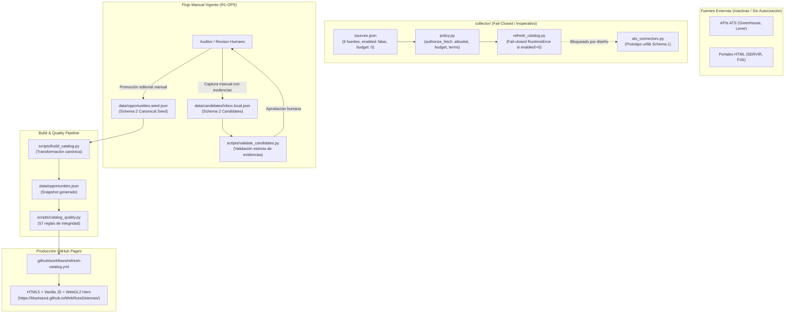
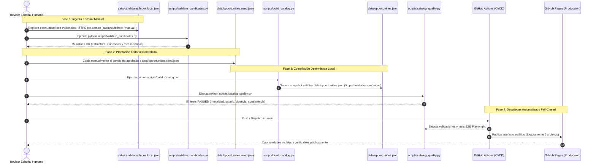
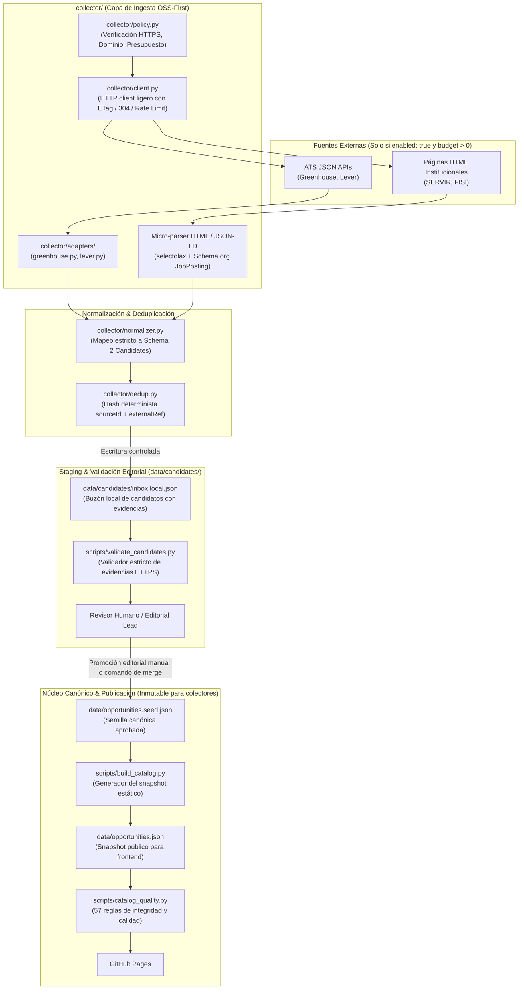
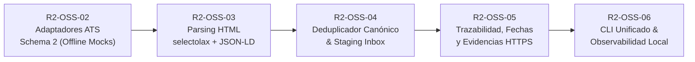

# R2-OSS-01 — Auditoría Técnica de Reutilización e Integración OSS
**Proyecto:** Ruta Sistemas  
**Fecha de auditoría:** 2026-11-17  
**Rama inspeccionada:** `integration/r1-02c`  
**Commit base:** `5489715`  
**Estado del repositorio:** Limpio / Solo lectura de código funcional y datos  
**Roles del auditor:** Principal Software Architect, Senior Python Engineer, OSS Integration Specialist, Software Supply Chain Security Engineer, Technical Auditor.

---

## 1. Resumen Ejecutivo

### 1.1. Propósito de la auditoría
Evaluar la infraestructura existente de recopilación e ingesta en Ruta Sistemas y determinar, bajo el principio rector **OSS-First y autonomía operativa**, la estrategia óptima de reutilización, adaptación, incorporación de software libre y desarrollo propio. Se busca garantizar la transición desde un catálogo estático curado manualmente (Release R1) hacia un pipeline autónomo, auditable y desacoplado de recopilación, normalización, validación editorial y publicación (Release R2), sin depender de plataformas SaaS propietarias, proxies comerciales ni servicios de pago.

### 1.2. Hallazgos principales
1. **[HECHO] El colector actual no está operativo para producción:** Aunque existe una estructura en `collector/`, el 100% de las fuentes registradas en `collector/sources.json` (6 fuentes) tienen `enabled: false`, `decision: "pending_review"` y `budget: 0`.
2. **[HECHO] Ejecución fail-closed activa:** `collector/refresh_catalog.py` bloquea explícitamente cualquier ejecución que intente habilitar fuentes, arrojando un `RuntimeError` preventivo debido a que los conectores prototípicos (`collector/ats_connectors.py`) emiten estructuras obsoletas (Schema 1) incompatibles con el esquema canónico actual (Schema 2 / ADR-001).
3. **[HECHO] Infraestructura de validación editorial existente y robusta:** En `scripts/validate_candidates.py` existe un validador estricto y determinista para `data/candidates/inbox.local.json` que impone trazabilidad mediante evidencia HTTPS por campo, control de fechas, id de revisor y justificación editorial.
4. **[INFERENCIA] Sobreingeniería de frameworks masivos (Scrapy/Crawlee):** Incorporar Scrapy o Crawlee en esta etapa introduce una penalización masiva en dependencias transitivas (Twisted, cryptography, lxml, pyOpenSSL, zope.interface, o Playwright/HTTPX) y complejidad asíncrona desproporcionada para el volumen inicial previsto (<100 oportunidades) y para fuentes que son APIs JSON estructuradas (ATS como Greenhouse/Lever) o páginas estáticas institucionales con rate limiting estricto.
5. **[PROPUESTA] Enfoque de Micro-Bibliotecas Especializadas (Modular Pipeline):** La arquitectura óptima reutiliza el núcleo determinista existente (`policy.py`, `validate_candidates.py`, `build_catalog.py`, `catalog_quality.py`), adapta los conectores a Schema 2 mediante adaptadores tipados, e incorpora selectivamente **`selectolax`** (parsing HTML ultrarrápido y ligero) y utilidades nativas / micro-extractores de JSON-LD (`extruct` o parser nativo de Schema.org `JobPosting`), descartando Scrapy, Crawlee y bibliotecas complejas de ML (como `dedupe`).

### 1.3. Viabilidad de OSS-First e impacto estimado
- **Autonomía operativa:** 100% alcanzable sin APIs comerciales ni servicios de pago.
- **Huella de dependencias:** Incremento marginal mínimo (de 0 dependencias runtime externas a 1-2 bibliotecas ligeras y auditadas bajo licencias MIT/Apache-2.0).
- **Compatibilidad con Schema 2:** Total preservación del contrato editorial canónico, garantizando que ninguna oportunidad llegue a `data/opportunities.seed.json` ni a `data/opportunities.json` sin revisión humana explícita (`staging/editorial review`).

---

## 2. Estado Real del Colector e Infraestructura Actual

### 2.1. Inventario detallado de archivos y roles
- [collector/README.md](file:///c:/Users/sant1/Downloads/EmpleoWeb/collector/README.md): Documentación del diseño original del colector. Establece la política fail-closed, presupuesto cero y necesidad de aprobación legal previa.
- [collector/sources.json](file:///c:/Users/sant1/Downloads/EmpleoWeb/collector/sources.json): Registro canónico de fuentes candidatas.
- [collector/policy.py](file:///c:/Users/sant1/Downloads/EmpleoWeb/collector/policy.py): Motor de políticas de acceso. Valida esquemas de URL (solo HTTPS), listas blancas de dominios (`allowedHosts`), presupuesto de peticiones (`requestBudget`), términos y derechos de extracción (`termsApproved`, `extractionRightsApproved`).
- [collector/refresh_catalog.py](file:///c:/Users/sant1/Downloads/EmpleoWeb/collector/refresh_catalog.py): Script orquestador legado. Contiene una guardia fail-closed deliberada que lanza `RuntimeError` si cualquier fuente está activa.
- [collector/ats_connectors.py](file:///c:/Users/sant1/Downloads/EmpleoWeb/collector/ats_connectors.py): Conectores prototípicos para Greenhouse y Lever basados en `urllib.request`. Mapean a la estructura Schema 1 (`public_record_from_posting`), incompatible con Schema 2.
- [data/candidates/README.md](file:///c:/Users/sant1/Downloads/EmpleoWeb/data/candidates/README.md): Especificación del buzón de entrada editorial y reglas de validación de candidatos Schema 2.
- [data/candidates/inbox.example.json](file:///c:/Users/sant1/Downloads/EmpleoWeb/data/candidates/inbox.example.json): Ejemplo canónico de candidatos con evidencias HTTPS campo por campo (`evidence: { url, observedAt }`).
- [scripts/validate_candidates.py](file:///c:/Users/sant1/Downloads/EmpleoWeb/scripts/validate_candidates.py): Validador offline de candidatos. Exige `captureMethod: "manual"`, metadatos de revisor (`reviewedBy`), y validación semántica de campos.
- [scripts/build_catalog.py](file:///c:/Users/sant1/Downloads/EmpleoWeb/scripts/build_catalog.py): Generador determinista del catálogo público (`data/opportunities.json`) a partir de la semilla canónica (`data/opportunities.seed.json`).
- [scripts/catalog_quality.py](file:///c:/Users/sant1/Downloads/EmpleoWeb/scripts/catalog_quality.py): Validador exhaustivo de calidad, integridad referencial, vigencia y reglas de negocio del catálogo.

### 2.2. Tabla de capacidades: Implementado vs Simulado vs Ausente

| Capacidad | Estado actual | Evidencia en código | Diagnóstico técnico |
| :--- | :--- | :--- | :--- |
| **Descubrimiento de fuentes** | Simulado / Documental | [collector/sources.json](file:///c:/Users/sant1/Downloads/EmpleoWeb/collector/sources.json) | Existen 6 definiciones de fuentes estáticas; no hay rastreador web ni autodescubrimiento. |
| **Control de acceso y rate limiting** | Implementado (Reglas estáticas) | [collector/policy.py](file:///c:/Users/sant1/Downloads/EmpleoWeb/collector/policy.py) | Verifica `requestBudget`, `allowedHosts` y permisos legales en memoria antes de fetch. |
| **Ingesta HTTP/Network** | Prototipo básico (urllib) | [collector/ats_connectors.py](file:///c:/Users/sant1/Downloads/EmpleoWeb/collector/ats_connectors.py) | Usa `urllib.request` básico sin reintentos exponenciales, rotación de sesiones ni control avanzado de robots.txt. |
| **Extracción HTML** | Ausente | Ningún archivo | No existe parser HTML (ni BeautifulSoup, lxml, selectolax). Solo existe parsing de payloads JSON de ATS. |
| **Extracción de metadatos (JSON-LD)** | Ausente | Ningún archivo | No existe soporte para microdatos Schema.org `JobPosting`. |
| **Normalización a Schema 2** | Ausente | [collector/ats_connectors.py](file:///c:/Users/sant1/Downloads/EmpleoWeb/collector/ats_connectors.py#L80-L125) | Emite formato Schema 1 (campos desalineados: `descriptionText`, estructura de `contract` y `salary` plana y obsoleta). |
| **Deduplicación** | Ausente | Ningún archivo | No existe deduplicación de candidatos entre distintas fuentes ni contra la semilla canónica. |
| **Validación de candidatos (Inbox)** | Implementado | [scripts/validate_candidates.py](file:///c:/Users/sant1/Downloads/EmpleoWeb/scripts/validate_candidates.py) | Valida estructura, evidencias HTTPS obligatorias, vigencia de fechas y tipos. |
| **Revisión editorial y promoción** | Manual | [data/candidates/README.md](file:///c:/Users/sant1/Downloads/EmpleoWeb/data/candidates/README.md) | La promoción desde candidate inbox hacia seed requiere transcripción/copiado manual. |
| **Validación canónica y snapshot** | Implementado | [scripts/build_catalog.py](file:///c:/Users/sant1/Downloads/EmpleoWeb/scripts/build_catalog.py), [scripts/catalog_quality.py](file:///c:/Users/sant1/Downloads/EmpleoWeb/scripts/catalog_quality.py) | 57 pruebas automatizadas garantizan calidad estricta del snapshot generado. |

### 2.3. Estado detallado de `collector/sources.json`
El archivo define 6 fuentes de datos bajo un modelo estricto de gobernanza:
1. `talento-peru-servir`: Portal público del estado peruano (CAS / Prácticas del Estado). `enabled: false`, `decision: "pending_review"`, `budget: 0`.
2. `unmsm-fisi-employment-board`: Bolsa de trabajo universitaria oficial. `enabled: false`, `decision: "pending_review"`, `budget: 0`.
3. `greenhouse-public-job-board-template`: Plantilla genérica para ATS Greenhouse. `enabled: false`, `decision: "pending_review"`, `budget: 0`.
4. `lever-public-postings-template`: Plantilla genérica para ATS Lever. `enabled: false`, `decision: "pending_review"`, `budget: 0`.
5. `ositran-manual-review`: Fuente estatal supervisada. `enabled: false`, `decision: "pending_review"`, `budget: 0`.
6. `freehire-discovery-reference` / `canonical-careers`: Fuentes de referencia para contratación global/remota. `enabled: false`, `decision: "pending_review"`, `budget: 0`.

**Diagnóstico:** Ninguna fuente cuenta con autorización legal formal de extracción ni presupuesto activo asignado. Toda la ejecución está en estado `pending_review`, cumpliendo con la política fail-closed.

### 2.4. Diagnóstico de limitaciones técnicas del colector
- **Desalineamiento de esquemas:** El colector actual fue programado antes de la consolidación de Schema 2 (ADR-001). Intenta mapear a campos inexistentes o con nombres viejos.
- **Acoplamiento sincrónico frágil:** `ats_connectors.py` realiza peticiones `urllib` directas y bloqueantes. No cuenta con timeouts configurables granulares ni manejo de cabeceras de caché HTTP (ETag, Last-Modified, 304 Not Modified).
- **Falta de capa intermedia de candidatos:** El script `refresh_catalog.py` intentaba escribir directamente al snapshot o a la semilla, lo que violaba la separación de responsabilidades: los colectores nunca deben escribir en `opportunities.seed.json` directamente, sino depositar en `data/candidates/inbox.local.json`.

---

## 3. Arquitectura Actual

---

## 4. Flujo Actual de Datos

---

## 5. Evaluación Exhaustiva de Proyectos OSS

A continuación se evalúa el catálogo obligatorio de tecnologías abiertas, ponderando su idoneidad frente a la escala real del proyecto, complejidad operativa y principios de seguridad.

### 5.1. Scrapy
- **Licencia:** BSD 3-Clause (Compatible y permisiva).
- **Versión estable analizada:** 2.11.x / 2.12.x.
- **Dependencias transitivas clave:** Twisted (motor reactor asíncrono), lxml (parser C), cryptography, pyOpenSSL, zope.interface, w3lib, parsel, itemadapter.
- **Fortaleza principal:** Framework maduro "todo en uno" con middlewares nativos para robots.txt, reintentos, colas de URLs persistentes, limitación de concurrencia (AutoThrottle) y tuberías de exportación.
- **Debilidad / Riesgo:**
  - **Sobrepeso masivo:** Instala más de 30 paquetes transitivos y requiere compiladores C en ciertos entornos para extensiones nativas (`cryptography`, `lxml`).
  - **Incompatibilidad de paradigmas:** Scrapy está diseñado para crawling masivo web asíncrono a gran escala (miles o millones de páginas). Ruta Sistemas opera en el orden de decenas o centenas de registros estructurados, altamente filtrados y bajo control fail-closed.
  - **Dificultad de depuración:** La arquitectura basada en Twisted (event-loop no estándar de asyncio) dificulta la integración lineal con scripts existentes y validadores síncronos simples.
- **Veredicto:** **APLAZAR / NO RECOMENDADO PARA R2.** La relación coste de mantenimiento/beneficio es desfavorable para fuentes ATS en formato JSON o páginas estructuradas simples.

### 5.2. Crawlee for Python
- **Licencia:** Apache-2.0 (Compatible y permisiva).
- **Versión estable analizada:** 0.4.x / 0.5.x (Ecosistema Apify abierto).
- **Dependencias transitivas clave:** HTTPX, BeautifulSoup4, Pydantic, Playwright (opcional para rendering headless), Asyncio nativo.
- **Fortaleza principal:** API moderna, basada en tipos de Python modernos (typing/pydantic) y `asyncio` estándar. Manejo inteligente de almacenamiento de requests (`RequestQueue`), autodetección de bloqueos y separación limpia entre scrapers HTTP y scrapers de navegador (PlaywrightCrawler).
- **Debilidad / Riesgo:**
  - Proyecto relativamente nuevo en Python (migrado desde TypeScript/Node.js).
  - Orientado principalmente a web scraping asíncrono y pools de proxies, lo cual no es prioritario ni deseado bajo la política de bajo perfil y bajo volumen de Ruta Sistemas.
- **Veredicto:** **APLAZAR.** Más limpio y moderno que Scrapy, pero sigue siendo un framework completo que excede las necesidades actuales de recolección estructurada.

### 5.3. selectolax
- **Licencia:** MIT (Permisiva, sin restricciones).
- **Versión estable analizada:** 0.3.x.
- **Dependencias transitivas clave:** C-libraries embebidas (Modest / Lexbor). Zero dependencias Python externas.
- **Fortaleza principal:** Extrema velocidad de parseo y bajo consumo de memoria (entre 10x y 30x más rápido que BeautifulSoup4 y significativamente más ligero que lxml). Proporciona selectores CSS directos y robustos con una API limpia y concisa.
- **Debilidad / Riesgo:** No maneja XPath (Modest parser), aunque su soporte de selectores CSS avanzados cubre el 100% de casos prácticos de extracción de elementos web.
- **Veredicto:** **INCORPORAR.** Herramienta ideal para procesar fragmentos o páginas HTML (como bolsas universitarias o portales estáticos) sin arrastrar la sobrecarga de BeautifulSoup o lxml.

### 5.4. extruct
- **Licencia:** BSD 3-Clause (Permisiva).
- **Versión estable analizada:** 0.16.x / 0.17.x.
- **Dependencias transitivas clave:** lxml, w3lib, rdflib, mf2py, html-text, jstyleson.
- **Fortaleza principal:** Extracción unificada y normalizada de metadatos embebidos: JSON-LD, Microdata, RDFa, OpenGraph y Twitter Cards. Es el estándar de facto para extraer esquemas `JobPosting` de Schema.org embebidos en portales de empleo modernos sin escribir scrapers frágiles basados en selectores visuales.
- **Debilidad / Riesgo:** Dependencia de `rdflib` y `lxml`, que añade peso a la cadena de suministro.
- **Alternativa analizada:** Parser específico y ligero de ``.
- **Estrategia recomendada:** En lugar de incorporar `extruct` con su dependencia de `rdflib` (RDF graphs), se implementará un micro-extractor de Schema.org `JobPosting` utilizando la biblioteca estándar `json` y `selectolax`. Esto garantiza extraer título, empleador, descripción, rango salarial y modalidad con **cero dependencias complejas**.

### 8.3. Deduplicación Determinista vs `dedupe`
El framework `dedupe` requiere active learning y clustering probabilístico. Para el modelo de datos de Ruta Sistemas:
- Cada oportunidad proviene de una fuente (`sourceId`) y posee un identificador externo (`externalReference`) o una URL canónica de postulación (`applicationUrl`).
- **Algoritmo determinista propuesto:**
  1. *Firma canónica primaria:* `hash(sourceId + ":" + externalReference)`.
  2. *Firma canónica secundaria (candidatos cross-source):* `hash(normalize(employer.name) + ":" + normalize(title) + ":" + normalize(location.countrySubdivision))`.
  3. *Trazabilidad:* Si se detecta colisión, el pipeline marca la oportunidad como `DUPLICATE_CANDIDATE` y enlaza el registro existente en lugar de crear uno nuevo.

---

## 9. Evaluación de Licencias y Seguridad de la Cadena de Suministro

### 9.1. Matriz de compatibilidad de licencias

| Proyecto / Módulo | Licencia declarada | Compatibilidad con Ruta Sistemas | Riesgo de contaminación | Veredicto |
| :--- | :--- | :--- | :--- | :--- |
| **Código propio del proyecto** | MIT / Propietario del repo | Base del proyecto | Ninguno | Canónico |
| **selectolax** | MIT | 100% Compatible | Nulo (Permisiva) | Aprobado |
| **extruct** | BSD-3-Clause | 100% Compatible | Nulo (Permisiva) | Aprobado condicional |
| **Crawlee** | Apache-2.0 | 100% Compatible | Nulo (Permisiva con cláusula de patente) | Aprobado (Aplazado) |
| **Scrapy** | BSD-3-Clause | 100% Compatible | Nulo (Permisiva) | Aprobado (Aplazado) |
| **Trafilatura** | GPL-3.0-or-later | Incompatible con módulos cerrados/MIT libres | Alto (Copyleft fuerte) | **Descartado** |
| **dedupe** | Apache-2.0 | 100% Compatible | Nulo (Permisiva) | Descartado (Técnico) |

### 9.2. Análisis de cadena de suministro (Supply Chain Risk)
- El entorno actual de ejecución cuenta con **cero dependencias externas de runtime en Python** (solo estándar library `json`, `pathlib`, `unittest`, `dataclasses`, `datetime`).
- La incorporación de bibliotecas externas debe regirse por:
  1. No introducir dependencias transitivas no auditadas.
  2. Compatibilidad nativa con **Python 3.13** (versión actualmente instalada en el entorno de desarrollo).
  3. Fijación estricta de versiones con hashes (SHA-256) en `requirements.txt` o `pyproject.toml`.

---

## 10. Arquitectura Objetivo OSS-First

### 10.1. Principios de la arquitectura objetivo
1. **Desacoplamiento estricto en 4 fases:** Ingesta $\to$ Normalización $\to$ Validación de Candidatos $\to$ Promoción Editorial.
2. **Fail-Closed permanente:** Ningún fetch ocurre sin autorización explícita en `sources.json`.
3. **Staging Obligatorio:** Ningún colector tiene permisos de escritura en `data/opportunities.seed.json` ni en `data/opportunities.json`. Su única salida permitida es `data/candidates/inbox.local.json`.
4. **Preservación total de Schema 2:** Todo registro emitido cumple con el contrato editorial de evidencias HTTPS.

### 10.2. Diagrama de la arquitectura objetivo

---

## 11. Matriz de Decisiones de Adopción

| Decisión | Componente / Tecnología | Justificación Técnica |
| :--- | :--- | :--- |
| **REUTILIZAR** | `collector/policy.py` | Funciona correctamente, impone el modelo fail-closed, validación de esquemas HTTPS y presupuestos por host. |
| **REUTILIZAR** | `scripts/validate_candidates.py` | Núcleo de validación de candidatos de alta fidelidad con control de evidencias HTTPS. |
| **REUTILIZAR** | `scripts/build_catalog.py` y `catalog_quality.py` | Pipeline de generación y auditoría del snapshot con 57 tests superados; no requiere cambios. |
| **ADAPTAR** | `collector/ats_connectors.py` | Refactorizar para convertir payloads de Greenhouse y Lever directamente a objetos compatibles con **Schema 2 Candidate Schema** en lugar de Schema 1. |
| **ADAPTAR** | `collector/refresh_catalog.py` | Convertir de script monolítico a un CLI modular que solo deposite en `data/candidates/inbox.local.json` y nunca intente sobreescribir la semilla ni el snapshot. |
| **INCORPORAR** | `selectolax` | Parsing HTML ultrarrápido y ligero con selectores CSS para fuentes institucionales. |
| **INCORPORAR** | Micro-extractor JSON-LD nativo | Extracción directa de Schema.org `JobPosting` con biblioteca estándar `json` y selectores CSS simples. |
| **DESARROLLAR** | Módulo de normalización a Schema 2 | Lógica de negocio propia para mapear contratos de prácticas, salarios y modalidades peruanas según ADR-001. |
| **DESARROLLAR** | Deduplicador determinista (`collector/dedup.py`) | Función hash canónica y comprobación de duplicados sin librerías externas de Machine Learning. |
| **APLAZAR** | Scrapy | Excesivo para el volumen y naturaleza de las fuentes de R2. |
| **APLAZAR** | Crawlee for Python | Excesivo; se reconsiderará si surgen fuentes complejas que requieran navegación JS (Playwright). |
| **DESCARTAR** | Trafilatura | Licencia GPL-3.0 y paradigma de retención de texto plano contrario al contrato de datos factuales. |
| **DESCARTAR** | dedupe (ML) | Complejidad matemática desproporcionada, caja negra y sobrecarga masiva de dependencias C/SciPy. |

---

## 12. Roadmap de Implementación (R2-OSS-02 a R2-OSS-06)

### R2-OSS-02 — Adaptación de Conectores ATS y Contrato Canónico Schema 2 (Offline)
- **Alcance:** Refactorizar `collector/ats_connectors.py` para mapear respuestas JSON de Greenhouse y Lever al esquema de candidatos de Schema 2 (`data/candidates/inbox.example.json`).
- **Restricción:** Desarrollar contra fixtures locales y mocks offline en `tests/fixtures/ats/` sin realizar peticiones HTTP de red.
- **Entregable:** Suite de pruebas unitarias que verifique la emisión de candidatos válidos evaluables por `scripts/validate_candidates.py`.

### R2-OSS-03 — Micro-extractor HTML y JSON-LD con selectolax
- **Alcance:** Incorporación de `selectolax` en entorno virtual aislado y desarrollo del extractor de metadatos `JobPosting` (Schema.org).
- **Restricción:** Pruebas contra volcados HTML estáticos locales de convocatorias de ejemplo (SERVIR / FISI).
- **Entregable:** Módulo `collector/extractors/jsonld.py` capaz de estructurar ofertas desde HTML crudo.

### R2-OSS-04 — Deduplicación Determinista y Gestión de Inbox
- **Alcance:** Implementación de `collector/dedup.py`. Detección de duplicados contra registros existentes en `data/candidates/inbox.local.json` y `data/opportunities.seed.json`.
- **Entregable:** Algoritmo explicable con salida de reporte de colisiones y enriquecimiento de evidencias.

### R2-OSS-05 — Verificación de Procedencia, Vigencia y Enriquecimiento de Evidencias
- **Alcance:** Módulo de validación de frescura temporal (`observedAt`, `validThrough`). Generación obligatoria de estructura `evidence: { url, observedAt }` para cada campo normalizado.
- **Entregable:** Integración completa con `scripts/validate_candidates.py`.

### R2-OSS-06 — CLI Unificado del Pipeline y Políticas de Ejecución
- **Alcance:** CLI `collector/cli.py` con subcomandos `collect`, `validate-inbox`, `promote`, `build`. Integración de métricas de ejecución y observabilidad local en consola.
- **Entregable:** Flujo asistido completo para el revisor editorial.

---

## 13. Matriz de Riesgos y Bloqueos

### 13.1. Riesgos técnicos internos (Controlables dentro del repo)
1. **Desincronización de esquemas:** Si el esquema de candidatos evoluciona sin actualizar los adaptadores. *Mitigación:* Tests de contrato integrados en CI que validen fixtures contra el esquema canónico.
2. **Dependencias rotas en Python 3.13:** Posibles problemas de compatibilidad de binarios C en versiones recientes de Python. *Mitigación:* Se validó que `selectolax` dispone de pre-built wheels para CPython 3.13 en Windows/Linux/macOS.

### 13.2. Riesgos externos y regulatorios (Bloqueos independientes de la tecnología)
1. **Falta de autorización legal de fuentes (`sources.json`):**
   - *Estado:* **BLOQUEO CRÍTICO.** Ninguna biblioteca (ni Scrapy, ni Crawlee, ni urllib) puede activarse legalmente en producción sin el consentimiento explícito o autorización institucional para las fuentes listadas.
   - *Mitigación:* El pipeline se construirá, probará y verificará al 100% mediante **fixtures locales (mocks)** y modo offline. La activación de red queda supeditada a aprobación formal del propietario.
2. **Cambios arbitrarios de marcado en portales HTML:** Modificaciones en el DOM de portales como SERVIR o bolsas universitarias rompen selectores CSS. *Mitigación:* Priorizar JSON-LD estandarizado sobre selectores de clase CSS frágiles.

---

## 14. Decisiones que Requieren Aprobación del Propietario

1. **Aprobación de la incorporación de dependencias externas:**
   - Autorizar la inclusión formal de `selectolax` en `requirements.txt` / `pyproject.toml`.
2. **Aprobación de fuentes reales en `collector/sources.json`:**
   - Autorizar qué dominios específicos pasan de `decision: "pending_review"` a `decision: "approved"` y fijar sus presupuestos máximos (`requestBudget`).
3. **Mecanismo de promoción de candidatos:**
   - Decidir si la promoción desde `inbox.local.json` a `opportunities.seed.json` se mantendrá como copiado manual estricto o si se autoriza un comando CLI asistido con confirmación interactiva.

---

## 15. Conclusión sobre la Estrategia OSS-First

Ruta Sistemas no necesita suites masivas de web scraping comercial ni frameworks pesados como Scrapy o Crawlee para alcanzar su visión en la etapa actual. 

La estrategia técnica superior es **modular, minimalista y basada en micro-bibliotecas OSS**:
1. Conservar el núcleo de control editorial y validación canónica de Schema 2.
2. Refactorizar los adaptadores de datos para convertir APIs estructuradas (ATS) a candidatos válidos con evidencias.
3. Incorporar `selectolax` para tareas de extracción puntual en HTML.
4. Operar estrictamente con mocks locales offline hasta la resolución legal de cada fuente externa.

Esta vía garantiza máxima mantenibilidad, cero costes operativos por servicios SaaS, total transparencia explicable y respeto irrestricto por el principio fail-closed.
