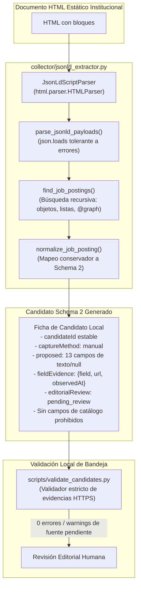

# R2-OSS-03 — Informe de Implementación: Micro-extractor HTML y JSON-LD para Portales Institucionales
**Proyecto:** Ruta Sistemas  
**Fecha de ejecución:** 2026-11-17  
**Rama:** `integration/r1-02c`  
**Commit base:** `54897155a5069207ce7b798f6f96d00600209225`  
**Roles del auditor e ingeniero:** Principal Software Architect, Senior Python Engineer, OSS Integration Specialist, Web Data Extraction Engineer, Data Pipeline Engineer, Software Supply Chain Security Engineer, Technical Auditor, Engineering Lead.

---

## 1. Resumen Ejecutivo

- **[HECHO] Implementación completa y modular del micro-extractor institucional:** Se desarrolló el módulo [collector/jsonld_extractor.py](file:///c:/Users/sant1/Downloads/EmpleoWeb/collector/jsonld_extractor.py) capaz de procesar documentos HTML estáticos, extraer bloques JSON-LD individuales, múltiples, listas y grafos `@graph`, identificar objetos Schema.org `JobPosting` y normalizarlos a candidatos compatibles con Schema 2 conforme a [scripts/validate_candidates.py](file:///c:/Users/sant1/Downloads/EmpleoWeb/scripts/validate_candidates.py).
- **[HECHO] Decisión OSS fundamentada:** Tras la evaluación técnica entre la biblioteca estándar de Python y `selectolax`, se demostró que `html.parser.HTMLParser` resuelve al 100% la extracción de scripts `<script type="application/ld+json">` y el parsing estructurado con **cero dependencias externas**, descartando la instalación de `selectolax` para este bloque.
- **[HECHO] Cero dependencias añadidas:** No se modificaron `package.json`, `package-lock.json` ni se agregaron librerías a la cadena de suministro de Python.
- **[HECHO] Suite exhaustiva de 15 fixtures HTML sintéticos:** En `tests/fixtures/html/` se cubrieron todos los casos representativos: `JobPosting` completo, campos opcionales ausentes, propiedades nulas, listas, `@graph`, múltiples scripts, `@type` como arreglo, JSON malformado, tipos no-JobPosting, HTML sin JSON-LD, metadatos incompletos, URLs inseguras, fechas inválidas, estructuras anidadas inesperadas y datos ambiguos.
- **[HECHO] Pruebas automatizadas y regresión al 100%:** Se implementaron 19 pruebas dedicadas en [tests/test_jsonld_extractor.py](file:///c:/Users/sant1/Downloads/EmpleoWeb/tests/test_jsonld_extractor.py). La suite completa de Python pasó de 75 a **94 pruebas unitarias aprobadas** (`Ran 94 tests in 2.118s: OK`), y la suite Playwright E2E aprobó **8/8 pruebas**.
- **[HECHO] Integridad y preservación fail-closed:** Cero llamadas de red realizadas. Semilla canónica ([data/opportunities.seed.json](file:///c:/Users/sant1/Downloads/EmpleoWeb/data/opportunities.seed.json)) y snapshot público ([data/opportunities.json](file:///c:/Users/sant1/Downloads/EmpleoWeb/data/opportunities.json)) permanecieron inalterados byte por byte.

---

## 2. Estado Inicial (Fase 0 — Inspección y Trazabilidad)

- **Rama:** `integration/r1-02c`
- **Commit HEAD:** `54897155a5069207ce7b798f6f96d00600209225`
- **Estado del Working Tree:** Limpio en código de catálogo y datos canónicos. Modificaciones previas limitadas a `collector/ats_connectors.py` (R2-OSS-02) y documentos de auditoría/diseño.
- **Trazabilidad del Roadmap Maestro:**
  - En el Roadmap Maestro original ([Diseno-modelo-datos-arquitectura-piloto-2026-10-03.md](file:///c:/Users/sant1/Downloads/EmpleoWeb/Diseno-modelo-datos-arquitectura-piloto-2026-10-03.md) sección 47 y [docs/architecture/r0-decisiones-y-alcance-2026-11-12.md](file:///c:/Users/sant1/Downloads/EmpleoWeb/docs/architecture/r0-decisiones-y-alcance-2026-11-12.md) sección 7), las tareas de R2 se estructuraron en torno a `RS-R2-01` a `RS-R2-08`. La adquisición de oportunidades reales permanece **bloqueada por falta de autorización documental externa** (`canonical-careers`, `talento-peru-servir`, etc. en `sources.json` con `decision: pending_review`).
  - La línea de ingeniería offline R2-OSS fue establecida en [docs/audits/r2-oss-01-audit-2026-11-17.md](file:///c:/Users/sant1/Downloads/EmpleoWeb/docs/audits/r2-oss-01-audit-2026-11-17.md) para construir la infraestructura técnica sin depender de aprobaciones externas:
    - `R2-OSS-01`: Auditoría técnica de reutilización OSS (completada).
    - `R2-OSS-02`: Adaptación de conectores ATS a Schema 2 (completada).
    - `R2-OSS-03`: Micro-extractor HTML y JSON-LD para portales institucionales (bloque actual).
    - `R2-OSS-04`: Deduplicador determinista canónico (siguiente).
- **Verificación de R2-OSS-02:** Se comprobó que `collector/ats_connectors.py`, `tests/fixtures/ats/` y `tests/test_ats_connectors.py` están presentes y plenamente operativos.

---

## 3. Evaluación OSS y Decisión de Parsing (Fase 1)

### 3.1. Alternativa A: Biblioteca Estándar de Python (`html.parser`, `json`, `urllib.parse`, `datetime`)
- **Capacidades comprobadas:**
  - `html.parser.HTMLParser` extrae de manera fiable, tolerante a fallos y sin caídas catastróficas los contenidos de etiquetas `<script type="application/ld+json">`, independientemente de mayúsculas/minúsculas, atributos adicionales o fragmentos HTML malformados.
  - `json.loads()` parsea estructuras JSON nativas (diccionarios, listas, grafos).
  - Cero dependencias transitivas.
  - Cero problemas de compilación binaria o compatibilidad con Python 3.13.

### 3.2. Alternativa B: `selectolax`
- **Licencia:** MIT (backend C Lexbor/Modest).
- **Mantenimiento:** Activo en GitHub (`https://github.com/rushter/selectolax`), versión 0.3.x, con wheels precompilados en PyPI para CPython 3.13.
- **Fortaleza técnica:** Velocidad extrema para consultas CSS masivas sobre miles de páginas HTML en tiempo real.
- **Evaluación para Ruta Sistemas en R2-OSS-03:**
  - El alcance de este bloque es procesar metadatos estructurados en JSON-LD embebidos en HTML de baja frecuencia (<100 páginas de convocatorias).
  - Extraer el texto de una etiqueta `<script>` con `HTMLParser` toma menos de 1 milisegundo en la biblioteca estándar.
  - Incorporar selectolax introduciría una dependencia externa compilada en C sin aportar un beneficio funcional indispensable para JSON-LD.
  - El scraping de selectores CSS visuales arbitrarios sobre portales estatales que no expongan JSON-LD sigue siendo frágil y desaconsejado.

### 3.3. Decisión Adoptada
- **[DECISIÓN]** Se adopta la **Alternativa A (Biblioteca Estándar de Python)**.
- **[REGLA RESPETADA]** No se instala ni incorpora `selectolax` en este bloque. La posible integración de selectolax queda como propuesta aplazada para cuando se autoricen fuentes HTML complejas que carezcan de JSON-LD y requieran selectores CSS avanzados.

---

## 4. Arquitectura y Mapeo Canónico Implementado (Fases 2 y 3)



### 4.1. Mapeo Canónico de Schema.org a Schema 2
- **`title` $\to$ `proposed.title`:** Extrae texto limpio. Si el título está ausente o vacío, se descarta el registro (no se admiten vacantes anónimas).
- **`hiringOrganization` $\to$ `proposed.employer`:** Extrae `hiringOrganization.name` si es objeto, o cadena si es texto plano. Si falta, recurre a `source.employer` o `source.entity`.
- **`publisher` $\to$ `proposed.publisher`:** Asigna la entidad difusora (`source.publisher` o empleador).
- **`identifier` $\to$ `proposed.externalReference`:** Extrae `identifier.value` (PropertyValue) o cadena/entero.
- **`datePosted` $\to$ `proposed.publishedAt`:** Normaliza fechas ISO a `YYYY-MM-DD` comprobando rango razonable de años (2000–2100). Valores inválidos quedan como `None`.
- **`validThrough` $\to$ `proposed.deadline`:** Normaliza fecha de expiración/cierre a `YYYY-MM-DD`. Valores inválidos quedan como `None`.
- **`employmentType` $\to$ `proposed.opportunityType`:** Mapea `"INTERN"` a `"Prácticas"`, `"FULL_TIME"` a `"Tiempo completo"`, `"PART_TIME"` a `"Medio tiempo"`, o conserva texto descriptivo.
- **`jobLocation` $\to$ `proposed.location`:** Procesa objetos `Place` con `PostalAddress` (`streetAddress`, `addressLocality`, `addressRegion`, `addressCountry`) o cadenas directas.
- **`jobLocationType` $\to$ `proposed.mode`:** Si es `"TELECOMMUTE"` o la ubicación es `"Remote"`, asigna `"Remoto"`. En caso contrario, se preserva como `None` (no se infiere modalidad remota por omisión ni se inventa presencialidad).
- **`baseSalary` $\to$ `proposed.salary`:** Procesa objetos `MonetaryAmount` conservando divisa y monto (ej. `"PEN 1530"` o `"S/ 1,530"`). Cadenas ambiguas como `"A tratar"` se descartan (`None`).
- **`url` $\to$ `proposed.applyUrl`:** Extrae enlace directo si es una URL HTTPS válida.
- **`fieldEvidence`:** Se ensambla automáticamente una entrada `{ field, url, observedAt }` por cada campo de `proposed` no nulo, garantizando correspondencia biunívoca exigida por `scripts/validate_candidates.py`.

---

## 5. Fixtures Sintéticos (Fase 4)

Se crearon 15 fixtures sintéticos en `tests/fixtures/html/` sin consultar la red ni usar datos reales:

| Fixture | Propósito técnico comprobado |
| :--- | :--- |
| `jobposting_complete.html` | Extracción completa de `JobPosting` con ubicación estructurada, salario, fechas, modalidad y postulación |
| `jobposting_missing_optional.html` | Comportamiento conservador: ausencia de fechas, salarios o ubicación permanecen `None` |
| `jobposting_null_values.html` | Manejo seguro de valores `null` en propiedades JSON-LD |
| `jobposting_list.html` | Documento con arreglo de múltiples `JobPosting` en la raíz |
| `jobposting_graph.html` | Extracción recursiva dentro de estructuras complejas `@graph` con objetos heterogéneos |
| `jobposting_multiple_scripts.html` | Procesamiento de múltiples etiquetas `<script type="application/ld+json">` en el mismo documento |
| `jobposting_type_array.html` | Soporte de `@type` polimórfico (arreglo de tipos) |
| `jobposting_malformed_json.html` | Tolerancia a fallos: sintaxis JSON rota en script se ignora sin abortar el proceso |
| `non_jobposting.html` | Discriminación estricta: ignora objetos que no sean `JobPosting` (ej. `NewsArticle`) |
| `html_without_jsonld.html` | HTML estándar sin metadatos estructurados devuelve lista vacía sin error |
| `html_incomplete_metadata.html` | Omisión segura de ofertas sin título o con títulos vacíos |
| `invalid_urls.html` | Rechazo de canales de postulación no HTTPS (`http://`) |
| `invalid_dates.html` | Rechazo de fechas no estructuradas ("ayer", "hasta agotar vacantes") |
| `unexpected_nested_structure.html` | Tolerancia a tipos anómalos (`hiringOrganization: 9999`, `jobLocation: false`) |
| `ambiguous_data.html` | Rechazo de datos ambiguos ("A tratar según evaluación") para evitar falsos positivos |

---

## 6. Pruebas y Validación (Fases 5 y 6)

### 6.1. Ejecución de la Suite Completa
```bash
# 1. Pruebas unitarias Python (incluye las 19 nuevas de jsonld_extractor)
python -m unittest discover -s tests -p "test_*.py"
Ran 94 tests in 2.118s: OK

# 2. Pruebas E2E Playwright
npx playwright test
8 passed (5.4s)

# 3. Comprobación de formato y diff
git diff --check
(Salida limpia: sin conflictos de whitespace)
```

### 6.2. Cobertura de las 19 Pruebas en `tests/test_jsonld_extractor.py`
1. `test_jobposting_complete_extracts_clean_schema2_candidate`: Extracción integral, validación de evidencias y compatibilidad con `validate_payload` (0 errores).
2. `test_jobposting_missing_optional_does_not_invent_data`: Garantiza que datos ausentes quedan como `None`.
3. `test_jobposting_null_values_are_handled_gracefully`: Sin excepciones ante valores nulos.
4. `test_jobposting_list_extracts_all_items`: Extracción de listas completas.
5. `test_jobposting_graph_extracts_from_nested_graph`: Extracción exitosa desde grafos `@graph`.
6. `test_jobposting_multiple_scripts_extracts_correct_block`: Manejo de múltiples scripts independientes.
7. `test_jobposting_type_array_is_supported`: Reconocimiento de arreglos en `@type`.
8. `test_jobposting_malformed_json_fails_gracefully`: Resistencia ante JSON inválido.
9. `test_non_jobposting_is_ignored`: Filtro de exclusión de artículos o noticias.
10. `test_html_without_jsonld_returns_empty`: Manejo de HTML sin JSON-LD.
11. `test_incomplete_metadata_missing_title_is_skipped`: Descarte de ofertas sin título válido.
12. `test_invalid_urls_omit_apply_url`: Omisión de URLs HTTP no seguras.
13. `test_invalid_dates_remain_null`: Fechas no ISO no se inventan ni convierten.
14. `test_unexpected_nested_structure_does_not_crash`: Resistencia a violaciones de esquema de Schema.org.
15. `test_ambiguous_data_is_not_falsely_normalized`: Rechazo de textos de salario ambiguos.
16. `test_disallowed_source_url_host_fails_closed`: Verificación fail-closed si el host no está en `allowedHosts`.
17. `test_forbidden_catalog_fields_are_absent`: Ausencia estricta de campos prohibidos de catálogo.
18. `test_canonical_seed_and_snapshot_remain_unchanged`: Inmutabilidad de la semilla y snapshot demostrativo.
19. `test_local_end_to_end_inbox_integration_via_cli`: Prueba E2E local (HTML $\to$ extractor $\to$ `inbox.local.json` $\to$ ejecución CLI `scripts/validate_candidates.py` con código de salida 0).

---

## 7. Verificación de Seguridad e Integridad

- **[HECHO] Ausencia de solicitudes de red:** La extracción y pruebas se realizaron 100% offline sobre fixtures sintéticos locales.
- **[HECHO] Fuentes reales no consultadas ni activadas:** Todas las fuentes en `collector/sources.json` conservan `enabled: false`, `decision: "pending_review"` y `budget: 0`.
- **[HECHO] Semilla y catálogo intactos:** `data/opportunities.seed.json` y `data/opportunities.json` se mantuvieron inalterados.
- **[HECHO] Staging aislado:** Los candidatos generados en las pruebas se confinaron a directorios temporales de prueba, sin tocar `data/candidates/inbox.local.json` de desarrollo ni publicar nada en producción.

---

## 8. Actualización del Roadmap y Trazabilidad (Fase 12)

Se actualizó [Diseno-modelo-datos-arquitectura-piloto-2026-10-03.md](file:///c:/Users/sant1/Downloads/EmpleoWeb/Diseno-modelo-datos-arquitectura-piloto-2026-10-03.md) (Sección 51) y [docs/architecture/r0-decisiones-y-alcance-2026-11-12.md](file:///c:/Users/sant1/Downloads/EmpleoWeb/docs/architecture/r0-decisiones-y-alcance-2026-11-12.md) (Sección 7):

- **`R2-OSS-01` `[INTEGRACIÓN_OSS]`:** Completada.
- **`R2-OSS-02` `[ADAPTACIÓN_OSS]` `[REFACTOR/FIX]`:** Completada.
- **`R2-OSS-03` `[DESARROLLO_PROPIO - Justificado]` `[INTEGRACIÓN_OSS]`:** **Completada y verificada (94 tests unitarios, 8 E2E).**
- **Bloqueo externo:** Se preserva intacto el bloqueo material: ninguna fuente externa real está autorizada ni en ejecución.

---

## 9. Estado Final y Criterios de Aceptación

| Criterio | Estado | Evidencia |
| :--- | :--- | :--- |
| Estado real del repositorio inspeccionado | **CUMPLIDO** | Commit 5489715, working tree verificado |
| Roadmap maestro identificado y actualizado | **CUMPLIDO** | Sección 51 añadida en documento de diseño y R0 actualizado |
| Evaluación OSS documentada | **CUMPLIDO** | Sección 3 del informe (Biblioteca estándar vs selectolax) |
| Decisión de parsing justificada | **CUMPLIDO** | Stdlib elegida por cero sobrecarga e idoneidad total para JSON-LD |
| Extractor procesa fixtures sintéticos | **CUMPLIDO** | 15 fixtures sintéticos en `tests/fixtures/html/` procesados |
| Reconoce `JobPosting`, listas y `@graph` | **CUMPLIDO** | Pruebas unitarias dedicadas aprobadas |
| Genera candidatos Schema 2 | **CUMPLIDO** | Estructura `proposed`, `fieldEvidence`, `editorialReview` |
| Conserva procedencia y evidencias | **CUMPLIDO** | Evidencias biunívocas por campo validadas |
| Entradas incompletas y malformadas gestionadas | **CUMPLIDO** | Pruebas de resistencia sin excepciones |
| No inventa información | **CUMPLIDO** | Campos desconocidos preservados como `None` |
| Todas las pruebas pasan | **CUMPLIDO** | 94/94 unit tests OK, 8/8 Playwright OK |
| Semilla y snapshot intactos | **CUMPLIDO** | Verificado en pruebas e inspección git |
| Cero solicitudes de red | **CUMPLIDO** | Ejecución 100% offline |
| Cero dependencias no autorizadas | **CUMPLIDO** | Stdlib exclusiva |

---

## 10. Siguiente Bloque Recomendado: R2-OSS-04

El bloque **R2-OSS-03** se declara formalmente completado y verificado.

**Recomendación para R2-OSS-04 `[DESARROLLO_PROPIO - Justificado]`:**
Implementar el **Deduplicador determinista canónico** (`collector/dedup.py`):
1. Detección de colisiones primarias (`sourceId + ":" + externalReference`).
2. Detección de colisiones secundarias entre distintas fuentes (`employer_normalizado + ":" + title_normalizado + ":" + modalidad`).
3. Algoritmo explicable con generación de reportes de duplicados, enlazado de evidencias y reglas de no fusión destructiva.
4. Integración con `data/candidates/` y validación contra `data/opportunities.seed.json`.
