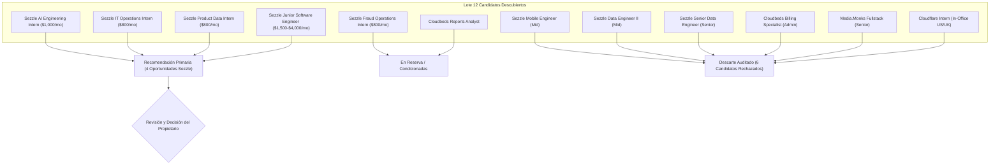

# R3-ALPHA-CURATION-02 — Descubrimiento y Curaduría de Nuevas Oportunidades Reales para la Alpha Privada

**Proyecto:** Ruta Sistemas  
**Fase:** R3 — Evaluación con Círculo Cercano y Alpha Privada  
**Identificador:** `R3-ALPHA-CURATION-02`  
**Fecha de corte e informe:** 2026-11-21 (Hora Lima, UTC-5)  
**Responsables (Roles):** Principal Software Architect, Senior Software Engineer, Technical Product Manager, OSS Integration Specialist, Curador Editorial de Empleo TI y Auditor Técnico de Procedencia  
**Estado:** `COMPLETED_READY_FOR_HUMAN_REVIEW`  
**Rama objetivo:** `integration/r1-02c`  
**HEAD de referencia:** `b27e41804f3ae216173059daeaec39c77174db44`  
**Referencias rectoras:**
- [docs/architecture/r0-decisiones-y-alcance-2026-11-12.md](../architecture/r0-decisiones-y-alcance-2026-11-12.md)
- [docs/architecture/r3-private-alpha-scope-decision-2026-11-20.md](../architecture/r3-private-alpha-scope-decision-2026-11-20.md)
- [docs/audits/r3-alpha-curation-01-second-batch-2026-11-20.md](r3-alpha-curation-01-second-batch-2026-11-20.md)
- [docs/audits/r3-alpha-owner-review-01-canonical-editorial-decision-2026-11-20.md](r3-alpha-owner-review-01-canonical-editorial-decision-2026-11-20.md)
- [docs/audits/r3-alpha-promotion-01-private-catalog-2026-11-21.md](r3-alpha-promotion-01-private-catalog-2026-11-21.md)
- [docs/audits/r3-alpha-ux-01-catalog-pagination-and-lists-2026-11-21.md](r3-alpha-ux-01-catalog-pagination-and-lists-2026-11-21.md)

---

## 1. Identidad y Objetivo

El presente informe documenta la ejecución del bloque **`R3-ALPHA-CURATION-02`**, enfocado en la ampliación del inventario de oportunidades reales candidatas para la Alpha privada de Ruta Sistemas mediante un segundo ciclo riguroso de investigación, adquisición, normalización y auditoría editorial.

El público objetivo prioritario de Ruta Sistemas está compuesto por:
1. **Estudiantes de últimos ciclos (prácticas preprofesionales).**
2. **Egresados recientes (prácticas profesionales / graduados).**
3. **Perfiles entry-level y junior de Ingeniería de Sistemas y TI en Perú.**

La plataforma mantiene el principio fundamental de aportar valor práctico al postulante, distinguiendo con claridad objetiva las vacantes accesibles y formativas de aquellas que imponen barreras encubiertas (experiencia desmedida, exclusión territorial, o perfiles puramente administrativos ajenos a la ingeniería).

### Principios y Limitaciones de Ejecución:
- **Cero alteración de fuentes canónicas:** `data/opportunities.seed.json`, `data/opportunities.json` y `collector/sources.json` permanecen 100% inalterados (hashes criptográficos SHA-256 idénticos).
- **Cero promoción automática:** Ningún candidato ha sido promovido al catálogo canónico ni se le ha asignado código `OP-011+`.
- **Aislamiento en Staging:** Los registros residen exclusivamente en `data/candidates/inbox.local.json` (ignorado por `.gitignore`), bajo el estándar Candidate Schema 2.
- **Cero dependencias nuevas:** 0 paquetes npm, 0 paquetes pip añadidos.
- **Cero git commit / push / deployment:** Trabajo estrictamente local de preparación y auditoría.

---

## 2. Contexto y Estado de Partida

### 2.1. Estado Canónico Previo
El catálogo de la Alpha privada cuenta con **11 oportunidades** (6 reales + 5 registros demostrativos de calibración):
- `OP-005`: CookUnity — Supply Chain Analyst (Lima, Perú / Híbrido).
- `OP-006`: Canonical Ubuntu — Graduate Software Engineer, Open Source and Linux (Remoto, Elegible Perú).
- `OP-007`: Canonical Ubuntu — Junior Ubuntu Software Engineer (Remoto, Elegible Perú).
- `OP-008`: Canonical Ubuntu — Junior Linux Kernel Engineer (Remoto, Elegible Perú).
- `OP-009`: Canonical Ubuntu — Software Engineer, Python - Cloud (Remoto, Elegible Perú).
- `OP-010`: Canonical Ubuntu — Associate Linux Support Engineer (Remoto, Elegible Perú).
- `OP-001` a `OP-004`, `QA-001`: Registros demostrativos históricos.

### 2.2. Necesidad Operativa
Aunque las 5 oportunidades de Canonical enriquecieron la cobertura técnica en sistemas operativos, cloud y kernel Linux, todas ellas provienen de un único empleador internacional y exigen inglés profesional fluido. Se requiere **diversificar los empleadores, sectores y áreas de especialización** (fintech, data/analítica, IA, operaciones TI, desarrollo web/backend), identificando convocatorias con remuneración transparente y modelos contractuales aptos para estudiantes y juniors en Perú.

---

## 3. Metodología de Búsqueda y Fuentes Investigadas

Se exploraron sistemáticamente portales ATS públicos y tableros oficiales de empleo sin scraping intrusivo ni evasión de protecciones técnicas:

| Empleador / Organización | Plataforma ATS | Endpoint / Tablero Investigado | Resultado de Exploración |
|---|---|---|---|
| **Sezzle** (Fintech NASDAQ: SEZL) | Greenhouse Public API | `https://boards-api.greenhouse.io/v1/boards/sezzle/jobs` | **Alta pertinencia.** Múltiples vacantes con localización explícita `Peru` y remuneración publicada en USD. |
| **Cloudbeds** (Hospitality SaaS) | Greenhouse Public API | `https://boards-api.greenhouse.io/v1/boards/cloudbeds/jobs` | **Pertinencia mixta.** Identificada 1 vacante de datos para LATAM (Perú elegible) y 1 vacante administrativa de facturación. |
| **Media.Monks** (Digital Services) | Greenhouse Public API | `https://boards-api.greenhouse.io/v1/boards/monks/jobs` | Identificada vacante Fullstack LATAM; descartada tras auditar nivel (requiere 5+ años). |
| **Cloudflare** (Cloud Infrastructure) | Greenhouse Public API | `https://boards-api.greenhouse.io/v1/boards/cloudflare/jobs` | Convocatoria intern 2027; descartada por requerir presencia física en oficinas US/UK (no remota para Perú). |
| **Thoughtworks** | Greenhouse Public API | `https://boards-api.greenhouse.io/v1/boards/thoughtworks/jobs` | Sin vacantes formativas o junior activas para Perú en el corte. |
| **GitLab** | Greenhouse Public API | `https://boards-api.greenhouse.io/v1/boards/gitlab/jobs` | Vacantes de ingeniería de nivel Senior/Staff a nivel global. |
| **Fintual** | Lever API | `https://api.lever.co/v0/postings/fintual` | Posiciones en Chile y México; sin vacantes abiertas para Perú en el corte. |
| **Kavak** | Lever API | `https://api.lever.co/v0/postings/kavak` | Posiciones operativas/logísticas en México; sin aperturas de software para Perú. |

---

## 4. Inventario de Candidatos Descubiertos (12 Nuevos Registros)

Se normalizaron e incorporaron **12 nuevos registros** a `data/candidates/inbox.local.json`, elevando el inventario total de la bandeja de 12 a **24 candidatos auditados**.

| ID Candidato | Empleador | Título | Modalidad / Ubicación | Nivel | Compensación Declarada | Estado en Bandeja |
|---|---|---|---|---|---|---|
| `CAND-greenhouse-public-job-board-template-7906563003` | **Sezzle** | AI Engineering Intern | Remoto (Peru) | Intern / Prácticas | $1,000 USD/mes | `pending_review` |
| `CAND-greenhouse-public-job-board-template-7907182003` | **Sezzle** | IT Operations Intern | Remoto (Peru) | Intern / Prácticas | $800 USD/mes | `pending_review` |
| `CAND-greenhouse-public-job-board-template-8000825003` | **Sezzle** | Product Data Intern | Remoto (Peru) | Intern / Prácticas | $800 USD/mes | `pending_review` |
| `CAND-greenhouse-public-job-board-template-8001111003` | **Sezzle** | Junior Software Engineer with Accounting Experience | Remoto (Peru) | Junior | $1,500 - $4,000 USD/mes | `pending_review` |
| `CAND-greenhouse-public-job-board-template-8044006003` | **Sezzle** | Mobile Engineer | Remoto (Peru) | Mid / All Levels | $3,000 - $4,500 USD/mes | `rejected` |
| `CAND-greenhouse-public-job-board-template-8009616003` | **Sezzle** | Fraud Operations Intern | Remoto (Peru) | Intern / Prácticas | $800 USD/mes | `pending_review` |
| `CAND-greenhouse-public-job-board-template-8061426003` | **Sezzle** | Data Engineer II, Credit Reporting | Remoto (Peru) | Mid (Nivel II) | $2,800 - $4,500 USD/mes | `rejected` |
| `CAND-greenhouse-public-job-board-template-8055968003` | **Sezzle** | Senior Data Engineer, Credit Reporting | Remoto (Peru) | Senior | $4,500 - $6,000 USD/mes | `rejected` |
| `CAND-greenhouse-public-job-board-template-4732002005` | **Cloudbeds** | Data Services Reports & Insights Analyst | Remoto (LATAM / Perú) | Associate / Junior | No publicada | `pending_review` |
| `CAND-greenhouse-public-job-board-template-4743390005` | **Cloudbeds** | Associate Billing Specialist | Remoto (Peru) | Associate | No publicada | `rejected` |
| `CAND-greenhouse-public-job-board-template-6179243004` | **Media.Monks** | Fullstack Engineer | Remoto (LATAM) | Senior (5+ años) | No publicada | `rejected` |
| `CAND-greenhouse-public-job-board-template-8245197` | **Cloudflare** | Software Engineer Intern - Summer 2027 | Presencial (US/UK) | Intern (2027) | $45 - $50 USD/hora | `rejected` |

---

## 5. Análisis de Pertinencia Técnica para Ingeniería de Sistemas

De los 12 candidatos evaluados, se identificaron 4 con encaje técnico sobresaliente, 2 con encaje parcial o condicionado, y 6 sin pertinencia directa:

1. **AI Engineering Intern (Sezzle - `7906563003`):**
   - **Área:** Inteligencia Artificial aplicada y desarrollo backend.
   - **Tecnologías:** Python, APIs de Modelos de Lenguaje (Claude, OpenAI), Prompt Engineering, RAG, pipelines de automatización.
   - **Pertinencia:** **Excepcional.** Conecta de forma directa con la formación contemporánea en ciencias de la computación e inteligencia artificial generativa.

2. **IT Operations Intern (Sezzle - `7907182003`):**
   - **Área:** Gestión de Servicios TI, Sysadmin, Mesa de Ayuda y Redes.
   - **Tecnologías:** Jira Service Desk, administración de usuarios/accesos, soporte de infraestructura de endpoints, procesos ITIL.
   - **Pertinencia:** **Alta.** Encaje ideal para estudiantes y egresados de Ingeniería de Sistemas orientados a operaciones, infraestructura y soporte corporativo.

3. **Product Data Intern (Sezzle - `8000825003`):**
   - **Área:** Analítica de Datos, Inteligencia de Negocios y Ciencia de Datos.
   - **Tecnologías:** SQL avanzado, Python (pandas/numpy), Tableau/PowerBI, visualización de métricas de producto.
   - **Pertinencia:** **Muy Alta.** Aplica competencias clave del plan de estudios de Ingeniería de Sistemas (bases de datos relacionales, analítica y modelado).

4. **Junior Software Engineer with Accounting Experience (Sezzle - `8001111003`):**
   - **Área:** Ingeniería de Software, Arquitectura Backend y Sistemas Transaccionales.
   - **Tecnologías:** Python, Go, Java, microservicios, bases de datos SQL relacionales (PostgreSQL/MySQL), concientización de consistencia transaccional.
   - **Pertinencia:** **Alta.** Perfil interdisciplinario clásico de Ingeniería de Sistemas (sistemas de información empresariales y contabilidad computarizada).

5. **Data Services Reports & Insights Analyst (Cloudbeds - `4732002005`):**
   - **Área:** Business Intelligence y Consultoría de Datos.
   - **Tecnologías:** SQL, generación de reportes analíticos, extracción de datos de sistemas hoteleros (PMS).
   - **Pertinencia:** **Moderada.** Valor técnico adecuado, pero requiere familiaridad con sistemas de hospitalidad.

6. **Fraud Operations Intern (Sezzle - `8009616003`):**
   - **Área:** Prevención de Fraude y Riesgo Operacional.
   - **Tecnologías:** Detección de patrones anómalos, herramientas de auditoría transaccional.
   - **Pertinencia:** **Marginal.** Mayor énfasis en operaciones financieras que en arquitectura o ingeniería técnica.

---

## 6. Análisis de Elegibilidad Territorial desde Perú

El criterio de elegibilidad territorial es esencial para evitar frustración en los usuarios de la Alpha privada:
- **Elegibilidad Explícita y Confirmada (Perú):**
  - Todas las posiciones de Sezzle analizadas (`7906563003`, `7907182003`, `8000825003`, `8001111003`, `8009616003`) declaran explícitamente en el campo oficial de ubicación de Greenhouse: `"Peru"`. El esquema de contratación es remoto internacional formalizado (contratista / EOR en USD).
- **Elegibilidad Regional Amplia (LATAM):**
  - Cloudbeds (`4732002005`) acepta candidatos de América Latina en trabajo 100% remoto, sin restricción hacia postulantes residentes en Perú.
- **Incompatibilidad Territorial Detectada y Descartada:**
  - Cloudflare (`8245197`): Aunque es una vacante de intern de alto nivel, la descripción formal exige trabajo presencial en oficinas de Austin (TX), San Francisco (CA) o Londres (UK), excluyendo la contratación remota desde Perú.

---

## 7. Análisis de Nivel, Experiencia Previa y Tipo de Oportunidad

Se analizó la congruencia entre el nivel anunciado y las exigencias reales descritas en la convocatoria:
- **Pasantías Formativas (Internships):**
  - Sezzle AI, IT Ops y Product Data internships especifican formalmente **0 años de experiencia previa obligatoria**, requiriendo estar cursando o haber finalizado recientemente estudios universitarios afines.
  - Dedicación requerida: Tiempo completo (Full-time, 40 horas semanales). Requiere compatibilidad horaria si el estudiante aún cursa materias diurnas.
- **Puestos Junior:**
  - Sezzle Junior Software Engineer (`8001111003`): Rango salarial de $1,500 a $4,000 USD brutos mensuales. Puesto junior que admite egresados con experiencia en proyectos académicos, pasantías o hasta 2 años de trayectoria.

---

## 8. Descarte Editorial Auditado (6 Oportunidades Descartadas)

Siguiendo el rigor del sistema de curaduría, las siguientes 6 candidatas fueron rechazadas formalmente con causa auditada en bandeja:

| ID Candidato | Empleador | Puesto | Causa Primaria de Rechazo | Detalle Técnico del Descarte |
|---|---|---|---|---|
| `CAND-greenhouse-public-job-board-template-8044006003` | **Sezzle** | Mobile Engineer | **Nivel fuera de rango (Mid-level)** | Exige experiencia previa demostrada en producción con React Native y tiendas de aplicaciones; salario ($3,000-$4,500 USD) refleja puesto mid-level. |
| `CAND-greenhouse-public-job-board-template-8061426003` | **Sezzle** | Data Engineer II, Credit Reporting | **Nivel fuera de rango (Mid-level / Level II)** | Convocatoria explícita Nivel II; requiere experiencia previa en diseño de pipelines ETL y reportes regulatorios en producción. |
| `CAND-greenhouse-public-job-board-template-8055968003` | **Sezzle** | Senior Data Engineer, Credit Reporting | **Nivel fuera de rango (Senior)** | Requiere más de 5 años de experiencia liderando infraestructura de datos; fuera del alcance de la Alpha privada. |
| `CAND-greenhouse-public-job-board-template-4743390005` | **Cloudbeds** | Associate Billing Specialist | **Baja pertinencia técnica (Administrativo)** | Rol enfocado en cobranzas, facturación y conciliación administrativa; sin contenido de ingeniería o sistemas. |
| `CAND-greenhouse-public-job-board-template-6179243004` | **Media.Monks** | Fullstack Engineer | **Nivel fuera de rango (Senior)** | Aunque catalogado genéricamente, los requisitos exigen 5+ años de experiencia y liderazgo en stacks web complejos. |
| `CAND-greenhouse-public-job-board-template-8245197` | **Cloudflare** | Software Engineer Intern - Summer 2027 | **Inelegibilidad territorial (Presencial US/UK)** | Requiere residencia y presencia física en Estados Unidos o Reino Unido; no admite postulantes remotos en Perú. |

---

## 9. Preselección Recomendada para Decisión Humana (4 Destacadas + 2 en Reserva)

Para la siguiente revisión del propietario, se propone priorizar un paquete de **4 oportunidades destacadas de Sezzle**, caracterizadas por remuneración transparente en USD y elegibilidad expresa desde Perú:



### Detalle de las 4 Oportunidades Primarias:
1. **Sezzle — AI Engineering Intern** (`7906563003`): $1,000 USD/mes. Remoto (Perú). Enfoque en LLMs, Python y automatización con IA.
2. **Sezzle — IT Operations Intern** (`7907182003`): $800 USD/mes. Remoto (Perú). Enfoque en gestión de servicios TI, soporte y procesos de sistemas.
3. **Sezzle — Product Data Intern** (`8000825003`): $800 USD/mes. Remoto (Perú). Enfoque en SQL, Python, analítica y dashboards de producto.
4. **Sezzle — Junior Software Engineer** (`8001111003`): $1,500 - $4,000 USD/mes. Remoto (Perú). Enfoque en microservicios backend y lógica transaccional.

---

## 10. Verificación Técnica de Staging y Calidad

Se ejecutaron todas las herramientas analíticas y de validación sobre `data/candidates/inbox.local.json`:

```powershell
# 1. Validación estructural Schema 2
python scripts/validate_candidates.py data/candidates/inbox.local.json
# Resultado: VÁLIDO (24 candidatos conformes con Schema 2, 0 errores, 0 advertencias).

# 2. Análisis de deduplicación determinista
python scripts/editorial_cli.py deduplicate data/candidates/inbox.local.json
# Resultado: 0 duplicados exactos, 0 colisiones de ID, 0 colisiones de firma.

# 3. Inspección editorial consolidada
python scripts/editorial_cli.py inspect data/candidates/inbox.local.json
# Total: 24 candidatos (12 pending_review, 12 rejected).
# Modalidades: 21 Remoto, 2 Presencial, 1 Híbrido.

# 4. Reporte consolidado de frescura
python scripts/editorial_cli.py report data/candidates/inbox.local.json
# Frescura: 100% ALL_FRESH (evidencias observadas al 2026-11-20 y 2026-11-21, TTL 7 días).
```

### Resultados de la Suite Integral de Pruebas:
- **Pruebas Unitarias Python:** 193/193 tests pasando satisfactoriamente (`Ran 193 tests in 3.438s - OK`).
- **Pruebas E2E Playwright:** 18/18 tests pasando satisfactoriamente (Desktop Chromium y Mobile Pixel 5).
- **Consistencia de Catálogo:** `python scripts/build_catalog.py --check` y `python scripts/validate_catalog.py` confirmados en verde (11 registros canónicos validados).

---

## 11. Integridad de Fuentes y Catálogo Canónico

Se verificaron las firmas criptográficas SHA-256 de los archivos canónicos antes y después de la ejecución de este bloque:

| Archivo Canónico | Hash SHA-256 Verificado | Estado de Integridad |
|---|---|---|
| `data/opportunities.seed.json` | `789a5fe4777a596a031089f48885a5d492c401fcf01df1f5ec56b6df490de61c` | **Inalterado (100% Criptográficamente Idéntico)** |
| `data/opportunities.json` | `a6ccb384f232af9a3e05bfce4807691c270b23eba37978e3a69aee06802e9e2c` | **Inalterado (100% Criptográficamente Idéntico)** |
| `collector/sources.json` | `ae5ba4d314a450db9118c3ad3a98a6fbe261542a74bd0ec7a623aa7f66b0a124` | **Inalterado (100% Criptográficamente Idéntico)** |

---

## 12. Advertencias de Gobernanza y Limitaciones Éticas

1. **Uso Exclusivo en Alpha Privada:** Toda la información recopilada está destinada a la evaluación personal del propietario y su círculo cercano. No se autoriza su indexación pública, distribución masiva ni publicación en producción abierta.
2. **Dedicación y Jornada Laboral:** Las vacantes de pasantía de Sezzle demandan jornada completa (Full-time, 40h semanales). Es imperativo advertir a los evaluadores que estudiantes cursando semestres regulares diurnos podrían afrontar incompatibilidad horaria.
3. **Requisito de Idioma:** Al tratarse de una fintech estadounidense con operaciones globales, la comunicación técnica y operativa se desarrolla en inglés (intermedio/avanzado).
4. **Vigencia Dinámica:** Las vacantes en ATS públicos pueden cerrar sin previo aviso en cuanto se completan los cupos de postulación. La fecha de verificación (`observedAt`) garantiza frescura a noviembre de 2026, pero requiere revalidación previa a una eventual promoción.

---

## 13. Estado de Tareas y Roadmap

- **R3-ALPHA-CURATION-02:** `DONE` (Completado y listo para revisión humana).
  - `R3-ALPHA-CURATION-02A` (Descubrimiento y adquisición en staging): `DONE`.
  - `R3-ALPHA-CURATION-02B` (Auditoría de descarte y selección): `DONE`.
  - `R3-ALPHA-CURATION-02C` (Verificación y elaboración de expediente): `DONE`.
- **R3-02 (Trabajo de campo con 5-8 usuarios formales):** Preservado estrictamente en `NOT_STARTED` / `PENDING_HUMAN`.
- **R3-03 a R3-05 y R4:** Preservados estrictamente en `BLOCKED`.

---

## 14. Recomendación Editorial y Opciones para el Propietario

Se presentan las siguientes opciones para la decisión soberana del propietario:

- **Opción A (Recomendada — Promoción Selectiva Sezzle 4):** Promover las 4 oportunidades formativas y junior de Sezzle (AI, IT Ops, Data, Junior Dev) al catálogo canónico de la Alpha privada (`OP-011` a `OP-014`). Esto elevaría el catálogo a 10 oportunidades reales y 5 de prueba (15 en total), aportando gran variedad temática y rangos salariales transparentes.
- **Opción B (Promoción Única de Pasantías):** Promover exclusivamente las 3 pasantías (AI, IT Ops, Product Data) para enfocar la herramienta en estudiantes universitarios.
- **Opción C (Conservación en Staging):** Mantener las 12 candidatas en la bandeja local `data/candidates/inbox.local.json` sin alterar el catálogo actual, prosiguiendo la evaluación del círculo cercano con las 6 vacantes existentes.
