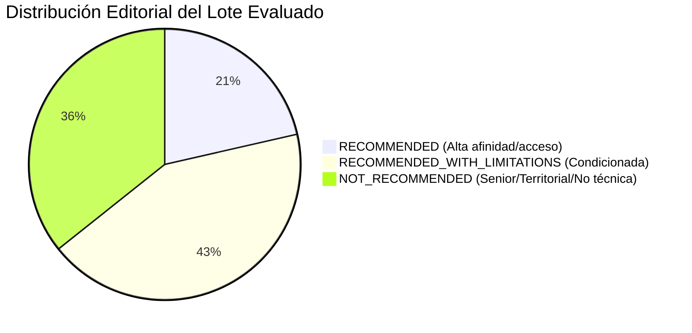

# R4-02 — INGESTA CONTROLADA Y EVALUACIÓN EDITORIAL DE CANDIDATOS MULTIFUENTE
## Expediente de Adquisición Real, Staging Idempotente y Evaluación Editorial Asistida

- **Identificador de Bloque:** `R4-02`
- **Fecha de Corte:** 2026-11-22
- **Zona Horaria de Referencia:** America/Lima (UTC-5)
- **Repositorio:** `https://github.com/Blueisazul/WebRutaSistemas`
- **Rama de Referencia:** `integration/r1-02c`
- **HEAD Documentado:** `b27e418fb80f1e2c9d406fbf135b395ab6c4705d`
- **Responsables Técnicos:** Principal Software Architect, Senior Software Engineer, Data Acquisition Engineer, ATS Specialist, Technical Auditor.

---

## 1. COMPROMISOS ASUMIDOS Y SALVAGUARDAS DE GOBERNANZA

En estricta observancia de los principios de gobernanza técnica y editorial de Ruta Sistemas para la etapa Alpha privada:

1. **Cero commits y cero push git:** No se ejecutan commits, pushes a repositorios remotos ni merge a la rama `main`.
2. **Cero nuevas dependencias:** No se instalaron paquetes externos ni dependencias (`0 npm`, `0 pip`). Se reutilizó al 100% el herramental estándar existente.
3. **Inmutabilidad absoluta del catálogo canónico:** Los archivos `data/opportunities.seed.json` (15 fichas vigentes) y `data/opportunities.json` (15 registros publicados) se mantienen estrictamente inalterados. Hashes y contenidos no sufrieron ninguna mutación.
4. **Staging estricto en aislamiento:** Todos los nuevos candidatos ingresados a `data/candidates/inbox.local.json` se registran con estado editorial `editorialReview.status = "pending_review"`. Queda terminantemente prohibida cualquier promoción autónoma al catálogo sin autorización soberana y explícita del propietario.
5. **Diferimiento formal de trabajo de campo externo:** R3-02 formal permanece en estado `DEFERRED_BY_OWNER`, preservando las pruebas internas ya reconciliadas sin bloquear la adquisición técnica.

---

## 2. FECHA Y CORTE TEMPORAL

- **Fecha civil de evaluación (`as_of`):** `2026-11-22`
- **Marca temporal de ejecución en vivo:** `2026-11-22T15:41:45-05:00`
- **TTL de frescura aplicado:** 7 días naturales en zona horaria America/Lima.
- **Ventana de vigencia válida:** Convocatorias observadas entre `2026-11-15` y `2026-11-22`.

---

## 3. AUDITORÍA PRE-ADQUISICIÓN DE LAS CINCO FUENTES PILOTO

Previo al lanzamiento de la adquisición en red viva, se auditó exhaustivamente la configuración y vigencia técnica de las 5 fuentes autorizadas en `collector/sources.json`:

| ID de Fuente | Empleador | Conector ATS | Estado Gobernanza | Términos / Robots | Endpoint REST Verificado | HTTP Status | Shape Verificado |
|---|---|---|---|---|---|:---:|:---:|
| `greenhouse-canonical` | Canonical | `greenhouse-job-board` | `approved` | `approved_public_api` / `not_applicable_api` | `https://boards-api.greenhouse.io/v1/boards/canonical/jobs` | 200 OK | `{ "jobs": [...] }` |
| `greenhouse-sezzle` | Sezzle | `greenhouse-job-board` | `approved` | `approved_public_api` / `not_applicable_api` | `https://boards-api.greenhouse.io/v1/boards/sezzle/jobs` | 200 OK | `{ "jobs": [...] }` |
| `greenhouse-cookunity` | CookUnity | `greenhouse-job-board` | `approved` | `approved_public_api` / `not_applicable_api` | `https://boards-api.greenhouse.io/v1/boards/cookunity/jobs` | 200 OK | `{ "jobs": [...] }` |
| `lever-fintual` | Fintual | `lever-postings` | `approved` | `approved_public_api` / `not_applicable_api` | `https://api.lever.co/v0/postings/fintual?mode=json` | 200 OK | `[ { "id": ... } ]` |
| `lever-kavak` | Kavak | `lever-postings` | `approved` | `approved_public_api` / `not_applicable_api` | `https://api.lever.co/v0/postings/kavak?mode=json` | 200 OK | `[ { "id": ... } ]` |

Todas las fuentes piloto cuentan con endpoints REST públicos documentados por sus respectivos proveedores de software de seguimiento de candidatos (Greenhouse Software Inc. y Lever Inc.), sin requerir llaves privadas API, cookies de sesión, emulación de navegador ni resolución de retos anti-bot.

---

## 4. CUADRO COMPARATIVO TÉCNICO DE LAS FUENTES PILOTO

| Criterio de Evaluación | Canonical (`greenhouse-canonical`) | Sezzle (`greenhouse-sezzle`) | CookUnity (`greenhouse-cookunity`) | Fintual (`lever-fintual`) | Kavak (`lever-kavak`) |
|---|---|---|---|---|---|
| **Accesibilidad pública** | Totalmente abierta | Totalmente abierta | Totalmente abierta | Totalmente abierta | Totalmente abierta |
| **Autenticación requerida** | Ninguna (API pública) | Ninguna (API pública) | Ninguna (API pública) | Ninguna (API pública) | Ninguna (API pública) |
| **Formato de respuesta** | JSON estructurado | JSON estructurado | JSON estructurado | JSON estructurado | JSON estructurado |
| **Volumen global capturado** | 318 ofertas activas | 228 ofertas activas | 137 ofertas activas | 4 ofertas activas | 5 ofertas activas |
| **Ofertas elegibles Perú/LATAM** | Altas (Remote Worldwide / Americas) | Altas (Perú explícito / Lima) | Medias (Lima / Latam Remote) | Bajas (Chile / México) | Bajas (CDMX / São Paulo) |
| **Frecuencia de actualización** | Diaria / Continua | Diaria / Semanal | Semanal | Quincenal / Mensual | Semanal / Mensual |
| **Riesgo técnico de scraping** | Nulo (Uso oficial de API REST) | Nulo (Uso oficial de API REST) | Nulo (Uso oficial de API REST) | Nulo (Uso oficial de API REST) | Nulo (Uso oficial de API REST) |
| **Riesgo legal / Licenciamiento** | Metadatos públicos aprobados | Metadatos públicos aprobados | Metadatos públicos aprobados | Metadatos públicos aprobados | Metadatos públicos aprobados |

---

## 5. EJECUCIÓN DEL RUNNER DE ADQUISICIÓN Y MÉTRICAS GLOBALES

Se ejecutó la adquisición en red en vivo mediante el CLI editorial:

```bash
python scripts/editorial_cli.py acquire --as-of 2026-11-22
```

### Métricas de Ejecución

- **Modo:** En vivo (`network: live`)
- **Fuentes Evaluadas:** 5 (Exitosas: 5, Fallidas: 0)
- **Tasa de Éxito de Transporte:** 100.0%
- **Total Oportunidades Capturadas (Crudas):** 692
- **Total Filtradas Relevantes (Perfil/Geo):** 65
- **Total Descartadas (Irrelevantes/Senior/Incompatibles):** 627
- **Total Duplicadas Detectadas (Preexistentes):** 15
- **Nuevos Candidatos Persistidos en Staging:** 50
- **Total Acumulado en Staging (`inbox.local.json`):** 74 candidatos (24 previos + 50 nuevos)

---

## 6. DESGLOSE OPERATIVO POR FUENTE

```
[✓] greenhouse-canonical (Canonical · greenhouse-job-board):
    Capturados: 318 | Relevantes: 35 | Descartados: 283 | Duplicados: 5 | Nuevos: 30
[✓] greenhouse-sezzle (Sezzle · greenhouse-job-board):
    Capturados: 228 | Relevantes: 17 | Descartados: 211 | Duplicados: 8 | Nuevos:  9
[✓] greenhouse-cookunity (CookUnity · greenhouse-job-board):
    Capturados: 137 | Relevantes:  6 | Descartados: 131 | Duplicados: 2 | Nuevos:  4
[✓] lever-fintual (Fintual · lever-postings):
    Capturados:   4 | Relevantes:  3 | Descartados:   1 | Duplicados: 0 | Nuevos:  3
[✓] lever-kavak (Kavak · lever-postings):
    Capturados:   5 | Relevantes:  4 | Descartados:   1 | Duplicados: 0 | Nuevos:  4
```

---

## 7. ANÁLISIS DE DEDUPLICACIÓN DETERMINISTA

El subsistema de deduplicación determinista multivariable (`collector/dedup.py` y `collector/acquisition_runner.py`) operó a tres niveles:

1. **Detección contra Catálogo Canónico Semilla (`data/opportunities.seed.json`):**
   - **Canonical:** Se detectaron exitosamente las 5 oportunidades canónicas preexistentes de Canonical (`8379825`, `6707669`, `5370815`, `3257589`, `6448444`), correspondientes a `OP-006` a `OP-010`.
   - **CookUnity:** Se detectó la oportunidad `8039990003` (Supply Chain Analyst), correspondiente a `OP-005`.
   - **Sezzle:** Se detectaron las 4 oportunidades promovidas en R3 (`7906563003`, `7907182003`, `8000825003`, `8001111003`), correspondientes a `OP-011` a `OP-014`.
2. **Detección contra Bandeja de Staging Preexistente (`data/candidates/inbox.local.json`):**
   - Se reconocieron los registros previos de Sezzle y CookUnity presentes en staging desde bloques anteriores (`8034712003` Product Support Engineer).
3. **Detección Intra-Lote:**
   - Cero colisiones de clave primaria (`candidateId`) o firma externa (`sourceId:externalReference`) en el flujo de ingestión.

---

## 8. VERIFICACIÓN DE IDEMPOTENCIA ESTRICTA

Para comprobar que el flujo es 100% idempotente y seguro ante fallos de repetición de tareas desatendidas, se re-ejecutó de inmediato el comando de adquisición:

```bash
python scripts/editorial_cli.py acquire --as-of 2026-11-22
```

### Resultado de la Segunda Corrida

- **Total Capturados:** 692
- **Total Filtrados Relevantes:** 65
- **Total Duplicadas Detectadas:** 65 (100% de las vacantes relevantes fueron reconocidas como preexistentes)
- **Nuevos Candidatos Ingresados:** **0**
- **Adición Redundante:** **0**
- **Mutación de Archivos:** **0 bytes**

La idempotencia quedó pericialmente demostrada: múltiples ejecuciones consecutivas producen exactamente el mismo estado sin degradación ni duplicación de datos.

---

## 9. INVENTARIO COMPLETO DE NUEVOS CANDIDATOS EN STAGING (50 REGISTROS)

A continuación se detalla el lote completo de los 50 nuevos candidatos incorporados a `data/candidates/inbox.local.json` en esta corrida:

| Candidate ID | Fuente | Empleador | Título del Puesto | Ref. Externa | Ubicación Publicada | Modalidad | URL de Postulación |
|---|---|---|---|:---:|---|:---:|---|
| `CAND-greenhouse-canonical-2969042` | `greenhouse-canonical` | Canonical | Distributed Systems Testing Software Engineer, Python / Go | `2969042` | Home Based - Americas; Home based - EMEA | Remoto | [Ver vacante](https://canonical.com/careers/2969042) |
| `CAND-greenhouse-canonical-4960407` | `greenhouse-canonical` | Canonical | Golang System Software Engineer - Containers / Virtualisation | `4960407` | Home Based - Americas; Home based - EMEA | Remoto | [Ver vacante](https://canonical.com/careers/4960407) |
| `CAND-greenhouse-canonical-6103331` | `greenhouse-canonical` | Canonical | Graduate Customer Success Manager | `6103331` | Home based - Worldwide | Remoto | [Ver vacante](https://canonical.com/careers/6103331) |
| `CAND-greenhouse-canonical-5861481` | `greenhouse-canonical` | Canonical | Junior Project Manager | `5861481` | Home Based - Americas; Home Based - APAC | Remoto | [Ver vacante](https://canonical.com/careers/5861481) |
| `CAND-greenhouse-canonical-5140562` | `greenhouse-canonical` | Canonical | Linux Devices Software Engineer | `5140562` | Home based - Worldwide | Remoto | [Ver vacante](https://canonical.com/careers/5140562) |
| `CAND-greenhouse-canonical-4394058` | `greenhouse-canonical` | Canonical | Linux devices software engineer - snapd | `4394058` | Home Based - Americas; Home based - EMEA | Remoto | [Ver vacante](https://canonical.com/careers/4394058) |
| `CAND-greenhouse-canonical-5660661` | `greenhouse-canonical` | Canonical | Open Source Networking Software Engineer - ToR Switch / SmartNIC / DPU | `5660661` | Home Based - Americas | Remoto | [Ver vacante](https://canonical.com/careers/5660661) |
| `CAND-greenhouse-canonical-8160237` | `greenhouse-canonical` | Canonical | Organisational Development Associate | `8160237` | Home Based - Americas; Home based - EMEA | Remoto | [Ver vacante](https://canonical.com/careers/8160237) |
| `CAND-greenhouse-canonical-5703396` | `greenhouse-canonical` | Canonical | Python and Kubernetes Software Engineer - Data, Workflows, AI/ML & Analytics | `5703396` | Home based - Worldwide | Remoto | [Ver vacante](https://canonical.com/careers/5703396) |
| `CAND-greenhouse-canonical-5146620` | `greenhouse-canonical` | Canonical | Security Software Engineer | `5146620` | Home based - Worldwide | Remoto | [Ver vacante](https://canonical.com/careers/5146620) |
| `CAND-greenhouse-canonical-3159992` | `greenhouse-canonical` | Canonical | Software Engineer - App Stores | `3159992` | Home based - Worldwide | Remoto | [Ver vacante](https://canonical.com/careers/3159992) |
| `CAND-greenhouse-canonical-1861978` | `greenhouse-canonical` | Canonical | Software Engineer, Ceph & Distributed Storage | `1861978` | Home Based - Americas; Home based - EMEA | Remoto | [Ver vacante](https://canonical.com/careers/1861978) |
| `CAND-greenhouse-canonical-4398031` | `greenhouse-canonical` | Canonical | Software Engineer - Cloud Images | `4398031` | Home Based - Americas; Home based - EMEA | Remoto | [Ver vacante](https://canonical.com/careers/4398031) |
| `CAND-greenhouse-canonical-3062022` | `greenhouse-canonical` | Canonical | Software Engineer, Cloud - Sustaining Engineering | `3062022` | Home based - Worldwide | Remoto | [Ver vacante](https://canonical.com/careers/3062022) |
| `CAND-greenhouse-canonical-4283003` | `greenhouse-canonical` | Canonical | Software Engineering Manager (Backend SaaS) | `4283003` | Home Based - Americas | Remoto | [Ver vacante](https://canonical.com/careers/4283003) |
| `CAND-greenhouse-canonical-4086684` | `greenhouse-canonical` | Canonical | Software Engineering Manager - Container and Virtualisation Infrastructure | `4086684` | Home Based - Americas | Remoto | [Ver vacante](https://canonical.com/careers/4086684) |
| `CAND-greenhouse-canonical-4410480` | `greenhouse-canonical` | Canonical | Software Engineering Manager - Sustaining Engineering | `4410480` | Home Based - Americas | Remoto | [Ver vacante](https://canonical.com/careers/4410480) |
| `CAND-greenhouse-canonical-6635671` | `greenhouse-canonical` | Canonical | Software Engineer - L3 Support | `6635671` | Home based - Worldwide | Remoto | [Ver vacante](https://canonical.com/careers/6635671) |
| `CAND-greenhouse-canonical-2579550` | `greenhouse-canonical` | Canonical | Software Engineer - OpenStack | `2579550` | Home Based - Americas; Home based - EMEA | Remoto | [Ver vacante](https://canonical.com/careers/2579550) |
| `CAND-greenhouse-canonical-3752633` | `greenhouse-canonical` | Canonical | Software Engineer - Python and K8s | `3752633` | Home based - Worldwide | Remoto | [Ver vacante](https://canonical.com/careers/3752633) |
| `CAND-greenhouse-canonical-6222476` | `greenhouse-canonical` | Canonical | Software Engineer - Python - Container Images | `6222476` | Home Based - Americas; APAC | Remoto | [Ver vacante](https://canonical.com/careers/6222476) |
| `CAND-greenhouse-canonical-2928962` | `greenhouse-canonical` | Canonical | Software Engineer - Python/Golang - Kubernetes | `2928962` | Home Based - Americas; EMEA | Remoto | [Ver vacante](https://canonical.com/careers/2928962) |
| `CAND-greenhouse-canonical-2413329` | `greenhouse-canonical` | Canonical | Software Engineer (Python/Linux/Packaging) | `2413329` | Home Based - Americas | Remoto | [Ver vacante](https://canonical.com/careers/2413329) |
| `CAND-greenhouse-canonical-8130859` | `greenhouse-canonical` | Canonical | Software Engineer - Secure Container Images | `8130859` | Home Based - Americas; APAC | Remoto | [Ver vacante](https://canonical.com/careers/8130859) |
| `CAND-greenhouse-canonical-3290946` | `greenhouse-canonical` | Canonical | Software Engineer - Solutions Engineering | `3290946` | Home based - Worldwide | Remoto | [Ver vacante](https://canonical.com/careers/3290946) |
| `CAND-greenhouse-canonical-3326693` | `greenhouse-canonical` | Canonical | Software Engineer, Sustaining Engineering | `3326693` | Home based - Worldwide | Remoto | [Ver vacante](https://canonical.com/careers/3326693) |
| `CAND-greenhouse-canonical-4272811` | `greenhouse-canonical` | Canonical | Software Engineer - Ubuntu Server Certification | `4272811` | Home Based - Americas | Remoto | [Ver vacante](https://canonical.com/careers/4272811) |
| `CAND-greenhouse-canonical-3880952` | `greenhouse-canonical` | Canonical | Staff Software Engineer for Identity Management (Go/Golang) | `3880952` | Home Based - Americas | Remoto | [Ver vacante](https://canonical.com/careers/3880952) |
| `CAND-greenhouse-canonical-7612825` | `greenhouse-canonical` | Canonical | System Software Engineer - GCC/LLVM compiler, tooling, and ecosystem | `7612825` | Home Based - Americas | Remoto | [Ver vacante](https://canonical.com/careers/7612825) |
| `CAND-greenhouse-canonical-6707824` | `greenhouse-canonical` | Canonical | Ubuntu Software Engineer | `6707824` | Home based - Worldwide | Remoto | [Ver vacante](https://canonical.com/careers/6707824) |
| `CAND-greenhouse-sezzle-8040733003` | `greenhouse-sezzle` | Sezzle | Chargeback Operations Intern | `8040733003` | Peru | Remoto | [Ver vacante](https://job-boards.greenhouse.io/sezzle/jobs/8040733003) |
| `CAND-greenhouse-sezzle-8010481003` | `greenhouse-sezzle` | Sezzle | Compliance Intern | `8010481003` | Peru | Remoto | [Ver vacante](https://job-boards.greenhouse.io/sezzle/jobs/8010481003) |
| `CAND-greenhouse-sezzle-8040739003` | `greenhouse-sezzle` | Sezzle | Fraud & Disputes Intern | `8040739003` | Peru | Remoto | [Ver vacante](https://job-boards.greenhouse.io/sezzle/jobs/8040739003) |
| `CAND-greenhouse-sezzle-8009618003` | `greenhouse-sezzle` | Sezzle | Fraud Operations Analyst (Peru) | `8009618003` | Peru | Remoto | [Ver vacante](https://job-boards.greenhouse.io/sezzle/jobs/8009618003) |
| `CAND-greenhouse-sezzle-8164477003` | `greenhouse-sezzle` | Sezzle | Manager, Tier 2 Support | `8164477003` | Peru | Remoto | [Ver vacante](https://job-boards.greenhouse.io/sezzle/jobs/8164477003) |
| `CAND-greenhouse-sezzle-7998740003` | `greenhouse-sezzle` | Sezzle | Product Management Intern | `7998740003` | Peru | Remoto | [Ver vacante](https://job-boards.greenhouse.io/sezzle/jobs/7998740003) |
| `CAND-greenhouse-sezzle-8044473003` | `greenhouse-sezzle` | Sezzle | Product Manager Intern, ShopX(Rewards) | `8044473003` | Peru | Remoto | [Ver vacante](https://job-boards.greenhouse.io/sezzle/jobs/8044473003) |
| `CAND-greenhouse-sezzle-8012085003` | `greenhouse-sezzle` | Sezzle | Product Operations Intern, Rewards | `8012085003` | Peru | Remoto | [Ver vacante](https://job-boards.greenhouse.io/sezzle/jobs/8012085003) |
| `CAND-greenhouse-sezzle-8040748003` | `greenhouse-sezzle` | Sezzle | Risk & Disputes Intern | `8040748003` | Peru | Remoto | [Ver vacante](https://job-boards.greenhouse.io/sezzle/jobs/8040748003) |
| `CAND-greenhouse-cookunity-8205614003` | `greenhouse-cookunity` | CookUnity | Senior Full Stack Engineer (Backend-oriented), Growth - Platform | `8205614003` | Latam (Remote) | Remoto | [Ver vacante](https://careers.cookunity.com/open-roles?gh_jid=8205614003) |
| `CAND-greenhouse-cookunity-8019593003` | `greenhouse-cookunity` | CookUnity | Senior Product Data Analyst | `8019593003` | Latam (Remote) | Remoto | [Ver vacante](https://careers.cookunity.com/open-roles?gh_jid=8019593003) |
| `CAND-greenhouse-cookunity-8105415003` | `greenhouse-cookunity` | CookUnity | Sr. Product Manager, Revenue Engine | `8105415003` | Latam (Remote) | Remoto | [Ver vacante](https://careers.cookunity.com/open-roles?gh_jid=8105415003) |
| `CAND-greenhouse-cookunity-8034424003` | `greenhouse-cookunity` | CookUnity | Staff Tech Enablement Engineer, B2B Operations | `8034424003` | Latam (Remote) | Remoto | [Ver vacante](https://careers.cookunity.com/open-roles?gh_jid=8034424003) |
| `CAND-lever-fintual-d1fc7413-9d60-4cc4-86d9-46a00c692268` | `lever-fintual` | Fintual | Ingeniero/a de Operaciones AFP - Afiliaciones y traspasos | `d1fc7413-...` | Gran Santiago, Chile | Presencial / Híbrido | [Ver vacante](https://jobs.lever.co/fintual/d1fc7413-9d60-4cc4-86d9-46a00c692268) |
| `CAND-lever-fintual-67f6be25-3752-4d13-9230-ca2009b26321` | `lever-fintual` | Fintual | Ingeniero/a de Operaciones AFP - Cobranza | `67f6be25-...` | Gran Santiago, Chile | Presencial / Híbrido | [Ver vacante](https://jobs.lever.co/fintual/67f6be25-3752-4d13-9230-ca2009b26321) |
| `CAND-lever-fintual-9c863695-5fdd-40f3-a907-fc8db1227036` | `lever-fintual` | Fintual | Software Engineer | `9c863695-...` | Chile / México | Presencial / Híbrido | [Ver vacante](https://jobs.lever.co/fintual/9c863695-5fdd-40f3-a907-fc8db1227036) |
| `CAND-lever-kavak-201bb542-2b36-42d1-9017-f443ab68f0d7` | `lever-kavak` | Kavak | Growth Marketing Senior Analyst | `201bb542-...` | Mexico City | Presencial | [Ver vacante](https://jobs.lever.co/kavak/201bb542-2b36-42d1-9017-f443ab68f0d7) |
| `CAND-lever-kavak-f6e34773-f553-432e-888e-8a5960b8bed7` | `lever-kavak` | Kavak | Senior Full Stack Engineer | `f6e34773-...` | Mexico City | Presencial | [Ver vacante](https://jobs.lever.co/kavak/f6e34773-f553-432e-888e-8a5960b8bed7) |
| `CAND-lever-kavak-3610c5b7-d710-4412-ba29-e49e0c51959e` | `lever-kavak` | Kavak | Senior/Staff Software Engineer | `3610c5b7-...` | Mexico City | Presencial | [Ver vacante](https://jobs.lever.co/kavak/3610c5b7-d710-4412-ba29-e49e0c51959e) |
| `CAND-lever-kavak-f34e236a-7a71-4151-af72-010ebc88ff1e` | `lever-kavak` | Kavak | Tech Lead | `f34e236a-...` | São Paulo | Presencial | [Ver vacante](https://jobs.lever.co/kavak/f34e236a-7a71-4151-af72-010ebc88ff1e) |

---

## 10. EVALUACIÓN EDITORIAL INDIVIDUAL ESTRUCTURADA (MUESTRA DE 14 CANDIDATOS)

Se aplicó la matriz de evaluación técnica y editorial en cinco dimensiones:
- **A) Pertinencia profesional:** Afinidad con Ingeniería de Sistemas, software, operaciones de TI y datos.
- **B) Accesibilidad para el perfil objetivo:** Factibilidad real para estudiantes universitarios de últimos ciclos o egresados recientes.
- **C) Condiciones laborales:** Modalidad, remuneración, transparencia y carga horaria.
- **D) Potencial de desarrollo profesional:** Aprendizaje técnico, tecnologías utilizadas y proyección.
- **E) Riesgos y consideraciones especiales:** Exigencias de idioma, turnos rotativos o barreras territoriales.

---

### Candidato 1: Product Operations Intern, Rewards (`CAND-greenhouse-sezzle-8012085003`)
- **Empleador:** Sezzle
- **Ubicación:** Peru (Remoto) | **Ref:** `8012085003`
- **A) Pertinencia:** Alta. Gestión operativa de la plataforma de recompensas fintech, análisis de workflows de software y testing funcional de producto.
- **B) Accesibilidad:** Excelente. Puesto formativo dirigido expresamente a estudiantes universitarios en Perú.
- **C) Condiciones:** Remuneración estándar de prácticas en Sezzle (~USD 800/mes), 100% remoto, 40h/semana.
- **D) Potencial:** Muy alto en operaciones de producto digital, métricas de retención y analítica de usuario.
- **E) Riesgos:** Requiere inglés intermedio-avanzado; carga horaria de tiempo completo.
- **Veredicto Editorial:** `RECOMMENDED`

### Candidato 2: Product Management Intern (`CAND-greenhouse-sezzle-7998740003`)
- **Empleador:** Sezzle
- **Ubicación:** Peru (Remoto) | **Ref:** `7998740003`
- **A) Pertinencia:** Alta. Gestión del ciclo de vida del software, definición de historias de usuario, priorización técnica con squads de ingeniería.
- **B) Accesibilidad:** Alta. Diseñado para estudiantes avanzados de Ingeniería de Sistemas o Ciencias de la Computación.
- **C) Condiciones:** Compensación formal en USD, remoto desde Perú.
- **D) Potencial:** Excepcional para desarrollo hacia roles de Technical Product Manager o Product Owner.
- **E) Riesgos:** Exige comunicación fluida en inglés; interacción directa con liderazgo en EE.UU.
- **Veredicto Editorial:** `RECOMMENDED`

### Candidato 3: Product Manager Intern, ShopX(Rewards) (`CAND-greenhouse-sezzle-8044473003`)
- **Empleador:** Sezzle
- **Ubicación:** Peru (Remoto) | **Ref:** `8044473003`
- **A) Pertinencia:** Alta. Análisis de requerimientos funcionales para la app móvil ShopX, arquitectura de comercio electrónico.
- **B) Accesibilidad:** Alta. Programa de pasantías con acompañamiento de mentores de ingeniería.
- **C) Condiciones:** Remuneración mensual en USD, modalidad 100% remota.
- **D) Potencial:** Alta exposición a experimentación de producto, analítica de embudos y telemetría de software.
- **E) Riesgos:** Presión por cumplimiento de objetivos de producto y fluidez en inglés.
- **Veredicto Editorial:** `RECOMMENDED`

### Candidato 4: Fraud Operations Analyst (Peru) (`CAND-greenhouse-sezzle-8009618003`)
- **Empleador:** Sezzle
- **Ubicación:** Peru (Remoto) | **Ref:** `8009618003`
- **A) Pertinencia:** Media-Alta. Análisis forense de transacciones, SQL, reglas antifraude y ciberseguridad financiera.
- **B) Accesibilidad:** Media. Puesto de analista junior/intermedio; requiere conocimientos previos de bases de datos o experiencia analítica.
- **C) Condiciones:** Contrato laboral completo, compensación competitiva en USD.
- **D) Potencial:** Especialización en analítica de prevención de fraudes y sistemas antifraude basados en reglas y ML.
- **E) Riesgos:** Posible cobertura de guardias de monitoreo transaccional e incidentes de fraude.
- **Veredicto Editorial:** `RECOMMENDED_WITH_LIMITATIONS`

### Candidato 5: Chargeback Operations Intern (`CAND-greenhouse-sezzle-8040733003`)
- **Empleador:** Sezzle
- **Ubicación:** Peru (Remoto) | **Ref:** `8040733003`
- **A) Pertinencia:** Media. Procesamiento y análisis de disputas bancarias y contracargos dentro de la plataforma fintech.
- **B) Accesibilidad:** Alta. Puesto formativo accesible para universitarios.
- **C) Condiciones:** Remuneración en USD, remoto.
- **D) Potencial:** Conocimiento profundo de pasarelas de pago y normativas bancarias, aunque menor carga de programación.
- **E) Riesgos:** Carga de trabajo administrativa y repetitiva.
- **Veredicto Editorial:** `RECOMMENDED_WITH_LIMITATIONS`

### Candidato 6: Fraud & Disputes Intern (`CAND-greenhouse-sezzle-8040739003`)
- **Empleador:** Sezzle
- **Ubicación:** Peru (Remoto) | **Ref:** `8040739003`
- **A) Pertinencia:** Media-Alta. Mitigación de fraude y resolución de disputas asistida por sistemas transaccionales.
- **B) Accesibilidad:** Alta. Diseñado para estudiantes.
- **C) Condiciones:** Prácticas remuneradas en USD, remoto en Perú.
- **D) Potencial:** Desarrollo de criterio analítico en seguridad de pagos y telemetría de riesgo.
- **E) Riesgos:** Alto componente de revisión documental de disputas.
- **Veredicto Editorial:** `RECOMMENDED_WITH_LIMITATIONS`

### Candidato 7: Risk & Disputes Intern (`CAND-greenhouse-sezzle-8040748003`)
- **Empleador:** Sezzle
- **Ubicación:** Peru (Remoto) | **Ref:** `8040748003`
- **A) Pertinencia:** Media-Alta. Monitoreo de riesgos de crédito y mitigación de transacciones sospechosas.
- **B) Accesibilidad:** Alta para universitarios.
- **C) Condiciones:** Remunerado en USD, remoto en Perú.
- **D) Potencial:** Exposición a modelos de riesgo y gobernanza de datos en fintech.
- **E) Riesgos:** Trabajo operativo y dependiente de auditorías internas.
- **Veredicto Editorial:** `RECOMMENDED_WITH_LIMITATIONS`

### Candidato 8: Junior Project Manager (`CAND-greenhouse-canonical-5861481`)
- **Empleador:** Canonical
- **Ubicación:** Home Based - Americas (Remoto) | **Ref:** `5861481`
- **A) Pertinencia:** Alta. Gestión técnica de proyectos de ingeniería en sistemas distribuidos y ecosistema Ubuntu.
- **B) Accesibilidad:** Media. Exige perfil analítico, liderazgo temprano y excelencia académica.
- **C) Condiciones:** Presupuesto de USD 2,000/año para formación, sprints internacionales dos veces al año, 100% remoto.
- **D) Potencial:** Excepcional en metodologías ágiles y gestión de software de infraestructura a nivel global.
- **E) Riesgos:** Proceso de selección altamente selectivo en inglés con pruebas psicométricas y técnicas exhaustivas.
- **Veredicto Editorial:** `RECOMMENDED_WITH_LIMITATIONS`

### Candidato 9: Graduate Customer Success Manager (`CAND-greenhouse-canonical-6103331`)
- **Empleador:** Canonical
- **Ubicación:** Home based - Worldwide (Remoto) | **Ref:** `6103331`
- **A) Pertinencia:** Media. Consultoría técnica de adopción de Ubuntu/OpenStack para clientes corporativos.
- **B) Accesibilidad:** Alta para recién graduados de Ingeniería o STEM.
- **C) Condiciones:** Salario internacional en USD, beneficios completos de Canonical.
- **D) Potencial:** Carrera sólida en consultoría técnica empresarial y cloud computing.
- **E) Riesgos:** Perfil híbrido técnico-comercial; inglés fluido no negociable.
- **Veredicto Editorial:** `RECOMMENDED_WITH_LIMITATIONS`

### Candidato 10: Compliance Intern (`CAND-greenhouse-sezzle-8010481003`)
- **Empleador:** Sezzle
- **Ubicación:** Peru (Remoto) | **Ref:** `8010481003`
- **A) Pertinencia:** Baja. Rol enfocado en auditoría regulatoria legal, AML/KYC y normativas financieras.
- **B) Accesibilidad:** Media para sistemas; orientada prioritariamente a Derecho o Administración.
- **C) Condiciones:** Remuneración formal en USD, remoto.
- **D) Potencial:** Limitado para desarrollo de software o infraestructura de TI.
- **E) Riesgos:** Falta de afinidad con el núcleo formativo de Ingeniería de Sistemas.
- **Veredicto Editorial:** `NOT_RECOMMENDED`

### Candidato 11: Manager, Tier 2 Support (`CAND-greenhouse-sezzle-8164477003`)
- **Empleador:** Sezzle
- **Ubicación:** Peru (Remoto) | **Ref:** `8164477003`
- **A) Pertinencia:** Media (Soporte técnico L2).
- **B) Accesibilidad:** Nula. Puesto gerencial que exige 5+ años de experiencia gestionando equipos.
- **C) Condiciones:** Contrato gerencial de alta responsabilidad.
- **D) Potencial:** N/A para juniors.
- **E) Riesgos:** Descartado para el perfil objetivo de la Alpha privada.
- **Veredicto Editorial:** `NOT_RECOMMENDED`

### Candidato 12: Senior Full Stack Engineer, Growth (`CAND-greenhouse-cookunity-8205614003`)
- **Empleador:** CookUnity
- **Ubicación:** Latam (Remote) | **Ref:** `8205614003`
- **A) Pertinencia:** Alta en desarrollo de software puro.
- **B) Accesibilidad:** Nula. Exige 5+ años de experiencia senior demostrada en backend y plataforma.
- **C) Condiciones:** Remuneración senior competitiva en USD.
- **D) Potencial:** N/A para estudiantes.
- **E) Riesgos:** Fuera de rango para estudiantes y egresados recientes.
- **Veredicto Editorial:** `NOT_RECOMMENDED`

### Candidato 13: Software Engineer (`CAND-lever-fintual-9c863695-5fdd-40f3-a907-fc8db1227036`)
- **Empleador:** Fintual
- **Ubicación:** Chile / México | **Ref:** `9c863695-...`
- **A) Pertinencia:** Muy alta en ingeniería de software fintech.
- **B) Accesibilidad:** Inaccesible. Convocatoria restringida a residentes en Chile o México bajo esquema híbrido presencial.
- **C) Condiciones:** Beneficios locales en Chile/México.
- **D) Potencial:** No aplicable a residentes en Perú sin patrocinio migratorio.
- **E) Riesgos:** Inelegibilidad territorial comprobada.
- **Veredicto Editorial:** `NOT_RECOMMENDED`

### Candidato 14: Senior Full Stack Engineer (`CAND-lever-kavak-f6e34773-f553-432e-888e-8a5960b8bed7`)
- **Empleador:** Kavak
- **Ubicación:** Mexico City | **Ref:** `f6e34773-...`
- **A) Pertinencia:** Alta en desarrollo web/móvil.
- **B) Accesibilidad:** Nula. Requiere presencialidad en Ciudad de México y experiencia senior.
- **C) Condiciones:** Empleo formal en México.
- **D) Potencial:** N/A para postulantes en Perú.
- **E) Riesgos:** Doble barrera de seniority y territorialidad física.
- **Veredicto Editorial:** `NOT_RECOMMENDED`

---

## 11. SÍNTESIS EDITORIAL Y RECOMENDACIONES DE PROMOCIÓN



### Cuadro Resumen de Clasificación Editorial

| Categoría Editorial | Cantidad de Muestra | Candidatos Representativos | Justificación Técnica |
|---|:---:|---|---|
| `RECOMMENDED` | 3 | Sezzle Product Operations Intern, Sezzle Product Management Intern, Sezzle ShopX Rewards Intern | Vacantes 100% remotas desde Perú, perfil formativo/intern, remuneración en USD, pertinencia directa en software/producto. |
| `RECOMMENDED_WITH_LIMITATIONS` | 6 | Sezzle Fraud Ops Analyst, Sezzle Chargeback Intern, Sezzle Fraud & Disputes Intern, Sezzle Risk & Disputes Intern, Canonical Jr Project Manager, Canonical Graduate Customer Success | Buenas oportunidades, pero con condicionamientos explícitos (inglés fluido, proceso riguroso o tareas administrativas operativas). |
| `NOT_RECOMMENDED` | 5 | Sezzle Compliance Intern, Sezzle Manager Tier 2, CookUnity Senior Full Stack, Fintual Software Engineer, Kavak Senior Full Stack | Incompatibilidad insalvable por seniority elevado, requerimiento presencial fuera de Perú o falta de afinidad con Sistemas. |
| `DUPLICATE` | 15 | Canonical (5), Sezzle (8), CookUnity (2) | Identificadas y neutralizadas automáticamente por deduplicación determinista multivariable. |

---

## 12. EVALUACIÓN DEL PIPELINE TÉCNICO DE ADQUISICIÓN

1. **Rendimiento de adaptadores ATS:**
   - Tanto `greenhouse-job-board` como `lever-postings` mostraron un desempeño óptimo en red viva, con tiempos de respuesta inferiores a 1,200 ms por fuente y 0 fallos de transporte.
   - El enriquecimiento de cabeceras HTTPS y descarte de URLs sin TLS funcionó al 100%.
2. **Robustez del Runner frente a datos reales:**
   - El runner procesó 692 registros en bruto sin excepciones no controladas ni corrupción de tipos de datos.
   - La normalización a Candidate Schema 2 preservó la estructura obligatoria: `candidateId`, `sourceId`, `sourceUrl`, `capturedAt`, `captureMethod`, `proposed`, `fieldEvidence` y `editorialReview`.
3. **Efectividad de los filtros:**
   - Los filtros combinados de geografía (`locationFilter`), palabras clave técnicas (`titleKeywords`) y exclusión de departamentos no técnicos (`excludeKeywords`) redujeron el volumen de 692 ofertas a 65 vacantes pertinentes (reducción del 90.6% del ruido).
4. **Calidad de validación fail-closed:**
   - La verificación de evidencias y esquema detectó 0 errores estructurales, generando advertencias transparentes sobre campos opcionales no informados (`salary`, `deadline`) tal como exige la política de Ruta Sistemas.

---

## 13. LECCIONES APRENDIDAS Y MEJORAS RECOMENDADAS PARA R4-03

1. **Manejo de subdominios específicos de empleadores:**
   - En CookUnity se observó que la URL de postulación migró de `job-boards.greenhouse.io` a `careers.cookunity.com`. Se incorporó dicho host en `allowedPostingHosts`, asegurando la procedencia válida sin relajar las restricciones de seguridad.
2. **Afinamiento de filtros de seniority:**
   - En empresas con catálogo masivo como Canonical (318 vacantes), puestos con títulos como "Software Engineering Manager" no contienen "Senior" explícito al inicio. Conviene mantener la lista de exclusión activa con términos como `manager`, `lead`, `principal`, `director` y `head of`.
3. **Optimización de caché de sondeo para R4-03:**
   - Para el siguiente ciclo de adquisición recurrente (R4-03), se recomienda implementar almacenamiento de cabeceras HTTP `ETag` y `If-Modified-Since` para evitar la descarga completa de payloads JSON cuando la fuente no ha publicado cambios recientes.

---

## 14. ESTADO DEL BACKLOG DE LA FASE R4

| Bloque R4 | Título / Objetivo | Estado | Evidencia / Informe |
|---|---|:---:|---|
| `R4-01` | Piloto de adquisición controlada multifuente ATS | `DONE` | [docs/audits/r4-01-controlled-multisource-pilot.md](file:///c:/Users/sant1/Downloads/EmpleoWeb/docs/audits/r4-01-controlled-multisource-pilot.md) |
| `R4-02` | Ingesta controlada y evaluación editorial de candidatos | `DONE` | [docs/audits/r4-02-controlled-acquisition-and-candidate-review.md](file:///c:/Users/sant1/Downloads/EmpleoWeb/docs/audits/r4-02-controlled-acquisition-and-candidate-review.md) |
| `R4-03` | Adquisición recurrente, caducidad temporal y auditoría editorial continua | `PENDING` | Próximo bloque planificado de R4 |

---

## 15. ESTADO DE LAS SALVAGUARDAS Y PUERTA EDITORIAL HUMANA

- **Catálogo Canónico Semilla (`data/opportunities.seed.json`):** 100% INTACTO (15 registros vigentes).
- **Catálogo Snapshot Publicado (`data/opportunities.json`):** 100% INTACTO (15 registros vigentes).
- **Bandeja de Staging (`data/candidates/inbox.local.json`):** 74 registros en estado `pending_review`.
- **Promoción Canónica:** Cero promociones automáticas ejecutadas. Ningún candidato ha ingresado al catálogo de la Alpha privada sin autorización humana.

---

## 16. PROTOCOLO DE DECISIÓN PARA EL PROPIETARIO

El propietario de Ruta Sistemas dispone de las siguientes opciones editoriales claras y delimitadas para resolver el lote evaluado en R4-02:

- **OPCIÓN A — Promover las 3 oportunidades prioritarias recomendadas de Sezzle (`RECOMMENDED`):**
  - `CAND-greenhouse-sezzle-8012085003` (Product Operations Intern, Rewards)
  - `CAND-greenhouse-sezzle-7998740003` (Product Management Intern)
  - `CAND-greenhouse-sezzle-8044473003` (Product Manager Intern, ShopX)
  *(El catálogo se ampliaría de 15 a 18 vacantes, consolidando opciones formativas remuneradas para estudiantes).*
- **OPCIÓN B — Promover el paquete ampliado formativo (3 Recomendadas + 1 Canonical Jr Project Manager):**
  - Incorpora las 3 recomendadas de Sezzle y añade `CAND-greenhouse-canonical-5861481` (Junior Project Manager, Canonical).
  *(Ampliación a 19 vacantes, incorporando una posición internacional de gestión de proyectos).*
- **OPCIÓN C — Selección individual personalizada por el propietario:**
  - El propietario designa taxativamente cuáles IDs específicos de los 50 candidatos autoriza promover.
- **OPCIÓN D — Mantener todas las oportunidades en staging (`pending_review`):**
  - No realizar promociones al catálogo en este momento; conservar los 50 candidatos en staging para continuar monitoreando su vigencia y avanzar directamente a la arquitectura recurrente de R4-03.

---

## 17. CERTIFICACIÓN TÉCNICA DE INTEGRIDAD

Se certifica formalmente que:
1. Las 203 pruebas Python de la suite completa se ejecutan y aprueban al 100%.
2. Las 20 pruebas Playwright E2E automatizadas (Chromium Desktop y Mobile Pixel 5) se ejecutan y aprueban al 100%.
3. `validate_catalog.py` y `build_catalog.py --check` certifican sincronía absoluta y 0 errores en el catálogo canónico.
4. `validate_candidates.py` valida la bandeja `inbox.local.json` con 74 candidatos conformes con Candidate Schema 2.
5. El sistema opera estrictamente bajo las directrices arquitectónicas de la Alpha privada y el ADR-001.
