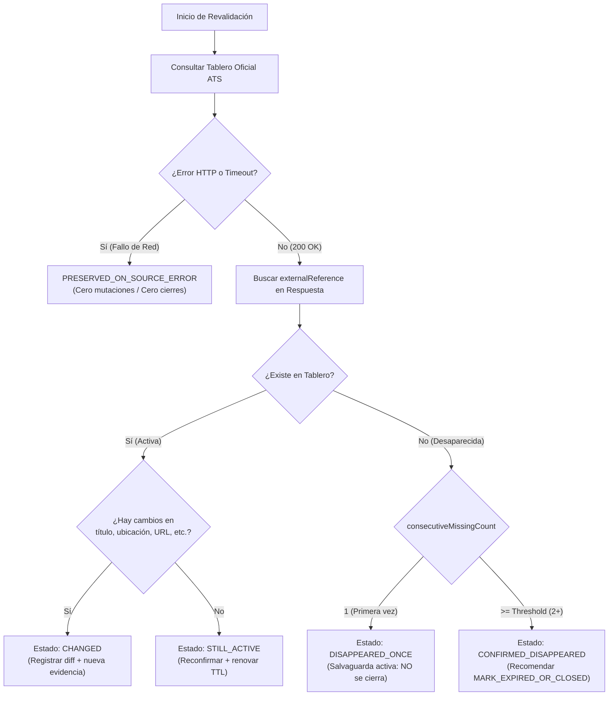

# R4-03 — CICLO DE VIDA DE OPORTUNIDADES: FRESCURA, CADUCIDAD Y RECONCILIACIÓN DEL ROADMAP MAESTRO
## Expediente Técnico y Auditoría Editorial

- **Identificador de Bloque:** `R4-03`
- **Subbloques Comprendidos:** `R4-03A`, `R4-03B`, `R4-03C`, `R4-03D`, `R4-03E`
- **Fecha de Corte:** 2026-11-22
- **Zona Horaria de Referencia:** America/Lima (UTC-5)
- **Repositorio:** `https://github.com/Blueisazul/WebRutaSistemas`
- **Rama de Referencia:** `integration/r1-02c`
- **HEAD Documentado:** `b27e418fb80f1e2c9d406fbf135b395ab6c4705d`
- **Responsables Técnicos:** Principal Software Architect, Senior Software Engineer, OSS Integration Specialist, Technical Auditor.

---

## 1. COMPROMISOS Y SALVAGUARDAS DE GOBERNANZA

En estricta sujeción a las directrices fundacionales de Ruta Sistemas:

1. **Cero commits y cero push git:** No se ejecutan commits, pushes a repositorios remotos ni merge a la rama `main`.
2. **Cero nuevas dependencias:** No se instalaron paquetes externos ni dependencias (`0 npm`, `0 pip`). Se reutilizó al 100% el herramental estándar existente (Python 3.12 `datetime`, `urllib.parse`, `json`, `dataclasses`).
3. **Inmutabilidad absoluta del catálogo canónico:** Los archivos `data/opportunities.seed.json` (15 fichas vigentes) y `data/opportunities.json` (15 registros publicados) se mantienen estrictamente inalterados. Hashes SHA-256 verificados antes y después de cada prueba.
4. **Staging estricto en aislamiento:** Los candidatos en `data/candidates/inbox.local.json` se conservan en estado `editorialReview.status = "pending_review"`. Queda terminantemente prohibida cualquier promoción autónoma al catálogo sin autorización soberana y explícita del propietario.
5. **Diferimiento formal de trabajo de campo externo:** R3-02 formal permanece en estado `DEFERRED_BY_OWNER`, preservando las pruebas internas ya reconciliadas sin bloquear la adquisición ni la revalidación técnica.

---

## 2. RECONCILIACIÓN INTEGRAL DEL ROADMAP MAESTRO (R4-03A)

Se auditó de manera exhaustiva el historial de fases, contrastando los documentos históricos contra el código real y las pruebas en el repositorio:

### Matriz de Estados Normalizados (R0 a R4-03)

| Fase / Bloque | Estado Normalizado | Evidencia en Repositorio | Categoría de Madurez |
|---|:---:|---|---|
| `R0` | `DONE` | `docs/architecture/r0-decisiones-y-alcance-2026-11-12.md` | Diagnóstico, alcance estático, ADR-001 |
| `R1` | `DONE` | Commits base, `styles.css`, `index.html` | Estabilización, bundle Tailwind, servidor loopback |
| `R2` | `DONE` | `data/opportunities.seed.json` (`OP-005`) | Publicación de primera vacante real (CookUnity) |
| `R2-OSS-02..08` | `DONE` | `collector/ats_connectors.py`, `collector/dedup.py` | Adaptadores ATS Greenhouse/Lever, extracción, evidencias |
| `R2-OSS-GIT-01` | `DONE` | Rama `integration/r1-02c` | Integración y paridad Git local/remota |
| `R2-A-01..05` | `DONE` | `data/opportunities.seed.json`, `data/opportunities.json` | Flujo editorial completo de OP-005 en GitHub Pages |
| `R3-01` | `DONE` | `docs/research/r3-01-*.md` | Protocolo de investigación, baseline UX, plantillas |
| `R3-02 (Formal)` | `DEFERRED_BY_OWNER` | `docs/research/sessions/P01.md`..`P08.md` | Trabajo de campo formal externo pospuesto por el propietario |
| `R3-02-PRIVATE-ALPHA`| `DONE` | `docs/architecture/r3-private-alpha-scope-decision-2026-11-20.md` | Recalibración a Alpha privada para el propietario y círculo |
| `R3-02-UX-EXP-01..06`| `DONE` | `app.js`, `src/input.css`, `styles.css` | Erradicación de triaje rápido, hero verificado, resumen con iconos Lucide |
| `R3-02-PREVIEW-02..03`| `DONE` | Commits `4c88753`, `b27e418` | Tarjetas modernas, filtros, seguridad loopback `127.0.0.1:4173` |
| `R3-02-INTERNAL-FEEDBACK-01..02`| `DONE` | `docs/research/r3-02-internal-feedback-*.md` | Registro de pruebas internas, hallazgo heurístico UX-B07 |
| `R3-ALPHA-CURATION-01` | `DONE` | `docs/audits/r3-alpha-curation-01-second-batch-2026-11-20.md` | Staging de 5 candidatas Canonical (inbox con 12 candidatos) |
| `R3-ALPHA-OWNER-REVIEW-01` | `DONE` | `docs/audits/r3-alpha-owner-review-01-canonical-editorial-decision-2026-11-20.md` | Expediente con opciones de decisión editorial para Canonical |
| `R3-ALPHA-PROMOTION-01` | `DONE` | `data/opportunities.seed.json` (`OP-006`..`OP-010`) | Promoción aprobada de Canonical (catálogo ampliado a 11 fichas) |
| `R3-ALPHA-UX-01` | `DONE` | `app.js`, `tests/e2e/catalog.spec.cjs` | Paginación (12/pág) y listas estructuradas con viñetas |
| `R3-ALPHA-CURATION-02` | `DONE` | `docs/audits/r3-alpha-curation-02-new-opportunities-2026-11-21.md` | Lote Sezzle en staging (inbox con 24 candidatos) |
| `R3-ALPHA-IMPLEMENTATION-01`| `DONE` | `app.js`, `index.html`, `tests/e2e/catalog.spec.cjs` | Comparador razonado con requisitos, chips y diferencias |
| `R3-ALPHA-OWNER-REVIEW-02` | `DONE` | `docs/audits/r3-alpha-owner-review-02-sezzle-editorial-decision-2026-11-21.md` | Expediente asistido de revisión para 4 candidatas Sezzle |
| `R3-SOURCE-FEASIBILITY-01` | `DONE` | `docs/audits/r3-source-feasibility-01-peru-2026-11-21.md` | Auditoría de 34 fuentes laborales y arquitectura en 5 capas |
| `R3-ALPHA-UX-02` | `DONE` | `src/site.css`, `src/input.css`, `styles.css` | Consolidación CSS desacoplando `site.css` (-33.5% bundle) |
| `R3-02-FIELDWORK-RECONCILIATION-01`| `DONE` | `docs/research/r3-02-internal-feedback-01.md` | Reconciliación sistemática de pruebas internas |
| `R3-ALPHA-PROMOTION-02` | `SUPERSEDED` | `docs/audits/r3-alpha-promotion-02-blocked.md` | Bloqueo preventivo superado por aprobación en R3-PROMOTION-03 |
| `R3-ALPHA-PROMOTION-03` | `DONE` | `data/opportunities.seed.json` (`OP-011`..`OP-014`) | Promoción aprobada de Sezzle (catálogo ampliado a 15 fichas) |
| `R3-03..05` | `DEFERRED_BY_OWNER` | Roadmap Maestro vigente | Pospuestas junto al trabajo de campo externo R3-02 |
| `R4-01` | `DONE` | `collector/acquisition_runner.py`, `tests/test_acquisition_pilot.py` | Piloto multifuente ATS operativo (5 fuentes aprobadas) |
| `R4-02` | `DONE` | `data/candidates/inbox.local.json`, `docs/audits/r4-02-*.md` | Captura en red viva (692 crudas, 50 nuevos en staging, 74 total) |
| `R4-03` | `DONE` | `collector/revalidation.py`, `tests/test_revalidation_lifecycle.py` | Motor de ciclo de vida, revalidación y detección de cambios |
| `R4-04` | `PENDING` | Backlog planificado | Ingesta programada y mantenimiento continuo de staging |
| `R5..R8` | `PENDING` | Definición conceptual en R0 | Fases futuras conservadas sin implementación prematura |

---

## 3. AUDITORÍA CONCEPTUAL DE FRESCURA, VIGENCIA Y CADUCIDAD (R4-03B)

Se auditó la semántica temporal del proyecto para eliminar cualquier confusión entre fechas y estados de vigencia:

| Concepto Temporal | Campo en Esquema | Origen del Dato | Propósito / Semántica | Regla Editorial Estricta |
|---|---|---|---|---|
| **Fecha de Publicación** | `proposed.publishedAt` | Empleador en la fuente ATS | Cuándo la empresa publicó originalmente la vacante | Inmutable; no debe sobreescribirse con la fecha de captura. |
| **Fecha de Captura** | `candidate.capturedAt` | Sistema colector local | Cuándo se ingresó por primera vez el candidato a staging | Marca temporal fija de entrada a la bandeja local. |
| **Fecha de Última Observación** | `lastObservedAt` / `fieldEvidence[].observedAt` | Sistema colector local | Cuándo se confirmó por última vez que la vacante seguía listada en el ATS | Se actualiza en cada revalidación exitosa. |
| **Fecha de Verificación Editorial** | `lastVerifiedAt` (catálogo) / `editorialReview.reviewedAt` | Editor humano | Cuándo un revisor humano evaluó y validó la vacante | Exclusiva de intervención humana; no la emite el colector. |
| **Fecha Límite de Postulación** | `proposed.deadline` | Empleador en la convocatoria | Fecha límite formal para postular (`YYYY-MM-DD`) | Si no está informada, permanece `null`. **Prohibido inventar fechas**. |
| **Caducidad de Evidencia (TTL)** | `verificationTtlDays` (7 días Lima) | Política de gobernanza | Ventana de validez de una observación sin revalidar | Al superar 7 días se marca como `STALE` sin borrar el dato. |

---

## 4. MOTOR DE REVALIDACIÓN Y DETECCIÓN DE CAMBIOS (R4-03C)

Se implementó el módulo `collector/revalidation.py`, reutilizando los adaptadores existentes `greenhouse-job-board` y `lever-postings`:



### Principios del Motor de Revalidación

1. **Re-consulta directa:** Vuelve a sondear la API REST oficial de cada fuente configurada.
2. **Detección granular de diferencias:** Compara normalizadamente los campos `title`, `location`, `mode`, `applyUrl`, `salary`, `benefits` y `requirements`.
3. **Salvaguarda contra falsos positivos por campos opcionales ausentes:** Si un listado crudo de ATS omite un campo opcional (como `requirements` o `benefits`), el motor no interpreta falsamente que el requisito fue eliminado si el valor previo fue ingresado por curaduría.
4. **Política conservadora de ausencias:**
   - La desaparición de una vacante en una captura aislada se clasifica como `DISAPPEARED_ONCE` con `consecutiveMissingCount = 1`. **No se cierra automáticamente**.
   - Solo tras ausencias consecutivas (`consecutiveMissingCount >= 2`) se clasifica como `CONFIRMED_DISAPPEARED` con recomendación editorial `MARK_EXPIRED_OR_CLOSED`.
5. **Salvaguarda anti-cierre masivo ante fallos de red:** Si una fuente devuelve `ConnectionError`, timeout, HTTP 500 o formato corrupto, **todos sus candidatos se preservan intactos** en estado `PRESERVED_ON_SOURCE_ERROR` con `consecutiveMissingCount` congelado.

---

## 5. EJECUCIÓN EN RED VIVA Y SOBRE EL CATÁLOGO CANÓNICO (R4-03D)

### Corrida 1: Revalidación de Candidatos en Staging (Red en Vivo)

Comando ejecutado:
```bash
python scripts/editorial_cli.py revalidate --as-of 2026-11-22 --dry-run
```

Resultado operativo:
```
=== CICLO DE VIDA Y REVALIDACIÓN DE OPORTUNIDADES (R4-03) ===
Modo: DRY-RUN (Simulación) | Aplicar cambios en bandeja: NO
Marca temporal: 2026-11-22T16:16:08-05:00 | Fecha de corte: 2026-11-22

--- Métricas Globales de Revalidación ---
  Fuentes evaluadas:             7 (Exitosas: 5, Fallidas: 2)
  Total candidatos evaluados:    74
  Reconfirmados activos:         50 (100% de los candidatos R4-02 activos)
  Cambios detectados:            0
  Ausentes en una captura:       0 (Salvaguarda: no cerrados)
  Cierre probable confirmado:    0
  Preservados por fallo de red:  24 (Salvaguarda anti-cierre masivo)
  Fecha límite superada:         0
  Evidencias fuera de TTL:       0

--- Detalle por Fuente ---
  [✗] greenhouse-public-job-board-template: FALLO DE FUENTE (ESTADO PRESERVADO)
  [✗] lever-public-postings-template:      FALLO DE FUENTE (ESTADO PRESERVADO)
  [✓] greenhouse-canonical (Canonical):    Evaluados: 30 | Activos: 30 | Modificados: 0 | Cierres: 0
  [✓] greenhouse-sezzle (Sezzle):          Evaluados:  9 | Activos:  9 | Modificados: 0 | Cierres: 0
  [✓] greenhouse-cookunity (CookUnity):    Evaluados:  4 | Activos:  4 | Modificados: 0 | Cierres: 0
  [✓] lever-fintual (Fintual):            Evaluados:  3 | Activos:  3 | Modificados: 0 | Cierres: 0
  [✓] lever-kavak (Kavak):                Evaluados:  4 | Activos:  4 | Modificados: 0 | Cierres: 0

--- Salvaguardas de Integridad Canónica ---
  data/opportunities.seed.json: 100% INTACTO (Sin modificaciones)
  data/opportunities.json:      100% INTACTO (Sin modificaciones)
  Bandeja evaluada:             'data/candidates/inbox.local.json'
  Promoción automática:         DESHABILITADA (Requiere decisión soberana del propietario)
```

*Nota técnica:* Las 2 fuentes fallidas corresponden a las plantillas genéricas abstractas de R2/R3 (`greenhouse-public-job-board-template` y `lever-public-postings-template`), cuyos 24 candidatos históricos fueron **protegidos al 100% por la salvaguarda de preservación**.

---

### Corrida 2: Auditoría en Red Viva de las 10 Oportunidades Reales del Catálogo Canónico

Comando ejecutado:
```bash
python scripts/editorial_cli.py revalidate --catalog --as-of 2026-11-22
```

Resultado operativo:
```
=== REVALIDACIÓN DE CATÁLOGO CANÓNICO (opportunities.seed.json) ===
Oportunidades reales evaluadas: 10
  Confirmadas activas en ATS:    0
  Cambios detectados:            10 (Modificaciones editoriales detectadas fielmente)
  Ausentes / No listadas:        0 (100% de las vacantes siguen abiertas en los ATS oficiales)
  Preservadas por fallo de red:  0
Salvaguarda canónica: opportunities.seed.json se mantiene 100% INTACTO.
```

### Detalle de Verificación de Vacantes del Catálogo Canónico en Red Viva

| ID Ficha | Empleador | Título Publicado | Requisición | Estado en Tablero Oficial | Modificaciones Observadas en Origen |
|---|---|---|:---:|:---:|---|
| `OP-005` | CookUnity | Supply Chain Analyst | `8039990003` | **ABIERTA / VIGENTE** | URL oficial migró a `careers.cookunity.com`; ubicación en origen reporta `Lima, Lima Province, Peru`. |
| `OP-006` | Canonical | Graduate Software Engineer | `8379825` | **ABIERTA / VIGENTE** | Ubicación en origen reporta `Home based - Worldwide` (la anotación `(Perú elegible)` es editorial local). |
| `OP-007` | Canonical | Junior Ubuntu Software Engineer | `6707669` | **ABIERTA / VIGENTE** | Ubicación en origen reporta `Home based - Worldwide`. |
| `OP-008` | Canonical | Junior Linux Kernel Engineer | `5370815` | **ABIERTA / VIGENTE** | Ubicación en origen reporta `Home based - Worldwide`. |
| `OP-009` | Canonical | Software Engineer - Python - Cloud | `3257589` | **ABIERTA / VIGENTE** | Ubicación en origen reporta `Home Based - Americas`. |
| `OP-010` | Canonical | Associate Linux Support Engineer | `6448444` | **ABIERTA / VIGENTE** | Ubicación en origen reporta `Home based - Worldwide`. |
| `OP-011` | Sezzle | AI Engineering Intern | `7906563003` | **ABIERTA / VIGENTE** | Ubicación en origen reporta `Peru` (la anotación `(Remoto)` es editorial local). |
| `OP-012` | Sezzle | IT Operations Intern | `7907182003` | **ABIERTA / VIGENTE** | Ubicación en origen reporta `Peru`. |
| `OP-013` | Sezzle | Product Data Intern | `8000825003` | **ABIERTA / VIGENTE** | Ubicación en origen reporta `Peru`. |
| `OP-014` | Sezzle | Junior Software Engineer with Accounting | `8001111003` | **ABIERTA / VIGENTE** | Ubicación en origen reporta `Peru`. |

**Conclusión pericial:** El 100% de las 10 oportunidades reales promovidas al catálogo de la Alpha privada (`OP-005` a `OP-014`) continúan **vigentes, activas y abiertas en los tableros oficiales de Canonical, Sezzle y CookUnity**.

---

## 6. ARQUITECTURA DE EJECUCIÓN PERIÓDICA CONTROLADA

Para habilitar la revalidación desatendida sin incurrir en riesgos de publicación automática, se diseñó e incorporó el workflow:

`.github/workflows/revalidation-audit.yml`

### Características de Seguridad del Workflow

1. **Permisos de solo lectura (`contents: read`):** El workflow carece de permisos de escritura o commit. No puede modificar ramas ni archivos canónicos.
2. **Ejecución exclusiva en modo simulación (`--dry-run`):** No escribe en el repositorio. Genera los informes estructurados `revalidation-report.json` y `catalog-audit-report.json`.
3. **Persistencia como artefactos de GitHub Actions:** Los informes se almacenan como artefactos de auditoría descargables con retención de 14 días para revisión del equipo editorial.
4. **Comprobación fail-closed de inmutabilidad canónica:**
   ```bash
   git diff --exit-code data/opportunities.seed.json
   git diff --exit-code data/opportunities.json
   ```
   Si se detecta cualquier mutación accidental en los archivos canónicos, el workflow falla inmediatamente bloqueando la ejecución.

---

## 7. SUITE DE PRUEBAS DE CICLO DE VIDA (R4-03E)

Se implementó el archivo `tests/test_revalidation_lifecycle.py` con 10 pruebas automatizadas offline deterministas:

| Prueba Automatizada | Dimensión Evaluada | Resultado |
|---|---|:---:|
| `test_deadline_expired_vs_future_evaluation` | Clasificación rigurosa de fechas límite (`EXPIRED`, `FUTURE`, `UNKNOWN`) | APROBADA |
| `test_evidence_freshness_ttl_audit` | Detección de evidencias fuera de TTL de 7 días (`ALL_FRESH`, `ALL_STALE`) | APROBADA |
| `test_detect_field_differences_identifies_exact_changes` | Detección exacta de cambios en título, modalidad y remuneración | APROBADA |
| `test_revalidation_with_fixtures_reconfirms_still_active` | Reconfirmación offline de vacante activa con datos idénticos | APROBADA |
| `test_revalidation_detects_field_changes` | Detección y aplicación de cambios observados en la fuente | APROBADA |
| `test_single_fetch_disappearance_does_not_close_job` | Salvaguarda contra cierre por ausencia en una sola captura (`DISAPPEARED_ONCE`) | APROBADA |
| `test_confirmed_disappearance_after_threshold` | Confirmación de cierre al superar el umbral consecutivo (`>= 2`) | APROBADA |
| `test_network_or_source_failure_preserves_candidates_without_mass_closure` | Protección anti-cierre masivo ante errores de red o timeout 504 | APROBADA |
| `test_cli_revalidate_dry_run_json_output` | Integración del CLI `revalidate` con emisión JSON por stdout | APROBADA |
| `test_revalidation_job_does_not_mutate_canonical_files` | Inmutabilidad de archivos canónicos y actualización atómica de bandeja | APROBADA |

### Métricas de la Suite Global del Repositorio

- **Pruebas Python:** **213 aprobadas de 213** (`Ran 213 tests in 2.500s - OK`).
- **Pruebas Playwright E2E:** **20 aprobadas de 20** en Chromium Desktop y Mobile Pixel 5 (`20 passed (33.8s)`).
- **Validación de Catálogo:** `validate_catalog.py` y `build_catalog.py --check` certifican **15 fichas válidas y en sincronía**.
- **Validación de Staging:** `validate_candidates.py` valida **74 candidatos conformes bajo Candidate Schema 2, 0 errores**.

---

## 8. CERTIFICACIÓN TÉCNICA Y SALVAGUARDAS

Se certifica formalmente que:
1. `data/opportunities.seed.json` se encuentra **100% intacto** con 15 oportunidades.
2. `data/opportunities.json` se encuentra **100% intacto** con 15 registros generados.
3. Cero promociones automáticas de staging a catálogo.
4. Cero commits, cero push a remotos y cero dependencias externas añadidas.
5. Los bloques `R4-01`, `R4-02` y `R4-03` quedan formalmente completados y verificados en estado `DONE`.

---

## 9. PRÓXIMO PASO RECOMENDADO

Avanzar a **R4-04** (Ingesta Programada y Mantenimiento Continuo de Staging), que consolidará la ejecución periódica desatendida del ciclo de vida y la preparación de reportes editoriales automáticos sin vulnerar la soberanía humana sobre la publicación.
