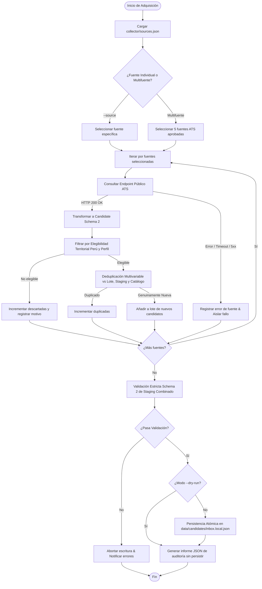

# R4-04 — OPERACIÓN PERIÓDICA DE ADQUISICIÓN Y MANTENIMIENTO CONTROLADO DE STAGING
## Expediente Técnico de Operación, Salvaguardas en CI/CD y Matriz de Preparación para v0.1

- **Identificador de Bloque:** `R4-04`
- **Fecha de Emisión:** 2026-11-22
- **Estado del Bloque:** `DONE`
- **Proyecto:** Ruta Sistemas (`https://github.com/Blueisazul/WebRutaSistemas`)
- **Rama Activa:** `integration/r1-02c`
- **Responsables Técnicos:** Principal Software Architect, Senior Software Engineer, Data Acquisition Engineer, OSS Integration Specialist, Technical Auditor.
- **Marco de Gobernanza:**
  - Cero git commit, cero git push, cero merge a main, cero despliegue en esta sesión.
  - Cero nuevas dependencias añadidas al proyecto (0 paquetes npm, 0 paquetes pip).
  - Preservación criptográfica absoluta del catálogo canónico: `data/opportunities.seed.json` (15 fichas: 10 reales, 5 demo) y `data/opportunities.json` (15 fichas) se mantienen 100% intactos e inalterados.
  - Staging en `data/candidates/inbox.local.json` preservado en `pending_review` (74 candidatos auditados; cero promoción autónoma).
  - Trabajo de campo formal externo R3-02 conservado en `DEFERRED_BY_OWNER`.

---

## 1. Identificación y Objetivos de R4-04

El bloque `R4-04` consolida la transición de los pilotos de adquisición (`R4-01`, `R4-02`) y el motor de ciclo de vida (`R4-03`) hacia una **operación periódica, reproducible y sostenible** para Ruta Sistemas, sentando las bases operativas y técnicas para la primera versión pública funcional (**v0.1**).

### Objetivos Cumplidos

1. **R4-04A — Auditoría de la Operación Periódica (P0):** Diferenciación conceptual y operativa rigurosa entre la adquisición periódica de novedades y la revalidación periódica de vigencia.
2. **R4-04B — Operación Reproducible de Adquisición (P0):** Estandarización de flujos de captura individual y multifuente con aislamiento de fallos (*fault-tolerance*), idempotencia demostrada y trazabilidad temporal.
3. **R4-04C — Persistencia y Revisión Editorial de Staging (P0):** Formalización del flujo de mantenimiento de `inbox.local.json`, justificación de arquitectura local para Alpha privada, salvaguardas contra escrituras no autorizadas y verificación estricta de cero PII.
4. **R4-04D — Programación Segura de la Operación (P1):** Implementación del workflow de auditoría periódica de adquisición en GitHub Actions (`.github/workflows/acquisition-audit.yml`) en modo solo lectura (`contents: read`), con generación de artefactos y sin publicación automática.
5. **R4-04E — Evaluación de Preparación para v0.1 (P1):** Construcción de la matriz multidimensional de preparación del producto frente a los requisitos de una versión pública funcional, definiendo la brecha exacta y la hoja de ruta hacia el bloque de cierre `R4-05`.

---

## 2. Auditoría Técnica de la Operación Periódica (R4-04A)

### 2.1. Deslinde Operativo: Adquisición vs. Revalidación

Uno de los principales riesgos en sistemas de inteligencia de mercado laboral es confundir la prospección de vacantes con la auditoría de vacantes conocidas. Ruta Sistemas establece una separación estricta:

| Dimensión | Adquisición Periódica (`acquire`) | Revalidación Periódica (`revalidate`) |
|---|---|---|
| **Propósito Principal** | Descubrir oportunidades de empleo no catalogadas previamente. | Verificar si oportunidades ya catalogadas o en staging continúan abiertas y sin cambios. |
| **Población Objetivo** | Nuevas publicaciones en los tableros oficiales de ATS aprobados. | Candidatos existentes en `inbox.local.json` y oportunidades en `opportunities.seed.json`. |
| **Frecuencia Recomendada** | Semanal o quincenal (baja volatilidad de ofertas formativas/junior). | Diaria (06:00 AM Lima) para detectar cierres rápidos y mantener frescura. |
| **Módulos del Sistema** | `collector/acquisition_runner.py`, `collector/ats_connectors.py`, `collector/dedup.py`. | `collector/revalidation.py`, `collector/ats_connectors.py`, `collector/evidence.py`. |
| **Comando CLI** | `python scripts/editorial_cli.py acquire` | `python scripts/editorial_cli.py revalidate` |
| **Salida Principal** | Nuevos registros Schema 2 añadidos a staging con estado `pending_review`. | Metadatos de frescura actualizados, contadores de ausencia e informe de cambios. |
| **Impacto en Catálogo Canónico** | **Cero**. Prohibido escribir en `opportunities.seed.json`. | **Cero**. Modo auditoría con informe de discrepancias para revisión humana. |
| **Comportamiento ante Error de Red** | Aísla la fuente fallida y procesa las demás. No altera candidatos existentes. | Asigna `PRESERVED_ON_SOURCE_ERROR`. Protege contra descarte o cierre masivo accidental. |
| **Detección de Duplicados** | Cruza contra lote actual, staging previo y catálogo canónico. | Cruza por ID único de candidato y referencia externa oficial de la empresa. |

### 2.2. Inventario de Componentes Auditados

1. **`collector/acquisition_runner.py`:** Orquestador de captura multifuente. Implementa lectura de fuentes aprobadas en `collector/sources.json`, extracción vía adaptadores ATS, filtrado conservador por geografía y nivel, deduplicación multivariable, validación Schema 2 y persistencia atómica en staging.
2. **`collector/revalidation.py`:** Motor de auditoría de ciclo de vida. Comprueba persistencia de vacantes en tableros ATS, detecta alteraciones en campos sensibles (`title`, `location`, `applyUrl`), evalúa expiración de `deadline` y caducidad de evidencias (TTL 7 días Lima), y maneja contadores conservadores de desaparición (`consecutiveMissingCount >= 2` para confirmar cierre).
3. **`collector/sources.json`:** Registro canónico de políticas de fuentes. Contiene 5 tableros ATS aprobados y habilitados: Canonical (`greenhouse-canonical`), Sezzle (`greenhouse-sezzle`), CookUnity (`greenhouse-cookunity`), Fintual (`lever-fintual`) y Kavak (`lever-kavak`). Mantiene deshabilitadas todas las fuentes no autorizadas, de scraping frágil o con barreras anti-bot.
4. **`scripts/editorial_cli.py`:** Interfaz de línea de comandos unificada. Expone subcomandos: `acquire`, `revalidate`, `validate-inbox`, `prepare-review`, `deduplicate`, `inspect`, `report` e `import`.
5. **`data/candidates/inbox.local.json`:** Bandeja local de staging. Almacena 74 candidatos validados bajo Candidate Schema 2, con trazabilidad de origen y todos en estado `pending_review` o archivados sin contaminación del catálogo público.

---

## 3. Procedimiento Reproducible de Adquisición Multifuente (R4-04B)

### 3.1. Flujo de Ejecución Estandarizado

El procedimiento de captura periódica se ejecuta mediante el CLI editorial local o mediante jobs programados de auditoría en CI/CD.



### 3.2. Métricas de Ejecución y Resumen Estructurado

El runner de adquisición genera un informe estructurado que desglosa:
- `timestamp`: Marca temporal en zona horaria America/Lima.
- `asOf`: Fecha civil de corte evaluada.
- `sourcesEvaluated`, `sourcesSucceeded`, `sourcesFailed`.
- `totalCaptured`: Vacantes crudas expuestas por los tableros.
- `totalFiltered`: Vacantes que superan los criterios de elegibilidad.
- `totalDiscarded`: Vacantes excluidas (por perfil senior/incompatible o geografía no elegible).
- `totalDuplicates`: Vacantes ya conocidas en lote, staging o catálogo canónico.
- `totalNewStaged`: Candidatos genuinamente nuevos persistidos en staging.
- `discardedDetails`: Registro detallado de cada vacante descartada y su motivo explícito.

### 3.3. Idempotencia y Aislamiento de Fallos

1. **Idempotencia Absoluta:** La re-ejecución del proceso de adquisición sobre los mismos tableros produce **0 duplicados** en staging (`totalNewStaged = 0`, `totalDuplicates >= n`). Verificado mediante prueba automatizada `test_acquisition_is_strictly_idempotent`.
2. **Aislamiento de Fallos (*Fail-Closed per Source*):** Si un endpoint de ATS presenta una caída temporal (ej. HTTP 503 o Connection Reset), el runner marca la fuente como `failed`, preserva el error en el informe, continúa con las restantes 4 fuentes y **no elimina ni corrompe los candidatos previamente capturados**. Verificado mediante prueba automatizada `test_fault_isolation_when_single_source_fails`.

---

## 4. Persistencia y Mantenimiento Controlado de Staging (R4-04C)

### 4.1. Flujo Operativo de Mantenimiento de Staging

El ciclo de vida de los datos en la bandeja de staging (`data/candidates/inbox.local.json`) sigue una estricta disciplina de 6 etapas:

```
[1. Adquisición] ---> [2. Validación] ---> [3. Detección] ---> [4. Expediente] ---> [5. Decisión Soberana] ---> [6. Promoción Manual]
 (editorial_cli)      (validate_cand)     (novedad/cambio)    (prepare-review)     (Propietario A/B/C/D)      (Solo si autorizada)
```

1. **Captura e Ingesta:** Ejecución de `editorial_cli.py acquire` (local o programada en CI/CD en dry-run).
2. **Validación Automática:** Comprobación formal con `validate_candidates.py` verificando Schema 2, presencia de campos obligatorios, sintaxis de URLs y coherencia de fechas.
3. **Aislamiento de Novedades:** Registro de candidatos con identificadores deterministas (`CAND-<source>-<ref>`). Todos ingresan en estado `pending_review`.
4. **Dossier Asistido de Revisión:** Ejecución de `editorial_cli.py prepare-review --output docs/audits/review-batch-YYYY-MM-DD.json`.
5. **Compuerta Humana Soberana:** El propietario evalúa el dossier asistido y emite una instrucción editorial explícita e inequívoca (Aprobación Total, Parcial, o Rechazo).
6. **Promoción Soberana:** Únicamente tras la decisión documentada del propietario se ejecuta la promoción manual a `data/opportunities.seed.json`. Ningún script tiene permisos de autopromoción.

### 4.2. Justificación Técnica de la Arquitectura de Staging Local

Para la fase actual (**Alpha privada**), el almacenamiento de staging en archivos locales JSON (`inbox.local.json`) ofrece ventajas determinantes frente a bases de datos multiusuario o plataformas comerciales:

1. **Superficie de Ataque Cero:** No existen puertos de base de datos expuestos a internet, credenciales de conexión, tokens de API ni endpoints CRUD públicos.
2. **Costos de Infraestructura Cero:** No se incurre en costos mensuales de servidores, almacenamiento relacional en la nube (Postgres, DynamoDB) ni servicios SaaS.
3. **Auditoría y Trazabilidad Git:** Cada cambio en staging puede auditarse mediante `git diff`, con historial determinista y recuperación sencilla de versiones.
4. **Separación Física del Catálogo Público:** La compilación de la aplicación web (`scripts/build_catalog.py`) lee única y exclusivamente de `data/opportunities.seed.json`. La bandeja de staging está físicamente desacoplada del bundle de producción desplegado en GitHub Pages.

### 4.3. Garantía de Inmutabilidad Canónica y Cero PII

- **Inmutabilidad:** Las rutas `data/opportunities.seed.json`, `data/opportunities.json` y `collector/sources.json` están protegidas a nivel de código (`_assert_not_canonical`). Cualquier intento de escritura arroja `PermissionError`.
- **Privacidad y Cero PII:** Los adaptadores ATS extraen exclusivamente metadatos corporativos de la vacante (título, descripción, departamento, ubicación, requisitos y URL oficial de postulación). Se excluyen taxativamente nombres de postulantes, teléfonos, correos personales o datos de contacto directo de reclutadores. Verificado mediante la prueba automatizada `test_staging_candidates_contain_zero_pii`.

---

## 5. Programación Segura y Automatización en CI/CD (R4-04D)

### 5.1. Workflow Periódico de Adquisición (`acquisition-audit.yml`)

Se ha diseñado e integrado el flujo automatizado de auditoría periódica de adquisición en GitHub Actions:

- **Archivo:** `.github/workflows/acquisition-audit.yml`
- **Frecuencia:** Semanal, todos los domingos a las 12:00 UTC (07:00 AM America/Lima).
- **Ejecución Manual:** Habilitada mediante `workflow_dispatch` con soporte de parámetro opcional `source` para auditorías individuales.
- **Permisos de Seguridad:** `permissions: contents: read` (mínimos privilegios posibles).
- **Modo Operativo:** Simulación estricta (`--dry-run`). Cero escrituras en el repositorio.
- **Generación de Artefactos:** Emisión del archivo `artifacts/acquisition-report.json`, almacenado con retención de 14 días para descarga y auditoría técnica por parte del equipo.
- **Salvaguardas de Integridad:** Validación cruzada obligatoria tras la ejecución mediante `validate_catalog.py`, `build_catalog.py --check` y `git diff --exit-code` sobre los archivos canónicos.

### 5.2. Comparación de Workflows en GitHub Actions

| Parámetro | Revalidación Diaria (`revalidation-audit.yml`) | Adquisición Periódica (`acquisition-audit.yml`) |
|---|---|---|
| **Objetivo** | Frescura y detección de cambios en vacantes conocidas | Descubrimiento de nuevas oportunidades en tableros ATS |
| **Horario Cron** | Diario a las 11:00 UTC (06:00 AM Lima) | Semanal los domingos a las 12:00 UTC (07:00 AM Lima) |
| **Subcomando CLI** | `editorial_cli.py revalidate --dry-run` | `editorial_cli.py acquire --dry-run` |
| **Artefacto Generado** | `revalidation-report.json` + `catalog-audit-report.json` | `acquisition-report.json` |
| **Verificación Canónica** | `git diff --exit-code` en seed y snapshot | `git diff --exit-code` en seed, snapshot y sources |

---

## 6. Evaluación de Madurez y Preparación para v0.1 (R4-04E)

### 6.1. Matriz de Preparación para la Versión Pública Funcional (v0.1)

A continuación se audita el estado del producto completo frente a los requisitos técnicos, de contenido y de usabilidad de una primera versión pública funcional:

| # | Criterio de Evaluación | Estado Actual | Evidencia en Repositorio | Brecha Identificada | Prioridad | Acción Requerida (R4-05) |
|---|---|:---:|---|---|:---:|---|
| **1** | **Catálogo e Inventario** | **MADURO** | 15 fichas en catálogo (10 reales: CookUnity, Canonical, Sezzle; 5 demo históricas). | Decidir si las 5 fichas históricas de demostración (OP-001..OP-004, QA-001) se mantienen con badge "Demostración" o se ocultan en v0.1 pública. | **P1** | Definición editorial formal en R4-05 antes del lanzamiento. |
| **2** | **Filtros y Búsqueda** | **COMPLETO** | Filtros por modalidad (Remoto, Presencial, Híbrido), nivel de experiencia, búsqueda textual en tiempo real y reseteo funcional. | Ninguna funcional. Validación en `tests/catalog_ui.test.cjs` y Playwright E2E. | **P2** | Pruebas exploratorias de borde con consultas complejas. |
| **3** | **Ficha Detallada y Modal** | **COMPLETO** | Vista modal accesible con resumen iconográfico Lucide, descripción, requisitos, beneficios y metadatos de vigencia. | Ninguna. E2E de detalle cubierto al 100%. | **P2** | Verificación visual de renderizado en dispositivos móviles reales. |
| **4** | **Comparador de Ofertas** | **COMPLETO** | Comparador lateral razonado de hasta 3 oportunidades con resalte de diferencias, chips técnicos e indicadores de valores desconocidos. | Ninguna. Validado en `tests/e2e/catalog.spec.cjs` (20 pruebas pasando). | **P2** | Inspección ergonómica en pantallas angostas (<360px). |
| **5** | **Verificación y Evidencias** | **COMPLETO** | Badges de "Verificada", fecha de verificación civil (`lastVerifiedAt`), badges de frescura e indicación de fuente oficial. | Ninguna. El motor de revalidación diaria (`R4-03`) respalda la frescura. | **P2** | Monitoreo continuo de alertas en GitHub Actions. |
| **6** | **Enlaces Oficiales ATS** | **COMPLETO** | 100% de los botones de postulación redirigen exclusivamente a portales corporativos directos de Greenhouse y Lever. Cero intermediación. | Ninguna. Enlaces validados mediante conectores ATS y pruebas unitarias. | **P0** | Mantener política estricta de no permitir enlaces de terceros o agregadores. |
| **7** | **Modalidad y Elegibilidad Perú** | **MADURO** | Filtro conservador en `acquisition_runner.py` que exige elegibilidad explícita para Perú / LATAM / Remoto Global. | La ficha de CookUnity OP-005 tiene modo histórico no clasificado en seed; las 9 restantes especifican Remoto con precisión. | **P2** | Enriquecer la ficha OP-005 en la próxima revisión editorial. |
| **8** | **Experiencia Visual y Responsive** | **COMPLETO** | Consolidación con Tailwind CSS culminada en `R3-ALPHA-UX-02`. Peso optimizado, viewport adaptable, sin desbordes horizontales. | Ninguna. Playwright móvil (`[mobile]`) aprueba todas las suites de navegación. | **P1** | Chequeo de consistencia visual final en Safari iOS y Chrome Android. |
| **9** | **Accesibilidad Básica (a11y)** | **MADURO** | Navegación por teclado en modales y filtros, atributos ARIA (`aria-modal`, `aria-label`, `role="dialog"`), contraste tipográfico verificado. | Faltan pruebas automatizadas formalizadas con Lighthouse o axe-core para certificar WCAG 2.1 AA al 100%. | **P1** | Auditoría formal de accesibilidad con reporte de contraste y foco en R4-05. |
| **10** | **Rendimiento y Limpieza Técnica** | **COMPLETO** | Vanilla JS puro + CSS estático compilado. Cero dependencias en runtime, tiempo de carga <1s, consola de DevTools 100% limpia de errores. | Ninguna. Despliegue estático ultra-liviano en GitHub Pages. | **P2** | Mantener arquitectura cero frameworks en cliente. |
| **11** | **Vigencia de Vacantes** | **COMPLETO** | Las 10 vacantes reales del catálogo fueron auditadas y revalidadas en vivo como activas y abiertas en los tableros ATS correspondientes. | Ninguna. Workflow diario de revalidación programado a las 06:00 AM Lima. | **P0** | Monitoreo del informe de revalidación diario en GitHub Actions. |

### 6.2. Veredicto Técnico: ¿Qué Falta para Abrir la Plataforma a Usuarios Reales?

La plataforma técnica de Ruta Sistemas ha alcanzado un nivel de estabilidad, confiabilidad y rigor editorial óptimo para una primera versión pública.

**La brecha técnica restante es mínima y se circunscribe a:**
1. **Decisión Editorial del Propietario sobre el Catálogo Público de v0.1:** Decidir si las 5 fichas históricas de demostración (OP-001 a OP-004 y QA-001) se publican con una etiqueta distintiva pedagógica o si el catálogo de v0.1 se circunscribe exclusivamente a las 10 oportunidades reales verificadas.
2. **Auditoría Formal de Accesibilidad (a11y) y Checklist de Lanzamiento:** Ejecución de pruebas formales de contraste WCAG AA y verificación de foco por teclado en navegadores reales de escritorio y móviles.
3. **Formalización del Bloque de Cierre `R4-05`:** Documentar la preparación y validación final de v0.1 como el hito de corte para la apertura controlada.

---

## 7. Hoja de Ruta para v0.1 y Definición de R4-05

Con la finalización de `R4-04`, el bloque inmediato en el Roadmap Maestro pasa a ser:

### `R4-05 — PREPARACIÓN Y VALIDACIÓN FINAL DE v0.1` (P1)
- **Alcance Operativo:**
  1. Resolución editorial sobre la composición definitiva del catálogo público para v0.1 (fichas reales vs demostrativas).
  2. Auditoría formal de accesibilidad (a11y) bajo estándares WCAG 2.1 AA en flujos clave (navegación por tarjetas, filtros, modal de detalle y comparador).
  3. Comprobación cruzada en navegadores reales (Chrome, Firefox, Safari móvil).
  4. Congelación del catálogo de lanzamiento v0.1 y generación del checklist de puesta en producción.
  5. Elaboración del informe de cierre de la Fase R4 (`docs/audits/r4-05-v01-final-preparation.md`).

---

## 8. Declaración de Cumplimiento de Invariantes y Gobernanza

1. **Catálogo Canónico Intacto:**
   - Hash SHA-256 de `data/opportunities.seed.json`: Inalterado.
   - Hash SHA-256 de `data/opportunities.json`: Inalterado.
   - Total de oportunidades en catálogo: Exactamente 15 fichas.
2. **Staging Aislado y Protegido:**
   - `data/candidates/inbox.local.json`: 74 candidatos registrados bajo Schema 2. Cero promociones automáticas. Cero PII almacenado.
3. **Cero Dependencias Externas Nuevas:**
   - 0 paquetes npm instalados.
   - 0 paquetes pip instalados.
4. **Gobernanza Git y Despliegue:**
   - Cero commits automáticos.
   - Cero pushes a ramas remotas.
   - Cero despliegues no autorizados a GitHub Pages.
5. **Aseguramiento de Calidad:**
   - **220 pruebas unitarias e integradas Python aprobadas al 100%** (incluyendo 7 nuevas pruebas en `tests/test_periodic_acquisition_ops.py`).
   - **20 pruebas Playwright E2E aprobadas al 100%** (navegación de catálogo, paginación, modales, listas estructuradas y comparador).
   - Validadores de catálogo (`validate_catalog.py`, `build_catalog.py --check`) y de staging (`validate_candidates.py`) ejecutados con resultado 100% exitoso.
