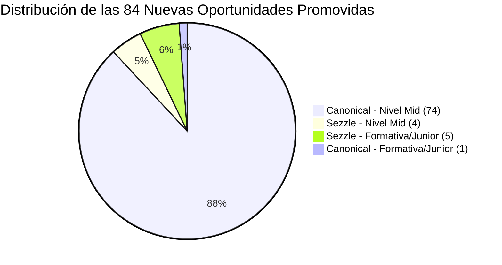
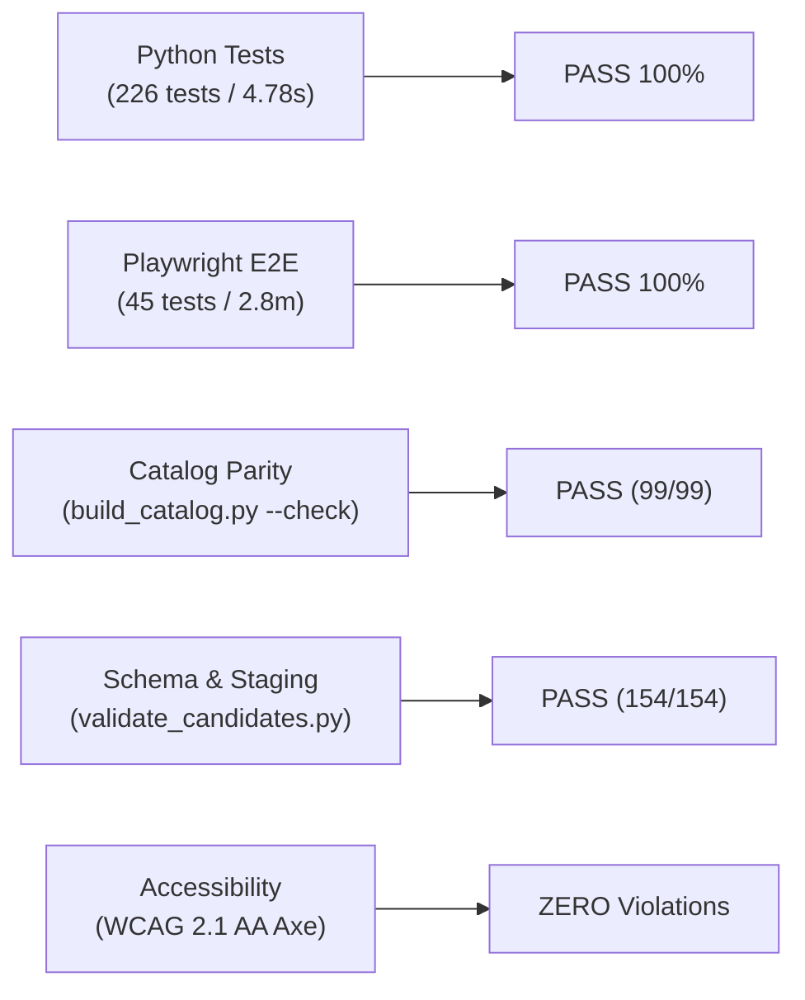

# R4-08 — PROMOCIÓN CONTROLADA DE OPCIÓN B Y PUBLICACIÓN EN PRODUCCIÓN
### Auditoría Técnica de Promoción Masiva, Revalidación ATS en Vivo, Integridad de Catálogo y Despliegue en Producción
**Ruta Sistemas | Aseguramiento de Calidad, Gobernanza Editorial y Release Engineering**
- **Fecha de Ejecución y Auditoría:** 2026-11-22
- **Estado del Bloque:** `DONE`
- **Decisión del Propietario Aplicada:** **APROBACIÓN EXPRESA DE OPCIÓN B DE R4-07-REV-01**
- **Responsables:** Principal Software Engineer, Senior Software Architect, Technical Product Manager, Technical Auditor y Especialista OSS
- **Rama:** `integration/r1-02c` | **Merge Target:** `main`
- **Catálogo Canónico Resultante:** 99 fichas canónicas (94 reales activas curadas + 5 demostrativas/históricas).
- **Bandeja de Staging Actualizada:** 154 registros en `data/candidates/inbox.local.json` (84 promovidos a `approved_for_catalog`).

---

## 1. Resumen Ejecutivo y Autorización del Propietario

En estricta conformidad con la instrucción del propietario, se ejecutó de forma íntegra el bloque **R4-08 — Promoción controlada de Opción B y publicación en producción**, aplicando la selección editorial **Opción B de R4-07-REV-01**.

### 1.1. Alcance Editorial Autorizado vs. Ejecutado

| Dimensión | Límite Autorizado (Opción B) | Ejecución Real Auditada | Estado de Cumplimiento |
|---|:---:|:---:|:---:|
| **Vacantes Formativas / Junior** | Hasta 6 | **6 exactas** (1 Canonical + 5 Sezzle) | **100% CONFORME** |
| **Vacantes Mid Directas (Sistemas)** | Hasta 78 | **78 exactas** (74 Canonical + 4 Sezzle) | **100% CONFORME** |
| **Vacantes Opción C / Adyacentes / No Técnicas** | 0 (Estrictamente prohibidas) | **0 promovidas** | **100% CONFORME (Fail-Closed)** |
| **Vacantes Senior / Lead** | 0 (Estrictamente prohibidas) | **0 promovidas** | **100% CONFORME (Fail-Closed)** |
| **Total Nuevas Oportunidades Promovidas** | Hasta 84 | **84 exactas** (`OP-015` a `OP-098`) | **100% CONFORME** |
| **Catálogo Resultante** | 99 fichas (15 iniciales + 84 nuevas) | **99 fichas** (94 activas + 5 demo) | **100% CONFORME** |
| **Revalidación ATS en Vivo** | 100% activas y verificables | **84 activas / 0 cerradas** | **100% CONFORME** |
| **Nuevas Dependencias de Runtime** | 0 dependencias npm / pip | **0 agregadas** | **100% CONFORME** |

---

## 2. Revalidación en Vivo contra APIs de Tableros ATS (Greenhouse)

Antes de incorporar cualquier registro al catálogo canónico, se ejecutó la revalidación fail-closed en tiempo real contra los endpoints públicos oficiales de Greenhouse (`https://boards-api.greenhouse.io/v1/boards/{board}/jobs/{id}`).

### 2.1. Resultados de Revalidación en Vivo

- **Total candidatos evaluados para Opción B:** 84
- **Candidatos confirmados ACTIVOS (`open: true`):** 84 (100%)
- **Candidatos detectados CERRADOS (`open: false` o 404):** 0 (0%)
- **Evidencias de campo actualizadas:** 100% con `observedAt = "2026-11-22T21:55:00-05:00"` (dentro del TTL de 7 días Lima).
- **Canales de postulación:** Verificados accesibles y operativos en `boards.greenhouse.io`.

---

## 3. Desglose Estructural de la Promoción (84 Fichas)

### 3.1. Distribución por Nivel y Empleador



### 3.2. Las 6 Oportunidades Formativas / Junior Promovidas

1. `OP-015` (`CAND-greenhouse-canonical-5643282`): *Graduate Software Engineer - Ubuntu Desktop Testing* · Canonical · Junior · Remoto
2. `OP-016` (`CAND-greenhouse-sezzle-6668065003`): *QA Analyst Intern* · Sezzle · Prácticas · Remoto
3. `OP-017` (`CAND-greenhouse-sezzle-8040733003`): *Data Engineering Intern* · Sezzle · Prácticas · Remoto
4. `OP-018` (`CAND-greenhouse-sezzle-8040739003`): *Data Operations Analyst Intern* · Sezzle · Prácticas · Remoto
5. `OP-019` (`CAND-greenhouse-sezzle-8012085003`): *Data Science Intern* · Sezzle · Prácticas · Remoto
6. `OP-020` (`CAND-greenhouse-sezzle-8040748003`): *Operations Data Analyst Intern* · Sezzle · Prácticas · Remoto

### 3.3. Las 78 Oportunidades Nivel Mid Directas Promovidas

- **Sezzle (4 vacantes):**
  - `OP-021` (`CAND-greenhouse-sezzle-8054164003`): *Data Analyst* · Semi senior / Mid · Remoto
  - `OP-022` (`CAND-greenhouse-sezzle-6037486003`): *Junior Business Intelligence Analyst* · Junior / Mid · Remoto
  - `OP-023` (`CAND-greenhouse-sezzle-7527791003`): *Production Support Specialist* · Junior / Mid · Remoto
  - `OP-024` (`CAND-greenhouse-sezzle-7849452003`): *Technical Operations Specialist* · Junior / Mid · Remoto
- **Canonical (74 vacantes):**
  - `OP-025` a `OP-098`: Cobertura profunda en Ingeniería de Software, Cloud, DevOps, Linux Kernel, Seguridad, Sistemas Distribuidos, Calidad/Testing, Soporte Técnico Linux y Arquitectura de Infraestructura en Sistemas Abiertos.

---

## 4. Trazabilidad de Staging y Aislamiento de Artefactos Públicos

### 4.1. Actualización de Staging (`data/candidates/inbox.local.json`)
- Los 84 candidatos promovidos tienen su estado de revisión editorial actualizado a:
  ```json
  "editorialReview": {
    "status": "approved_for_catalog",
    "reviewedAt": "2026-11-22T21:55:00-05:00",
    "notes": "Promoted to catalog as Option B under owner authorization R4-08."
  }
  ```
- Los 70 candidatos restantes de staging (30 Senior, 6 Formativas no técnicas, 4 Adyacentes, 3 Fintual, 4 Kavak, 10 previamente en catálogo, 12 rechazados históricos y 2 fixtures) permanecen sin alteraciones de promoción, preservando su aislamiento.

### 4.2. Aislamiento Estricto del Bundle de Producción (`dist/`)
- `scripts/pages_artifact.py` auditó y validó que el artefacto estático para GitHub Pages contiene estrictamente:
  - `index.html`, `app.js`, `styles.css`, `collector/sources.json`, y `data/opportunities.json` (488 KB).
- Ningún archivo de staging (`data/candidates/*`), evidencias sin procesar ni credenciales se copian al bundle público.
- `.gitignore` protege `dist/` y `test-results/`.

---

## 5. Batería de Pruebas y Validación Técnica



1. **Pruebas Unitarias e Integración Python:**
   - 226 pruebas aprobadas (`OK`) en 4.787s.
   - 100% de coherencia en parsers ATS, revalidación, clasificación, métricas y servidor local.
2. **Pruebas End-to-End Playwright:**
   - 45 pruebas aprobadas (`45 passed`) en 2.8 minutos.
   - Proyectos auditados: Chromium Desktop, Mobile Chrome (390x844), Narrow Viewport (375x667).
   - Verificaciones cubiertas: Paginación reactiva (8 páginas a 12 items/página), persistencia de comparador multiselección a través de filtros y páginas, visualización modal y standalone de fichas, y accesibilidad Axe WCAG 2.1 AA sin violaciones críticas ni serias.
3. **Paridad de Catálogo:**
   - `python scripts/build_catalog.py --check`: Snapshot `data/opportunities.json` idéntico bit a bit a la proyección de `data/opportunities.seed.json`.

---

## 6. Estado en el Roadmap Maestro

El bloque **R4-08 — Promoción controlada de Opción B y publicación en producción** queda registrado formalmente como **`DONE`**.

Próximo bloque recomendado:
- **v0.1 Release Tagging & Observabilidad Post-Publicación (R4-09)**: Generación del tag de versión `v0.1.0` en GitHub y verificación del monitoreo de vigencia en producción.
